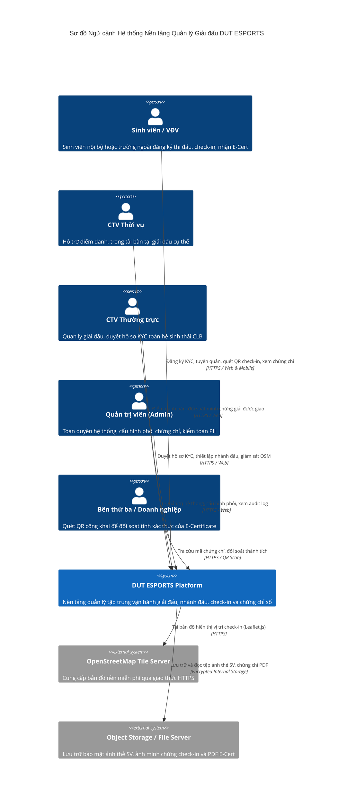
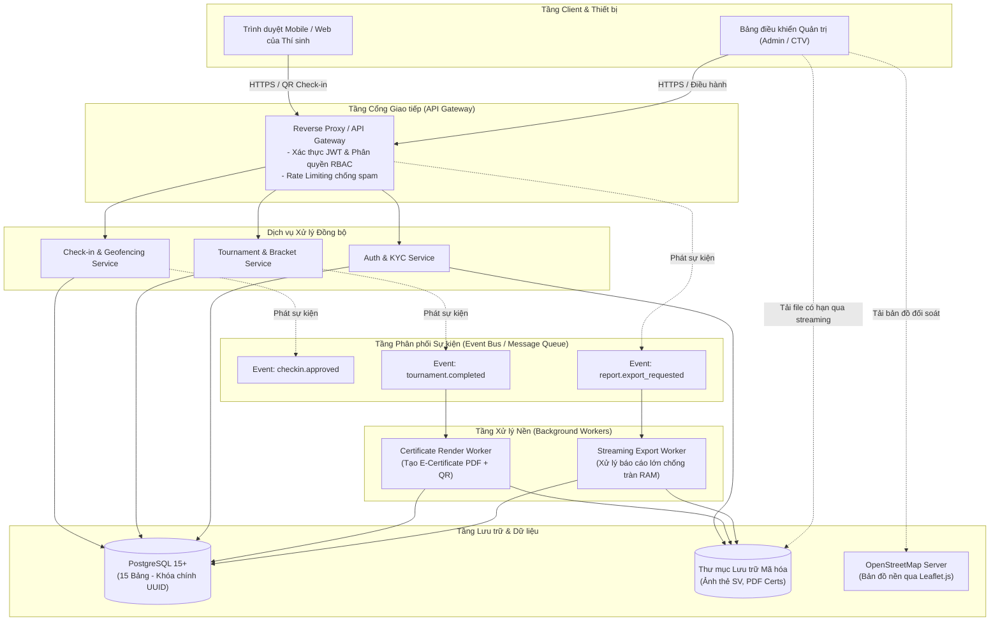
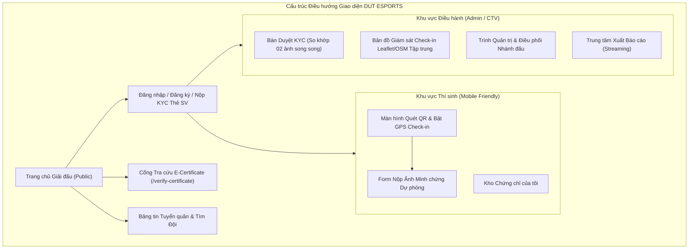
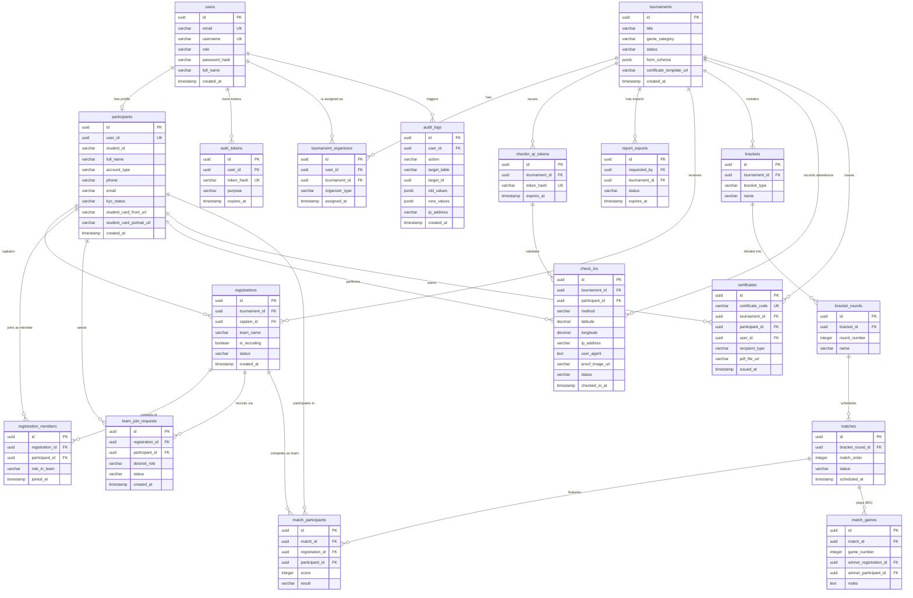
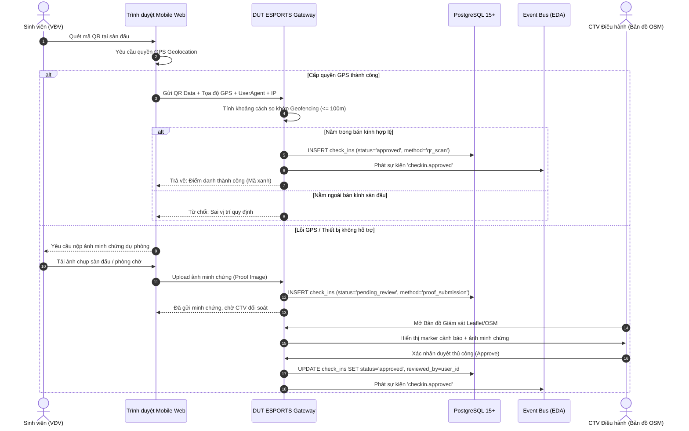
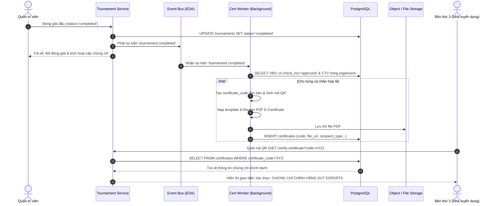

# ĐẶC TẢ YÊU CẦU PHẦN MỀM (SRS)
## NỀN TẢNG QUẢN LÝ GIẢI ĐẤU THỂ THAO ĐIỆN TỬ DUT ESPORTS

**Tham chiếu cấu trúc:** IEEE Std 830-1998 (mẫu tham khảo; yêu cầu được tổ chức theo phạm vi dự án)  
**Phiên bản tài liệu:** 1.1  
**Trạng thái:** Bản SRS 1.1; yêu cầu MVP được chốt, cấu hình của từng giải phải hoàn tất trước khi mở đăng ký  
**Tổ chức phát triển:** Câu lạc bộ Thể thao Điện tử - Trường Đại học Bách khoa (DUT)  
**Ngày cập nhật:** 29 tháng 09 năm 2026  

---

## MỤC LỤC
1. [Phần 1: Giới thiệu (Introduction)](#phần-1-giới-thiệu-introduction)
2. [Phần 2: Mô tả Tổng quan (Overall Description)](#phần-2-mô-tả-tổng-quan-overall-description)
3. [Phần 3: Yêu cầu Chức năng (Functional Requirements)](#phần-3-yêu-cầu-chức-năng-functional-requirements)
4. [Phần 4: Yêu cầu Giao diện Bên ngoài (External Interface Requirements)](#phần-4-yêu-cầu-giao-diện-bên-ngoài-external-interface-requirements)
5. [Phần 5: Yêu cầu Phi chức năng (Non-Functional Requirements)](#phần-5-yêu-cầu-phi-chức-năng-non-functional-requirements)
6. [Phần 6: Mô hình Dữ liệu (Data Model & Schema)](#phần-6-mô-hình-dữ-liệu-data-model--schema)
7. [Phần 7: Các Trường hợp Sử dụng (Use Cases)](#phần-7-các-trường-hợp-sử-dụng-use-cases)
8. [Phần 8: Tiêu chí Chấp nhận (Acceptance Criteria & Gherkin)](#phần-8-tiêu-chí-chấp-nhận-acceptance-criteria--gherkin)
9. [Phần 9: Các Ràng buộc Hệ thống (Constraints)](#phần-9-các-ràng-buộc-hệ-thống-constraints)
10. [Phần 10: Phụ lục (Appendices)](#phần-10-phụ-lục-appendices)

---

## Phần 1: Giới thiệu (Introduction)

### 1.1 Mục đích (Purpose)
Tài liệu Đặc tả Yêu cầu Phần mềm (Software Requirements Specification - SRS) này đóng vai trò là khung tham chiếu chiến lược và kỹ thuật cấp cao cho việc thiết kế, phát triển, kiểm thử và chuyển giao Nền tảng Quản lý Giải đấu Thể thao Điện tử **DUT ESPORTS**.

Trong bối cảnh vận hành các giải đấu thể thao điện tử quy mô lớn tại môi trường đại học, việc quản lý thủ công trước đây đã tạo ra "điểm nghẽn giấy tờ" (manual paperwork bottleneck), tiêu tốn hàng trăm giờ đối soát và tiềm ẩn rủi ro sai sót dữ liệu vận động viên nghiêm trọng. Hệ thống DUT ESPORTS được định hình nhằm:
- Thiết lập một nền tảng tự động hóa toàn diện từ khâu tiền giải đấu, trong giải đấu đến hậu giải đấu.
- Chuẩn hóa quy trình xác thực danh tính sinh viên (KYC), giảm nguy cơ gian lận danh tính và thi đấu hộ.
- Đảm bảo an toàn thông tin định danh cá nhân (PII), tuân thủ nguyên tắc tối thiểu hóa dữ liệu (không thu thập Căn cước công dân).
- Kiểm soát chi phí vận hành bằng cách dùng dữ liệu bản đồ mở và lựa chọn nhà cung cấp tile phù hợp với lưu lượng thực tế.
- Đây là cơ sở pháp lý và kỹ thuật duy nhất ràng buộc trách nhiệm giữa đội ngũ phát triển và Ban Chủ nhiệm CLB Esports Đại học Bách khoa (DUT).

### 1.2 Phạm vi sản phẩm (Product Scope)
Nền tảng DUT ESPORTS là hệ thống phần mềm quản lý tập trung, cung cấp các trụ cột chức năng trọng yếu:
1. **Quản lý thành viên & Xác thực KYC:** Xác thực thông tin sinh viên nội bộ DUT và sinh viên trường ngoài thông qua mã số sinh viên (`student_id`) kết hợp đối soát 02 ảnh thẻ sinh viên, đảm bảo loại bỏ dữ liệu CCCD nhạy cảm.
2. **Tuyển quân & Gia nhập đội:** Môi trường kết nối theo thời gian thực giữa các đội trưởng đang thiếu quân số và các vận động viên tự do thông qua bộ lọc thông minh.
3. **Quản lý giải đấu đa thể thức:** Vận hành linh hoạt các nội dung thi đấu từ cá nhân (Đấu Trường Chân Lý - TFT) đến đồng đội (MOBA, FPS) với cơ chế sinh nhánh đấu tự động và thuật toán phân phòng toán học.
4. **Quy trình Check-in đa phương thức:** Hệ thống điểm danh kết hợp mã QR Code động, định vị GPS Geofencing và quy trình nộp minh chứng hình ảnh đối soát thủ công trên bản đồ tập trung.
5. **Cấp phát & Tra cứu E-Certificate:** Tự động hóa kết xuất chứng chỉ số có mã xác thực độc bản và QR Code cho Vận động viên hợp lệ và Ban tổ chức giải đấu.

#### Bảng ranh giới phạm vi hệ thống
| Phân hệ / Tính năng | Trong phạm vi (In-Scope) | Ngoài phạm vi (Out-of-Scope) |
|:---|:---|:---|
| **Định danh người dùng** | Xác thực thẻ sinh viên (nội bộ/ngoại bộ), 02 ảnh thẻ SV | Xác thực CCCD/Hộ chiếu, tích hợp VNeID |
| **Bản đồ & Vị trí** | Leaflet với tile provider OSM được chọn; hiển thị vị trí cho nhân sự được phân quyền | Google Maps API và dịch vụ định vị vệ tinh độc quyền |
| **Nhánh đấu & Trận đấu** | Sinh nhánh đấu tự động, thuật toán chia bảng TFT ($N \bmod 8$) | Tích hợp API nhà phát hành game để lấy dữ liệu in-game theo thời gian thực |
| **Điểm danh** | Quét QR động + GPS Geofencing + Nộp ảnh minh chứng | Nhận diện khuôn mặt sinh trắc học (FaceID) tại sàn đấu |
| **Chứng nhận** | Tự động render PDF E-Certificate, mã QR tra cứu công khai | In ấn phôi chứng chỉ vật lý trên giấy |
| **Báo cáo** | Tác vụ nền, tải file streaming, Data Masking PII | Tích hợp hệ thống BI bên thứ ba, kho dữ liệu Data Warehouse riêng |

### 1.3 Đối tượng độc giả & Hướng dẫn sử dụng (Intended Audience)
| Nhóm đối tượng | Mục đích và phương thức sử dụng tài liệu |
|:---|:---|
| **Lập trình viên (Developers)** | Căn cứ vào logic nghiệp vụ, cấu trúc EARS/Gherkin, quy chuẩn kiến trúc EDA và Lược đồ Cơ sở Dữ liệu PostgreSQL (18 bảng với khóa chính UUID) để hiện thực hóa mã nguồn. |
| **Kiểm thử viên (Testers / QA)** | Sử dụng các kịch bản hành vi Gherkin và tiêu chí chấp nhận (Acceptance Criteria) để xây dựng Test Cases chi tiết và kịch bản UAT. |
| **Ban quản trị CLB (Admin / Staff)** | Nắm bắt quy trình phân quyền RBAC, cách thức vận hành luồng duyệt KYC, kiểm soát gian lận GPS và đối soát trên bản đồ OSM. |
| **Các Bên liên quan (Stakeholders / Nhà trường)** | Đánh giá tính khả thi về mặt chi phí vận hành (phương án bản đồ theo ngân sách được duyệt), mức độ bảo vệ dữ liệu cá nhân của sinh viên và tính toàn vẹn của chứng chỉ số. |

### 1.4 Quy ước tài liệu (Document Conventions)
- **Mức độ ưu tiên theo chuẩn MoSCoW:**
  - **BẮT BUỘC (MUST):** Yêu cầu cốt lõi bắt buộc phải có để hệ thống hoạt động hợp lệ.
  - **NÊN CÓ (SHOULD):** Yêu cầu quan trọng nâng cao trải nghiệm và độ bền hệ thống.
  - **CÓ THỂ CÓ (COULD):** Yêu cầu mở rộng hữu ích nhưng có thể trì hoãn nếu hạn chế tài nguyên.
  - **CHƯA LÀM (WON'T):** Yêu cầu chưa thực hiện trong phạm vi phát hành hiện tại.
- **Quy ước mã định danh:**
  - `[FR-xx]`: Yêu cầu chức năng (Functional Requirement).
  - `[NFR-xx]`: Yêu cầu phi chức năng (Non-Functional Requirement).
  - `[UC-xx]`: Trường hợp sử dụng (Use Case).
  - `[AC-xx]`: Tiêu chí chấp nhận (Acceptance Criteria).
- **Thẻ cảnh báo chuyên môn BA:**
  - Mọi quyết định còn phụ thuộc nhà cung cấp hoặc cấu hình triển khai được liệt kê ở Phụ lục 10.3.
  - Các mâu thuẫn đã xử lý được ghi thành quyết định nghiệp vụ ở Phụ lục 10.3.

### 1.5 Bảng thuật ngữ & Từ viết tắt (Definitions and Acronyms)
| Thuật ngữ / Từ viết tắt | Định nghĩa chi tiết |
|:---|:---|
| **KYC** | *Know Your Customer* – Quy trình thẩm tra và xác thực danh tính sinh viên dựa trên mã số sinh viên và ảnh chụp thẻ sinh viên. |
| **Dữ liệu cá nhân** | Thông tin có thể xác định hoặc liên quan đến cá nhân; gồm thông tin liên hệ, ảnh thẻ, vị trí và dữ liệu tài khoản. |
| **EDA** | *Event-Driven Architecture* – Kiến trúc hướng sự kiện giúp xử lý bất đồng bộ các tác vụ nặng (render chứng chỉ, điểm danh tải cao). |
| **OSM** | *OpenStreetMap* – Nền tảng bản đồ số nguồn mở miễn phí, thay thế cho Google Maps API nhằm tối ưu ngân sách. |
| **Leaflet.js** | Thư viện JavaScript mã nguồn mở dùng để dựng bản đồ tương tác nhẹ trên trình duyệt web và di động. |
| **E-Certificate** | Chứng chỉ điện tử được cấp tự động, bảo chứng bởi chuỗi băm duy nhất (`certificate_code`) và mã QR xác thực công khai. |
| **BO (Best Of)** | Thể thức thi đấu phân định thắng thua (Ví dụ: BO3 là đấu tối đa 3 ván, bên thắng 2 ván trước sẽ giành chiến thắng). |
| **TFT** | *Teamfight Tactics* (Đấu Trường Chân Lý) – Bộ môn cá nhân; mỗi phòng tiêu chuẩn có từ 7 đến 8 người chơi, trừ khi Điều lệ giải công bố thể thức khác. |
| **Geofencing** | Hàng rào địa lý ảo – Cơ chế so khớp tọa độ GPS thực tế của thí sinh với tọa độ sàn đấu trong một bán kính quy định. |
| **Streaming Response** | Kỹ thuật truyền dữ liệu dạng dòng từ máy chủ xuống trình duyệt, giúp xuất các tệp báo cáo lớn mà không gây quá tải bộ nhớ RAM. |
| **Data Masking** | Kỹ thuật che mờ một phần dữ liệu nhạy cảm (ví dụ: `090*****89`, `nguyen***@gmail.com`) khi kết xuất dữ liệu cho các vai trò hạn chế. |
| **FMEA** | *Failure Mode and Effects Analysis* – Phương pháp phân tích dạng hỏng và tác động để lượng hóa rủi ro qua chỉ số RPN. |

### 1.6 Tài liệu tham khảo (References)
1. *IEEE Std 830-1998*: IEEE Recommended Practice for Software Requirements Specifications.
2. Luật Bảo vệ dữ liệu cá nhân số 91/2025/QH15 và Nghị định 356/2025/NĐ-CP; rà soát văn bản hướng dẫn/sửa đổi đang có hiệu lực trước khi triển khai.
3. *Leaflet.js Documentation*: Thư viện bản đồ tương tác nguồn mở (v1.9+).
4. *OpenStreetMap Foundation Policy*: Quy chuẩn sử dụng Tile Server công cộng.
5. *PostgreSQL Documentation*: Hướng dẫn quản trị và tối ưu cơ sở dữ liệu PostgreSQL (v15+).

### 1.7 Sơ đồ ngữ cảnh hệ thống (System Context Diagram)
Sơ đồ C4Context dưới đây thể hiện ranh giới hệ thống DUT ESPORTS và sự tương tác với các tác nhân người dùng cùng hệ thống bên ngoài:



---

## Phần 2: Mô tả Tổng quan (Overall Description)

### 2.1 Góc nhìn sản phẩm & Kiến trúc hướng sự kiện (Product Perspective & EDA)
Hệ thống DUT ESPORTS là một nền tảng độc lập, thay thế toàn bộ các giải pháp quản lý rời rạc trước đây (Google Forms, bảng tính tính điểm thủ công). Để giải quyết bài toán tải đột biến khi hàng trăm vận động viên cùng check-in tại sàn đấu hoặc khi hệ thống phải kết xuất đồng loạt hàng ngàn tệp chứng chỉ PDF, nền tảng áp dụng mô hình **Kiến trúc Hướng Sự kiện (Event-Driven Architecture - EDA)**.

Mô hình EDA phân tách rạch ròi giữa:
- **Luồng xử lý đồng bộ (Synchronous Flow):** Xử lý các tương tác thời gian thực đòi hỏi phản hồi tức thì (xác thực người dùng, quét mã QR, truy vấn nhánh đấu).
- **Luồng xử lý bất đồng bộ (Asynchronous Flow):** Đẩy các sự kiện nặng vào hàng đợi (Queue) để các tiến trình nền (Background Workers) xử lý tuần tự mà không làm nghẽn Gateway máy chủ.

#### Các sự kiện trọng yếu trong hệ thống
| Tên sự kiện (Event Name) | Điều kiện phát sinh | Tác vụ xử lý bất đồng bộ tương ứng |
|:---|:---|:---|
| `checkin.approved` | Điểm danh hợp lệ qua QR+GPS hoặc được duyệt thủ công | Cập nhật quyền thi đấu của đội/thí sinh, kích hoạt thông báo trạng thái sẵn sàng vào trận. |
| `tournament.completed` | Trận chung kết kết thúc và Admin đóng giải đấu | Worker quét danh sách VĐV hợp lệ và Ban tổ chức để render hàng loạt file E-Certificate PDF kèm mã QR. |
| `report.export_requested` | Quản trị viên yêu cầu xuất báo cáo dữ liệu lớn | Tạo tác vụ xuất và trả mã tác vụ; worker tạo file theo quyền dữ liệu. Người dùng tải file khi tác vụ hoàn tất qua luồng streaming. |



### 2.2 Đặc điểm người dùng & Phân cấp Actor (User Classes and Characteristics)
Hệ thống xác lập 04 nhóm Actor với các quyền hạn và vai trò tách biệt rõ ràng:

| Nhóm Actor | Đặc điểm nhân khẩu & Trình độ kỹ thuật | Quyền hạn và Vai trò trong Hệ thống | Giá trị cốt lõi mang lại |
|:---|:---|:---|:---|
| **Sinh viên (Participant)** | Sinh viên ĐHBK Đà Nẵng (nội bộ) hoặc các trường ĐH lân cận (trường ngoài). Thành thạo smartphone và ứng dụng web. | Đăng ký hồ sơ, tải 02 ảnh thẻ SV làm thủ tục KYC; tạo hoặc xin gia nhập đội thi đấu; quét QR điểm danh bằng GPS tại sàn đấu; tra cứu và tải E-Certificate. | Tiếp cận sân chơi Esports chuyên nghiệp; nhận chứng nhận số tự động, uy tín. |
| **CTV Thời vụ (Seasonal Staff)** | Sinh viên được tuyển dụng hỗ trợ cho từng giải đấu đơn lẻ. Kỹ năng máy tính cơ bản. | Thực hiện điểm danh bàn, kiểm tra thiết bị thi đấu, đối soát minh chứng ảnh tại sàn đấu cho giải được phân công; kết xuất Giấy chứng nhận BTC cho chính mình. | Giảm tải áp lực nhân sự hiện trường; tự động hóa việc nhận giấy chứng nhận đóng góp. |
| **CTV Thường trực (Permanent Staff)** | Thành viên nòng cốt Ban chủ nhiệm CLB Esports (tài khoản trong bảng `users` với `role = 'ctv'`). Kỹ năng quản trị tốt. | Duyệt hồ sơ KYC toàn hệ thống; khởi tạo giải đấu; cấu hình form đăng ký; giám sát bản đồ check-in OSM; điều hành nhánh đấu và nhập kết quả trận đấu. | Giảm các thao tác đối soát thủ công; kiểm soát dữ liệu giải đấu qua Dashboard. |
| **Quản trị viên (Admin)** | Quản trị viên cấp cao nhất của nền tảng (role = 'admin' trong bảng `users`). Trình độ kỹ thuật chuyên sâu. | Toàn quyền cấu hình hệ thống; quản lý phân quyền; cấu hình phôi E-Certificate mẫu; truy vết audit log; xem dữ liệu PII đầy đủ (không che mờ). | Kiểm soát tối cao tính minh bạch, bảo mật dữ liệu sinh viên và an ninh hệ thống. |

> **Quyết định tài khoản CTV:** CTV Thời vụ có tài khoản riêng trong bảng users với role = seasonal_staff. Tài khoản chỉ được thao tác trên giải đấu có phân công còn hiệu lực trong tournament_organizers; phạm vi quyền hết hiệu lực khi Admin thu hồi phân công. Người dùng có thể đồng thời có hồ sơ participant; danh tính đăng nhập dùng chung một tài khoản users.


### 2.3 Môi trường vận hành (Operating Environment)
1. **Phía Client (Người dùng & Ban tổ chức):**
   - Trình duyệt Web hiện đại (Google Chrome 90+, Mozilla Firefox 88+, Apple Safari 14+, Microsoft Edge 90+) hỗ trợ chuẩn HTML5, CSS3, ES6+.
   - Thiết bị di động yêu cầu hỗ trợ API phần cứng: Camera (để quét mã QR trực tiếp trên web) và GPS/Geolocation API để thu thập tọa độ.
2. **Phía Máy chủ & Cơ sở hạ tầng:**
   - Hệ điều hành máy chủ: Linux (Ubuntu Server 22.04 LTS hoặc tương đương), hỗ trợ môi trường container hóa (Docker Engine 24+).
   - Hệ quản trị cơ sở dữ liệu: PostgreSQL phiên bản 15 trở lên; hàm gen_random_uuid() dùng để tạo khóa chính.
   - Nền tảng bản đồ số: Leaflet.js (v1.9+) kết nối nhà cung cấp tile OSM hoặc tile server tự host đã được chọn.
3. **Môi trường Mạng & Lưu trữ:**
   - Bắt buộc giao thức mã hóa HTTPS/TLS 1.3 cho toàn bộ kết nối truyền nhận dữ liệu.
   - Thư mục lưu trữ tệp tin có cơ chế phân quyền bảo mật cấp hệ điều hành (File System Level ACLs) cho dữ liệu ảnh thẻ sinh viên.

### 2.4 Ràng buộc thiết kế và triển khai (Design & Implementation Constraints)
1. **Ràng buộc Cơ sở Dữ liệu:** 100% các bảng dữ liệu phải sử dụng kiểu dữ liệu `UUID` làm khóa chính (Primary Key). Tuyệt đối không dùng số nguyên tự tăng (`serial`/`bigserial`) nhằm ngăn chặn nguy cơ tấn công vét cạn và dự đoán mã định danh (ID Enumeration).
2. **Ràng buộc Bản đồ:** Dùng Leaflet và dữ liệu OSM. Không dùng Google Maps API trong MVP. Nhà cung cấp tile có thể miễn phí, trả phí hoặc tự host; lựa chọn phải tuân thủ policy, attribution và ngân sách được phê duyệt.
3. **Ràng buộc Pháp lý Dữ liệu Cá nhân:** Tuyệt đối không thu thập, tiếp nhận hay lưu trữ hình ảnh hoặc số Căn cước công dân (CCCD/CMND). Mọi thủ tục KYC chỉ dựa trên thẻ sinh viên và mã sinh viên.
4. **Ràng buộc Quản lý Tài nguyên Bộ nhớ:** Worker xuất báo cáo phải đọc theo cursor/batches, không nạp toàn bộ tập dữ liệu lớn vào RAM; file đã tạo được tải bằng streaming.

### 2.5 Giả định và Phụ thuộc (Assumptions and Dependencies)
- **Giả định về phía Người dùng:** Thiết bị check-in có kết nối Internet và trình duyệt hỗ trợ Geolocation; độ chính xác GPS do thiết bị báo về, có thể không đạt yêu cầu. Khi không cấp quyền hoặc sai số vượt ngưỡng, người dùng chuyển sang nộp minh chứng.
- **Giả định về Mã sinh viên:** Mỗi sinh viên nội bộ trường DUT sở hữu một mã số sinh viên (`student_id`) duy nhất, bất biến trong suốt quá trình theo học.
- **Phụ thuộc Hạ tầng Bên thứ ba:** Hệ thống phụ thuộc vào tính sẵn sàng và tốc độ phản hồi của OpenStreetMap Tile Server trong quá trình render bản đồ giám sát.

> **Quyết định định danh sinh viên:** Mã sinh viên là duy nhất trong phạm vi trường. CSDL áp dụng UNIQUE(student_id, university_name); tên trường được chuẩn hóa từ danh sách trường do Admin quản lý để tránh lỗi do khác cách viết.


---

## Phần 3: Yêu cầu Chức năng (Functional Requirements)

### 3.1 Phân hệ Quản lý Tài khoản & Xác thực KYC Sinh viên
Phân hệ quản lý tài khoản đăng nhập và hồ sơ KYC, hỗ trợ giảm nguy cơ giả mạo danh tính; KYC không bảo đảm loại bỏ hoàn toàn hành vi thi đấu hộ.

| Mã Yêu cầu | Tên Yêu cầu & Chi tiết Đặc tả Nghiệp vụ | Mức độ Ưu tiên | Tiêu chí Nghiệm thu Cốt lõi |
|:---|:---|:---:|:---|
| **FR-AUTH-01** | **Tạo và bảo vệ tài khoản:**<br>- Người dùng tạo tài khoản bằng email duy nhất và mật khẩu; hệ thống gửi token xác minh dùng một lần. Hệ thống hỗ trợ đăng nhập, đăng xuất, đặt lại mật khẩu và khóa/mở tài khoản.<br>- Email phải xác minh trước khi người dùng đăng ký giải; KYC là bước riêng, không đồng nhất với xác minh email.<br>- Token xác minh/đặt lại chỉ lưu hash, hết hạn sau 30 phút và dùng một lần. | **BẮT BUỘC (MUST)** | Email chưa xác minh không đăng ký được giải; token hết hạn/đã dùng bị từ chối; email trùng không tạo tài khoản thứ hai. |
| **FR-KYC-01** | **Đăng ký hồ sơ và tải ảnh thẻ SV:**<br>- Hệ thống cho phép sinh viên đăng ký thông tin cá nhân gồm: Họ tên, Số điện thoại, Email, Mã số sinh viên (`student_id`), Trường theo học.<br>- Hệ thống bắt buộc sinh viên nộp 02 ảnh tải lên: (1) Ảnh chụp mặt trước thẻ SV; (2) Ảnh chụp chân dung cầm thẻ SV đặt ngang ngực.<br>- Tuyệt đối không cung cấp trường nhập số CCCD hoặc tải ảnh CCCD. | **BẮT BUỘC (MUST)** | - Chặn lưu nếu thiếu 1 trong 2 ảnh thẻ SV.<br>- Dung lượng mỗi ảnh không vượt quá 5MB, định dạng cho phép: `.jpg`, `.jpeg`, `.png`.<br>- Thông tin được lưu vào bảng `participants` với trạng thái `kyc_status = 'pending'`. |
| **FR-KYC-02** | **Phân loại đối tượng sinh viên:**<br>- Hệ thống tự động phân loại tài khoản dựa trên tên trường: sinh viên ĐH Bách khoa (`account_type = 'internal'`) và sinh viên các trường đại học khác (`account_type = 'external'`). | **BẮT BUỘC (MUST)** | Ghi nhận chính xác giá trị `account_type` vào cơ sở dữ liệu làm căn cứ tính tỷ lệ thành viên trong đội. |
| **FR-KYC-03** | **Xét duyệt hồ sơ KYC:**<br>- Cho phép CTV Thường trực (`role = 'ctv'`) hoặc Admin xem danh sách hồ sơ chờ duyệt trên Dashboard.<br>- Giao diện hỗ trợ so sánh song song 02 ảnh (thẻ SV và chân dung cầm thẻ) kèm phóng to/thu nhỏ.<br>- Khi CTV phê duyệt, cập nhật trạng thái `kyc_status = 'approved'` và kích hoạt mở khóa quyền tham gia giải đấu.<br>- Khi CTV từ chối, bắt buộc nhập lý do (ảnh mờ, sai thông tin...) và gửi thông báo cho sinh viên. | **BẮT BUỘC (MUST)** | - Bản ghi chỉ được cập nhật bởi tài khoản có quyền.<br>- Ghi nhật ký xét duyệt vào bảng `audit_logs`.<br>- Sinh viên bị từ chối được phép tải lại ảnh mới. |
| **FR-KYC-04** | **Bảo mật và Phân quyền Xem Ảnh Thẻ:**<br>- Ảnh thẻ sinh viên được lưu trữ trong thư mục mã hóa quyền truy cập. Chỉ CTV Thường trực và Admin mới có quyền truy cập tệp ảnh qua URL tạm thời có chữ ký thời hạn tối đa 5 phút. | **BẮT BUỘC (MUST)** | Truy cập trực tiếp qua đường dẫn tĩnh công khai sẽ nhận phản hồi lỗi `403 Forbidden`. |

> **Quy tắc Nghiệp vụ EARS cho KYC:**
> - *When* sinh viên thực hiện gửi hồ sơ đăng ký KYC, *the system shall* kiểm tra tính đầy đủ của 02 tệp ảnh (mặt trước thẻ SV và chân dung cầm thẻ SV), lưu trữ tệp vào phân vùng an toàn và chuyển trạng thái hồ sơ sang `pending`.
> - *When* CTV Thường trực xác nhận hồ sơ KYC hợp lệ, *the system shall* cập nhật trường `kyc_status = 'approved'` trong bảng `participants`, mở khóa quyền đăng ký giải đấu và ghi nhận lịch sử vào `audit_logs`.

---

### 3.2 Phân hệ Tuyển quân & Quản lý Đội (Recruitment & Team Join)
Hỗ trợ các đội tuyển linh hoạt tìm kiếm thành viên và tạo điều kiện cho người chơi tự do tìm kiếm đội tuyển phù hợp.

| Mã Yêu cầu | Tên Yêu cầu & Chi tiết Đặc tả Nghiệp vụ | Mức độ Ưu tiên | Tiêu chí Nghiệm thu Cốt lõi |
|:---|:---|:---:|:---|
| **FR-TEAM-01** | **Khởi tạo Đội & Thiết lập Tuyển quân:**<br>- Cho phép đội trưởng (đã được duyệt KYC) khởi tạo đơn đăng ký thi đấu cho đội.<br>- Cho phép đội trưởng bật cờ `is_recruiting = TRUE` khi đội chưa đủ quân số (ví dụ: đang có 4/7 thành viên).<br>- Đội trưởng có thể nhập các vị trí/role ingame đang cần tuyển và mô tả yêu cầu. | **BẮT BUỘC (MUST)** | - Cập nhật ngay trường `is_recruiting` trong bảng `registrations`.<br>- Đội lập tức hiển thị trên Bảng tin tuyển quân công khai. |
| **FR-TEAM-02** | **Bảng tin Tuyển quân & Bộ lọc Real-time:**<br>- Hiển thị danh sách các đội đang mở cờ tuyển quân công khai.<br>- Cho phép vận động viên tự do tìm kiếm và lọc danh sách theo bộ môn game, tên đội hoặc vị trí thi đấu còn trống. | **NÊN CÓ (SHOULD)** | Tốc độ phản hồi tìm kiếm < 500ms tại p95 trên môi trường kiểm thử được ghi nhận; tự động ẩn các đội đã đủ quân số hoặc đã tắt cờ `is_recruiting`. |
| **FR-TEAM-03** | **Yêu cầu gia nhập đội (Team Join Request):**<br>- VĐV tự do (đã duyệt KYC) có thể gửi yêu cầu gia nhập vào một đội đang tuyển quân.<br>- Hệ thống tạo bản ghi trong bảng `team_join_requests` với trạng thái `pending`.<br>- Đội trưởng nhận được thông báo, có quyền Chấp nhận (Accept) hoặc Từ chối (Reject). | **BẮT BUỘC (MUST)** | - Khi Đội trưởng chấp nhận, hệ thống tự động thêm VĐV vào bảng `registration_members`, cập nhật sĩ số đội.<br>- Hệ thống kiểm tra trong một giao dịch: người chơi chưa thuộc đội khác trong cùng giải, đội chưa đủ `max_team_size` và đăng ký còn mở. Nếu đủ điều kiện thì thêm thành viên; nếu sĩ số đạt tối đa, chuyển `is_recruiting = FALSE`. |

> **Kịch bản Hành vi Gherkin cho Tuyển quân:**
> ```gherkin
> Feature: Tuyển quân và Gia nhập đội thi đấu
>   Scenario: Đội trưởng bật chế độ tuyển quân thành công
>     Given Đội trưởng "Nguyễn Văn A" đã đăng nhập và hồ sơ đăng ký đội có 4/7 thành viên
>     When Đội trưởng bật cờ "is_recruiting" sang trạng thái TRUE và nhập vị trí cần tuyển "Xạ thủ"
>     Then Hệ thống phải cập nhật bản ghi tại bảng registrations với is_recruiting = TRUE
>     And Đội thi đấu phải xuất hiện công khai trên "Bảng tin tuyển quân" kèm thông tin vị trí còn thiếu
> ```

---

### 3.3 Phân hệ Quản lý Giải đấu & Nhánh đấu (Tournaments & Brackets)
Hỗ trợ đa dạng thể thức thi đấu, tùy biến biểu mẫu đăng ký và tự động hóa chia cặp đấu.

| Mã Yêu cầu | Tên Yêu cầu & Chi tiết Đặc tả Nghiệp vụ | Mức độ Ưu tiên | Tiêu chí Nghiệm thu Cốt lõi |
|:---|:---|:---:|:---|
| **FR-TRN-01** | **Cấu hình biểu mẫu đăng ký động (Dynamic Form Schema):**<br>- Hệ thống cho phép cấu hình trường `form_schema` dưới dạng `JSONB` trong bảng `tournaments` cho từng bộ môn thi đấu.<br>- Tùy biến thu thập thông tin in-game đặc thù (Ví dụ: Riot ID + Tagline cho Valorant/TFT; OpenID / Tên kiện tướng + Bậc Rank cho Liên Quân Mobile). | **BẮT BUỘC (MUST)** | Giao diện đăng ký tự động render các trường nhập liệu tương ứng từ cấu hình JSONB; lưu trữ dữ liệu nộp hợp lệ của thí sinh. |
| **FR-TRN-02** | **Vận hành Vòng đời Giải đấu:**<br>- Hệ thống quản lý các trạng thái giải đấu: `draft`, `open_registration`, `closed_registration`, `ongoing`, `completed`, `cancelled`.<br>- Tự động chặn tiếp nhận đơn đăng ký mới khi chuyển trạng thái sang `closed_registration`. | **BẮT BUỘC (MUST)** | Ngăn chặn mọi thao tác đăng ký khi cổng đã đóng; chỉ cho phép Admin/CTV Thường trực chuyển trạng thái giải. |
| **FR-TRN-03** | **Tự động sinh nhánh đấu (Brackets Generation):**<br>- Sau khi đóng cổng đăng ký và chốt danh sách hợp lệ, hệ thống sinh Single/Double Elimination theo seed hoặc bốc thăm. Bye được ghi nhận rõ.<br>- Double Elimination lưu đích chuyển tiếp đội thắng và đội thua; nhánh, lịch và quy tắc chung kết được xem trước và xác nhận trước khi công bố. | **BẮT BUỘC (MUST)** | Cấu trúc nhánh đấu hiển thị trực quan; hỗ trợ bốc thăm ngẫu nhiên hoặc xếp hạt giống. |
| **FR-TRN-04** | **Thuật toán chia phòng TFT:**<br>- Với mọi N, hệ thống chia phòng 7–8 người theo quy tắc ở mục này; nếu không có cách chia hợp lệ thì không sinh phòng và báo lý do. | **BẮT BUỘC (MUST)** | Số người mỗi phòng từ 7 đến 8; tổng sĩ số bằng N; không tạo dữ liệu dở dang. |
| **FR-TRN-05** | **Báo cáo, xác nhận và sửa kết quả trận:**<br>- Trọng tài hoặc CTV được phân công nhập kết quả và minh chứng; đội trưởng xác nhận hoặc gửi khiếu nại trong khoảng thời gian do Điều lệ giải quy định.<br>- Khiếu nại được CTV Thường trực/Admin xử lý; kết quả đã khóa chỉ Admin được sửa và phải nhập lý do. Mọi thay đổi kết quả, lịch sử trạng thái và người thao tác được ghi vào audit_logs.<br>- Bye được ghi nhận rõ trong nhánh đấu; đội nhận bye đi tiếp và không được tính là đã thắng một ván BO.<br>- Double Elimination phải lưu điểm đến tiếp theo cho cả đội thắng và đội thua; quy tắc chung kết nhánh thua/chung kết tổng phải được cấu hình trước khi sinh nhánh. | **BẮT BUỘC (MUST)** | Có thể lần theo nguồn của mọi đội ở vòng sau; kết quả tranh chấp không tự chuyển trạng thái trận cho đến khi được xử lý.

#### Quy tắc chia phòng TFT
Với N người chơi, hệ thống tìm số phòng m thỏa mãn ceil(N/8) ≤ m ≤ floor(N/7). Nếu tồn tại m, hệ thống chọn m = ceil(N/8) để tạo số phòng ít nhất. Số phòng 8 người là N − 7m; số phòng 7 người là 8m − N. Nếu không tồn tại số nguyên m phù hợp, hệ thống không sinh phòng và hiển thị lý do để BTC chọn thể thức khác hoặc điều chỉnh danh sách.

Ví dụ nghiệm thu: N=8 tạo 1 phòng 8 người; N=14 tạo 2 phòng 7 người; N=16 tạo 2 phòng 8 người; N=17 và N=25 không chia được theo điều kiện 7–8 người; N=22 tạo 1 phòng 8 người và 2 phòng 7 người. Danh sách phòng được sinh trong một giao dịch CSDL; nếu lưu một phần thất bại thì rollback toàn bộ.

### 3.4 Phân hệ Check-in Đa phương thức & Giám sát Tọa độ (Multi-modal Check-in)
Đảm bảo xác minh sự hiện diện tại sàn đấu bằng nhiều tín hiệu của vận động viên tại sàn đấu, chống gian lận vị trí từ xa.

| Mã Yêu cầu | Tên Yêu cầu & Chi tiết Đặc tả Nghiệp vụ | Mức độ Ưu tiên | Tiêu chí Nghiệm thu Cốt lõi |
|:---|:---|:---:|:---|
| **FR-CHK-01** | **Check-in bằng Quét mã QR Code động:**<br>- Ban tổ chức hiển thị QR động chứa token ngẫu nhiên có thời hạn 30 giây, chỉ gắn với một giải đấu. CSDL chỉ lưu token_hash; token hết hạn/bị thu hồi hoặc bị cùng một người chơi phát lại phải bị từ chối.<br>- Sinh viên đăng nhập và quét QR tại điện thoại. | **BẮT BUỘC (MUST)** | Mã hết hạn, sai giải, bị thu hồi hoặc bị cùng người chơi gửi lại đều bị từ chối; QR/GPS là tín hiệu kiểm tra và không được mô tả là ngăn chặn tuyệt đối việc gian lận. |
| **FR-CHK-02** | **Xác thực Định vị Geofencing:**<br>- Khi quét QR, trình duyệt yêu cầu cấp quyền GPS.<br>- Hệ thống thu thập tọa độ $(Latitude, Longitude)$ và tính khoảng cách đến tâm sàn đấu được thiết lập trong giải.<br>- Nếu khoảng cách không vượt quá bán kính cấu hình (mặc định 100m) và độ chính xác GPS không vượt quá 100m, check-in được ghi nhận là approved. Admin có thể đổi bán kính trước khi mở check-in; mọi lần đổi được audit. | **BẮT BUỘC (MUST)** | - Tọa độ hợp lệ lập tức kích hoạt sự kiện `checkin.approved`.<br>- Tọa độ ngoài vùng hoặc sai số GPS quá lớn bị từ chối tự động và cho phép gửi minh chứng; từ chối chia sẻ vị trí cũng dẫn tới luồng minh chứng. |
| **FR-CHK-03** | **Ghi nhận Nhật ký Thiết bị (Device Fingerprinting):**<br>- Hệ thống bắt buộc thu thập và ghi nhận: Địa chỉ IP do máy chủ xác định, User-Agent và tọa độ/sai số GPS do thiết bị gửi. Ghi nhận tối thiểu phục vụ xử lý gian lận, có giới hạn truy cập và thời hạn lưu theo chính sách dữ liệu. | **BẮT BUỘC (MUST)** | Dữ liệu được ghi nhận vào bảng `check_ins` và `audit_logs` phục vụ đối soát chống gian lận. |
| **FR-CHK-04** | **Check-in Dự phòng - Nộp Minh chứng Hình ảnh:**<br>- Áp dụng khi sinh viên gặp lỗi phần cứng (thiết bị không có GPS, lỗi trình duyệt không lấy được tọa độ).<br>- Sinh viên được phép tải lên ảnh minh chứng (ảnh chụp màn hình phòng chờ game hoặc ảnh chụp trực tiếp tại khán phòng giải đấu).<br>- Tạo bản ghi tại bảng `check_ins` với `method = 'proof_submission'` và trạng thái `status = 'pending_review'`. | **BẮT BUỘC (MUST)** | Hệ thống gửi thông báo có hồ sơ chờ duyệt đến Dashboard của CTV. |
| **FR-CHK-05** | **Đối soát Thủ công trên Bản đồ Tập trung (Leaflet/OSM):**<br>- CTV được phân công cho giải hoặc CTV Thường trực mở giao diện Bản đồ Điểm danh.<br>- Hệ thống nạp tọa độ của thí sinh thuộc giải được phân công và hiển thị dưới dạng điểm ghim (marker/cluster) trên nền bản đồ OpenStreetMap.<br>- CTV xem ảnh minh chứng của các ca `pending_review`, đối soát vị trí và nhấn "Duyệt" (chuyển thành `approved`) hoặc "Từ chối". | **BẮT BUỘC (MUST)** | - Hiển thị trực quan toàn bộ thí sinh trên bản đồ Leaflet.js.<br>- Mọi thao tác duyệt thủ công của CTV đều lưu lại `user_id` người duyệt. |

> **Quy tắc EARS & Gherkin cho Check-in:**
> - *EARS:* When sinh viên quét mã QR tại sàn đấu thành công, the system shall thu thập tọa độ GPS của thiết bị và tự động so khớp với bán kính Geofencing của địa điểm tổ chức giải đấu.
> - *Gherkin:*
> ```gherkin
> Feature: Nộp minh chứng check-in khi gặp sự cố phần cứng
>   Scenario: Sinh viên nộp ảnh minh chứng thành công do lỗi GPS
>     Given Sinh viên "Trần Văn B" có mặt tại sàn đấu nhưng thiết bị không thể bật định vị GPS
>     When Sinh viên chọn phương thức nộp minh chứng và tải lên ảnh chụp tại sàn đấu
>     Then Hệ thống tạo bản ghi điểm danh trong bảng check_ins với status = "pending_review"
>     And Hồ sơ hiển thị trên màn hình đối soát bản đồ OSM để CTV Thường trực duyệt thủ công
> ```

---

### 3.5 Phân hệ Tự động cấp & Xuất E-Certificate (Automated E-Certificate)
Tự động hóa hoàn toàn việc cấp phát chứng chỉ số có tính pháp lý kỹ thuật và khả năng đối soát công khai.

| Mã Yêu cầu | Tên Yêu cầu & Chi tiết Đặc tả Nghiệp vụ | Mức độ Ưu tiên | Tiêu chí Nghiệm thu Cốt lõi |
|:---|:---|:---:|:---|
| **FR-CRT-01** | **Kích hoạt Render Chứng chỉ Hướng Sự kiện:**<br>- Khi giải đấu được Admin chuyển sang trạng thái `completed`, hệ thống tự động phát đi sự kiện `tournament.completed`.<br>- Tiến trình nền (Worker) nhận sự kiện, quét danh sách toàn bộ Vận động viên có `check_ins.status = 'approved'` và Ban tổ chức được phân công trong `tournament_organizers`. | **BẮT BUỘC (MUST)** | Worker chạy ngầm, không làm nghẽn giao diện người dùng; ghi nhận tiến độ render. |
| **FR-CRT-02** | **Cấp phát E-Certificate cho Vận động viên:**<br>- Hệ thống sử dụng phôi chứng chỉ mẫu đã cấu hình trong `tournaments` để render file PDF chứng nhận VĐV.<br>- Sinh mã định danh duy nhất `certificate_code` (UUID/chuỗi băm bảo mật).<br>- Tạo bản ghi lưu vào bảng `certificates`. | **BẮT BUỘC (MUST)** | File PDF render đầy đủ: Họ tên, Tên giải, Thành tích, Mã tra cứu, Mã QR xác thực. |
| **FR-CRT-03** | **Cấp phát Giấy chứng nhận cho Ban Tổ chức (CTV):**<br>- Hệ thống tự động cấp phát Giấy chứng nhận đóng góp cho các CTV có tên trong bảng `tournament_organizers`.<br>- CTV có quyền truy cập trang cá nhân để tự kết xuất và tải về file PDF. | **BẮT BUỘC (MUST)** | Phôi chứng chỉ dành riêng cho BTC/Trọng tài bàn; phân biệt rõ với VĐV. |
| **FR-CRT-04** | **Trang Tra cứu Công khai (Public Verification Portal):**<br>- Hệ thống cung cấp cổng tra cứu không yêu cầu đăng nhập: `/verify-certificate?code={certificate_code}`.<br>- Khi bên thứ ba quét QR, hệ thống đối soát chứng chỉ; chỉ hiển thị tên người nhận nếu public_name_allowed = true; sự đồng ý được ghi nhận trước khi cấp chứng chỉ. Không hiển thị email, số điện thoại, mã sinh viên, ảnh KYC hoặc vị trí. | **BẮT BUỘC (MUST)** | - Hiển thị tên người nhận chỉ khi đã chọn chế độ công khai/đồng ý, tên giải, hạng mục hoặc thành tích, đơn vị cấp và trạng thái chứng chỉ. Không hiển thị email, điện thoại hay mã sinh viên.<br>- Nếu mã không tồn tại, hiển thị cảnh báo chứng chỉ giả mạo. |
| **FR-CRT-05** | **Cấu hình Phôi Chứng chỉ Mẫu:**<br>- Cho phép Admin tải lên phôi chứng chỉ hình ảnh/vector và định nghĩa tọa độ hiển thị các trường động (Tên, Mã, QR Code) trong bảng `tournaments`. | **NÊN CÓ (SHOULD)** | Hỗ trợ xem trước (preview) phôi chứng chỉ trước khi ban hành giải đấu. |

> **Ràng buộc cấp chứng chỉ:** Athlete liên kết với participants; organizer liên kết với users. Mỗi bản ghi phải có đúng một người nhận tương ứng với recipient_type. Worker phải xử lý idempotent và có chỉ mục duy nhất theo người nhận/giải.


---

### 3.6 Phân hệ Báo cáo, Thống kê & Streaming Response
| Mã Yêu cầu | Tên Yêu cầu & Chi tiết Đặc tả Nghiệp vụ | Mức độ Ưu tiên | Tiêu chí Nghiệm thu Cốt lõi |
|:---|:---|:---:|:---|
| **FR-REP-01** | **Tạo tác vụ xuất báo cáo:**<br>- Admin/CTV có quyền tạo báo cáo danh sách đăng ký, kết quả hoặc check-in trong phạm vi giải được phân công. Hệ thống phát report.export_requested và trả task_id trong tối đa 2 giây. | **BẮT BUỘC (MUST)** | Một yêu cầu được xử lý idempotent theo task_id; không tạo file trùng khi client gửi lại cùng idempotency key. |
| **FR-REP-02** | **Tác vụ xuất nền và tải file streaming:**<br>- API tạo tác vụ report_exports ở trạng thái queued và trả task_id. Worker đọc theo cursor/batches, áp dụng masking, tạo CSV UTF-8 hoặc XLSX, lưu file riêng tư trong 24 giờ; client truy vấn trạng thái rồi tải qua URL ký có hạn tối đa 5 phút.<br>- Không giữ kết nối tạo báo cáo mở trong lúc worker xử lý. | **BẮT BUỘC (MUST)** | Trạng thái queued/processing/completed/failed hiển thị được; tải file chỉ được phép với chủ thể có quyền và file còn hạn. Với 10.000 dòng CSV, peak RSS của worker không vượt quá 256 MiB trên môi trường nghiệm thu quy định tại NFR-PRF-02. |
| **FR-REP-03** | **Áp dụng Che giấu Dữ liệu (Data Masking) khi Xuất File:**<br>- Hệ thống kiểm tra quyền hạn của người yêu cầu xuất dữ liệu.<br>- Nếu người yêu cầu không có quyền Admin, trường email và số điện thoại phải bị che mờ trước khi lưu file. CTV chỉ xuất dữ liệu trong phạm vi giải được phân công. | **BẮT BUỘC (MUST)** | - Admin: Nhận file dữ liệu gốc đầy đủ.<br>- CTV / Người dùng khác: Nhận file với SĐT dạng `090****123` và Email dạng `ngu***@gmail.com`. |

---

### 3.7 Phân hệ Nhật ký Kiểm toán (Audit Logs)
| Mã Yêu cầu | Tên Yêu cầu & Chi tiết Đặc tả Nghiệp vụ | Mức độ Ưu tiên | Tiêu chí Nghiệm thu Cốt lõi |
|:---|:---|:---:|:---|
| **FR-AUD-01** | **Ghi nhận Tự động Mọi Biến động Dữ liệu Nhạy cảm:**<br>- Hệ thống tự động ghi nhật ký vào bảng `audit_logs` đối với các hành vi: Phê duyệt/từ chối KYC, Duyệt check-in thủ công, Thay đổi tỉ số trận đấu, Cấu hình lại nhánh đấu, Xuất báo cáo dữ liệu. | **BẮT BUỘC (MUST)** | Lưu trữ đầy đủ: `actor_id`, `action`, `target_table`, `old_values`, `new_values`, `ip_address`, `timestamp`. |
| **FR-AUD-02** | **Bất biến và Chống Can thiệp Nhật ký:**<br>- Bảng `audit_logs` chỉ hỗ trợ thao tác GHI (`INSERT`) và ĐỌC (`SELECT`). Tuyệt đối không cấp quyền CẬP NHẬT (`UPDATE`) hoặc XÓA (`DELETE`) cho bất kỳ người dùng hay dịch vụ ứng dụng nào. | **BẮT BUỘC (MUST)** | Đảm bảo tính pháp lý khi cần điều tra các nghi vấn gian lận kết quả hoặc rò rỉ dữ liệu. |

---

## Phần 4: Yêu cầu Giao diện Bên ngoài (External Interface Requirements)

### 4.1 Giao diện Người dùng (User Interfaces)
Hệ thống DUT ESPORTS cung cấp giao diện Web Responsive đa nền tảng, tối ưu hóa cho cả thiết bị máy tính để bàn (Desktop) và điện thoại di động (Mobile Web).



#### Đặc tả Màn hình Chức năng Trọng yếu
1. **Màn hình Điểm danh Quét QR & GPS (Thí sinh):**
   - Tối ưu cho thiết bị di động với khung camera quét mã QR tích hợp trực tiếp trên web (HTML5 Camera Stream).
   - Nút yêu cầu kích hoạt quyền GPS với thông báo chỉ dẫn rõ ràng. Hiển thị thông báo trạng thái tức thì (Thành công / Ngoài vùng hợp lệ / Lỗi cảm biến).
   - Nút bấm trực quan chuyển sang luồng "Nộp minh chứng hình ảnh" khi gặp trục trặc định vị.
2. **Màn hình Bàn Duyệt KYC (CTV Thường trực):**
   - Thiết kế giao diện chia đôi (Split-view): Phía trái hiển thị ảnh mặt trước thẻ sinh viên, phía phải hiển thị ảnh chân dung cầm thẻ.
   - Hỗ trợ công cụ phóng to chi tiết (Zoom in 200%), xoay ảnh để kiểm tra tem thẻ và chữ số trên thẻ SV.
   - Nút hành động nhanh: "Phê duyệt" (Phím tắt `A`) và "Từ chối" (Phím tắt `R`, mở modal nhập lý do).
3. **Màn hình Bản đồ Giám sát Check-in OSM (Điều hành):**
   - Nhúng bản đồ Leaflet.js toàn màn hình, hiển thị vòng tròn Geofencing giới hạn khu vực sàn đấu.
   - Các điểm check-in thành công hiển thị màu xanh lá cây; các vị trí nghi vấn nhảy vọt tọa độ hiển thị màu vàng; các ca lỗi nộp minh chứng hiển thị icon cảnh báo màu cam.
   - Thanh công cụ lọc nhanh danh sách theo trạng thái và tìm kiếm thí sinh theo mã sinh viên.
4. **Cổng Tra cứu E-Certificate Công khai:**
   - Giao diện đơn giản, tải nhanh, không yêu cầu xác thực.
   - Khung nhập mã `certificate_code` hoặc tự động hiển thị thông tin khi quét QR từ camera điện thoại.
   - Hiển thị badge xác thực "CHỨNG NHẬN HỢP LỆ" màu xanh lục kèm dấu mộc điện tử của DUT ESPORTS.

### 4.2 Giao diện Phần cứng (Hardware Interfaces)
- **Cảm biến Camera:** Hệ thống tương tác với camera của smartphone hoặc webcam laptop thông qua API chuẩn `navigator.mediaDevices.getUserMedia()` để quét mã QR Code điểm danh.
- **Mô-đun Định vị Vệ tinh (GPS / GNSS Chipset):** Hệ thống giao tiếp với phần cứng định vị thông qua W3C Geolocation API (`navigator.geolocation.getCurrentPosition()`) với tùy chọn `enableHighAccuracy: true` để thu thập tọa độ kinh độ, vĩ độ và sai số bán kính tính bằng mét.

### 4.3 Giao diện Phần mềm (Software Interfaces)
1. **Dịch vụ Bản đồ nền:**
   - Tích hợp Leaflet với tile provider được phê duyệt. URL tile và cache tuân theo policy nhà cung cấp; nếu dùng tile.openstreetmap.org phải tuân thủ Tile Usage Policy và attribution.
   - Dữ liệu vị trí chỉ tải cho nhân sự có quyền theo giải.
2. **Hệ quản trị Cơ sở Dữ liệu PostgreSQL:**
   - Kết nối qua giao thức chuẩn PostgreSQL Wire Protocol (TCP port 5432) với bộ nạp kết nối (Connection Pooling).
3. **Dịch vụ Lưu trữ Tệp tin (Object Storage / Local File Storage):**
   - Lưu trữ các tệp nhị phân gồm: ảnh thẻ sinh viên KYC, ảnh minh chứng điểm danh và tệp PDF chứng chỉ đã render. Truy cập tệp nội bộ thông qua đường dẫn mã hóa.
4. **Công cụ Render Tệp PDF (PDF Generation Engine):**
   - Sử dụng thư viện máy chủ (như Puppeteer / PDFKit) kết xuất động tệp PDF từ phôi mẫu và dữ liệu người dùng.
5. **Dịch vụ Email:** Gửi xác minh tài khoản, đặt lại mật khẩu và thông báo KYC qua SMTP/API nhà cung cấp email; không gửi mật khẩu hay token dùng lại trong nội dung log.

### 4.4 Giao diện Truyền thông (Communications Interfaces)
- **Giao thức HTTPS:** Bắt buộc mã hóa toàn bộ dữ liệu truyền nhận giữa trình duyệt và máy chủ bằng giao thức HTTPS với TLS phiên bản 1.2 hoặc 1.3, mã hóa cipher suite an toàn.
- **Kiến trúc RESTful API:** Trao đổi dữ liệu có cấu trúc định dạng `JSON` qua các phương thức HTTP chuẩn (`GET`, `POST`, `PUT`, `DELETE`).
- **HTTP Streaming:** Dùng streaming khi tải file đã được worker tạo; API tạo tác vụ chỉ trả task_id/trạng thái.
- **Message Queue Protocol:** Giao tiếp nội bộ giữa các dịch vụ và tiến trình nền thông qua giao thức của Message Broker (Redis Streams, RabbitMQ hoặc Kafka).

---

## Phần 5: Yêu cầu Phi chức năng (Non-Functional Requirements)

### 5.1 Bảo mật & Quyền riêng tư (PII Security)
| Mã Yêu cầu | Chi tiết Đặc tả Kỹ thuật | Mức độ Ưu tiên | Tiêu chí Nghiệm thu |
|:---|:---|:---:|:---|
| **NFR-SEC-01** | **Tối thiểu hóa Dữ liệu (Data Minimization):**<br>- Hệ thống tuyệt đối không thiết kế các trường thu thập thông tin Căn cước công dân (CCCD), Chứng minh nhân dân (CMND) hay Số định danh cá nhân trên toàn bộ cơ sở dữ liệu và giao diện. | **BẮT BUỘC (MUST)** | Kiểm tra mã nguồn và CSDL: không tồn tại bất kỳ bảng hoặc trường nào lưu thông tin CCCD/CMND. |
| **NFR-SEC-02** | **Lưu trữ Ảnh Thẻ SV Bảo mật:**<br>- Các tệp ảnh thẻ sinh viên và ảnh chân dung cầm thẻ phải được lưu trong thư mục phân quyền nghiêm ngặt, không đặt trong thư mục public web server.<br>- Mọi thao tác tải/xem ảnh phải đi qua API trung gian kiểm tra quyền của CTV/Admin. | **BẮT BUỘC (MUST)** | Truy cập trực tiếp qua đường dẫn tệp tĩnh bị máy chủ từ chối `403 Forbidden`. |
| **NFR-SEC-03** | **Cơ chế Che giấu Dữ liệu (Data Masking):**<br>- Áp dụng thuật toán che giấu dữ liệu PII khi hiển thị trên giao diện hoặc khi xuất báo cáo cho các tài khoản không có quyền Admin cấp cao.<br>- Số điện thoại hiển thị dạng `090****789`, Email hiển thị dạng `ngu*****@gmail.com`. | **BẮT BUỘC (MUST)** | CTV Thời vụ chỉ thấy dữ liệu che mờ. CTV Thường trực chỉ được xem dữ liệu liên hệ đầy đủ khi được giao hỗ trợ một giải và thao tác được audit; dữ liệu xuất của mọi CTV luôn bị che. Admin được xem dữ liệu đầy đủ khi cần vận hành. |
| **NFR-SEC-04** | **Bảo mật Định danh Khóa chính (UUID PKs):**<br>- 100% các khóa chính (PK) của 18 bảng cơ sở dữ liệu phải sử dụng định dạng `uuid` (UUID v4 ngẫu nhiên). | **BẮT BUỘC (MUST)** | Giảm khả năng đoán định mã; IDOR vẫn phải được ngăn bằng kiểm tra quyền trên từng tài nguyên. |
| **NFR-SEC-05** | **Kiểm soát Truy cập Dựa trên Vai trò (RBAC):**<br>- Hệ thống thực thi cơ chế phân quyền RBAC đa tầng tại API Gateway và từng service.<br>- Người dùng bị từ chối ngay lập tức khi cố gắng thực thi các hành động vượt quá quyền hạn của vai trò. | **BẮT BUỘC (MUST)** | Kiểm thử thâm nhập: Sinh viên không thể gọi API của CTV; CTV không thể gọi API cấu hình hệ thống của Admin. |
| **NFR-SEC-06** | **Bảo mật xác thực:**<br>- Email đăng nhập phải duy nhất và được xác minh trước khi đăng ký giải; mật khẩu lưu bằng Argon2id hoặc bcrypt cost ≥12; hỗ trợ đặt lại mật khẩu bằng token dùng một lần, lưu dạng hash và hết hạn sau 30 phút.<br>- Phiên hết hạn sau 30 phút không hoạt động hoặc 12 giờ tuyệt đối; giới hạn 5 lần đăng nhập sai mỗi tài khoản trong 15 phút; thao tác thất bại bị rate-limit; không ghi token/mật khẩu vào log. | **BẮT BUỘC (MUST)** | Token đặt lại hết hạn hoặc đã dùng bị từ chối; mật khẩu không xuất hiện trong CSDL dạng rõ, response API hoặc log. |
| **NFR-SEC-07** | **Thời hạn lưu dữ liệu:**<br>- Ảnh KYC bị từ chối được xóa sau 90 ngày; ảnh hồ sơ đã duyệt được xóa trong vòng 12 tháng kể từ lần đăng nhập cuối và không còn nghĩa vụ giải quyết khiếu nại. Tọa độ GPS thô được xóa hoặc ẩn danh sau 90 ngày; audit log giữ 24 tháng; chứng chỉ giữ 5 năm hoặc theo quyết định lưu trữ của CLB. Người dùng có thể gửi yêu cầu xóa tài khoản; hệ thống xác minh và xử lý trong 30 ngày. Nếu cần giữ bản ghi chứng chỉ/audit để bảo đảm tính toàn vẹn, hệ thống phải xóa hoặc ẩn danh các trường định danh không cần thiết và ghi lại lý do giữ dữ liệu. | **BẮT BUỘC (MUST)** | Báo cáo tác vụ xóa ghi nhận thời điểm, phạm vi và kết quả; file backup hết vòng lưu trữ cũng phải được loại bỏ theo chu kỳ backup. |

#### Bảng Phân loại và Chiến lược Bảo vệ Dữ liệu PII
| Loại Dữ liệu | Vị trí Lưu trữ | Cơ chế Bảo vệ At-Rest | Cơ chế Bảo vệ In-Transit | Đối tượng được xem Đầy đủ |
|:---|:---|:---|:---|:---|
| **Ảnh Thẻ SV / Chân dung** | Private Object Storage | Mã hóa at-rest, phân quyền riêng | HTTPS / URL ký tối đa 5 phút | Admin; CTV Thường trực/CTV giải được giao tùy nghiệp vụ |
| **Số điện thoại Thí sinh** | Bảng `participants` | Lưu CSDL kiểm soát truy cập | HTTPS / TLS 1.3 | Admin; CTV Thường trực chỉ xem theo giải được giao và có audit |
| **Email Thí sinh** | Bảng `participants`, `users` | Lưu CSDL kiểm soát truy cập | HTTPS / TLS 1.3 | Admin; CTV xem dạng masked, trừ quyền hỗ trợ đã được cấp theo giải |
| **Mật khẩu Tài khoản** | Bảng `users` | Hash Argon2id hoặc bcrypt cost ≥12 | HTTPS / Không bao giờ trả về | Không ai được xem (Kể cả Admin) |
| **Mã Chứng chỉ số** | Bảng `certificates` | Mã ngẫu nhiên không tuần tự | HTTPS / Công khai | Mã/trạng thái công khai; tên chỉ khi người nhận đồng ý |

---

### 5.2 Tối ưu hóa Chi phí & Ngân sách (Cost Optimization)
| Mã Yêu cầu | Chi tiết Đặc tả Kỹ thuật | Mức độ Ưu tiên | Tiêu chí Nghiệm thu |
|:---|:---|:---:|:---|
| **NFR-CST-01** | **Dữ liệu bản đồ mở và lựa chọn tile:**<br>- Dùng Leaflet và dữ liệu OpenStreetMap; trước khi triển khai, Admin/đội vận hành phải chọn nhà cung cấp tile hoặc tự host, tuân thủ attribution, điều khoản sử dụng, hạn mức và chi phí của phương án đó.<br>- Không mặc định tile.openstreetmap.org là dịch vụ có SLA hoặc miễn phí cho mọi lưu lượng. | **BẮT BUỘC (MUST)** | Kiểm thử hiển thị bản đồ và attribution trên môi trường nghiệm thu; chi phí dự kiến được ghi trong kế hoạch triển khai theo nhà cung cấp được chọn. |
| **NFR-CST-02** | **Tối ưu Tài nguyên Lưu trữ:**<br>- Hệ thống tự động nén kích thước ảnh thẻ sinh viên tải lên (giảm kích thước xuống $\le 500KB$ mà vẫn giữ nguyên độ nét chữ trên thẻ) trước khi lưu trữ bền vững. | **NÊN CÓ (SHOULD)** | Ảnh sau nén không vượt 500KB nếu vẫn đọc được thông tin cần duyệt; bản gốc không được lưu nếu không có mục đích xử lý đã phê duyệt. |

---

### 5.3 Hiệu năng & Tối ưu Bộ nhớ (Performance & Memory Optimization)
| Mã Yêu cầu | Chi tiết Đặc tả Kỹ thuật | Mức độ Ưu tiên | Tiêu chí Nghiệm thu |
|:---|:---|:---:|:---|
| **NFR-PRF-01** | **Thời gian Phản hồi Quét QR Điểm danh:**<br>- Thời gian từ khi sinh viên quét mã QR trên điện thoại đến khi nhận phản hồi kết quả hợp lệ tại API Gateway phải $< 2$ giây (đo tại 95% số lượng request - p95). | **BẮT BUỘC (MUST)** | Đảm bảo luồng check-in tại cửa sàn đấu diễn ra thông suốt, không gây ùn tắc hàng dài vận động viên. |
| **NFR-PRF-02** | **Cơ chế Streaming Response chống Memory Leak:**<br>- Phân hệ xuất báo cáo (NFR-06 trong tài liệu gốc) bắt buộc áp dụng kỹ thuật truyền dòng dữ liệu (Streaming Response).<br>- Không được tải (load) toàn bộ tập dữ liệu hàng chục ngàn bản ghi vào bộ nhớ RAM máy chủ để tạo file. | **BẮT BUỘC (MUST)** | Trong môi trường nghiệm thu: worker 2 vCPU/4 GiB RAM, file CSV 10.000 dòng, peak RSS tăng thêm không quá 256 MiB; không làm lỗi request check-in trong cùng bài test. |
| **NFR-PRF-03** | **Khả năng Xử lý Đồng thời Điểm danh (Concurrency):**<br>- Hệ thống xử lý mượt mà tối thiểu 500 yêu cầu quét QR điểm danh mỗi phút trong khung giờ cao điểm mở cổng check-in của giải đấu. | **BẮT BUỘC (MUST)** | Bài test 500 request check-in/phút trong 10 phút, tối thiểu 50 client đồng thời, trên cấu hình nghiệm thu đã ghi trong biên bản test; p95 < 2 giây, tỷ lệ 5xx < 1%. |

---

### 5.4 Độ tin cậy & Tính sẵn sàng (Reliability & Resilience)
| Mã Yêu cầu | Chi tiết Đặc tả Kỹ thuật | Mức độ Ưu tiên | Tiêu chí Nghiệm thu |
|:---|:---|:---:|:---|
| **NFR-REL-01** | **Cô lập Lỗi nhờ Kiến trúc EDA:**<br>- Các tác vụ render hàng loạt chứng chỉ PDF hoặc xuất báo cáo nặng được đẩy vào hàng đợi bất đồng bộ.<br>- Sự cố hoặc quá tải tại tiến trình render nền tuyệt đối không ảnh hưởng đến tính sẵn sàng của luồng check-in trực tiếp tại sàn đấu. | **BẮT BUỘC (MUST)** | Tách biệt hoàn toàn tài nguyên CPU/RAM giữa Web Server phục vụ thi đấu và Background Workers. |
| **NFR-REL-02** | **Bộ nhớ Đệm Trạng thái Trận đấu (Match State Cache):**<br>- Hệ thống có thể cache trạng thái trận trong Redis; kết quả đã xác nhận phải được ghi bền vững vào PostgreSQL trước khi trả thành công. | **BẮT BUỘC (MUST)** | Sau restart tiến trình ứng dụng, trạng thái trận được tải lại trong vòng 30 giây. CSDL là nguồn dữ liệu chuẩn; Redis chỉ là cache, không phải bản sao lưu duy nhất. |

---

### 5.5 Khả năng sử dụng & Tương thích (Usability & Portability)
| Mã Yêu cầu | Chi tiết Đặc tả Kỹ thuật | Mức độ Ưu tiên | Tiêu chí Nghiệm thu |
|:---|:---|:---:|:---|
| **NFR-USB-01** | **Khả năng Tương thích Đa Trình duyệt & Thiết bị:**<br>- Giao diện người dùng hoạt động đồng nhất trên các hệ điều hành phổ biến: Android 9+, iOS 14+, Windows 10/11, macOS.<br>- Hoạt động trơn tru trên trình duyệt Chrome, Safari, Edge, Firefox mà không cần cài đặt thêm ứng dụng native. | **BẮT BUỘC (MUST)** | Các luồng đăng ký, xác minh email, nộp KYC, đăng ký giải và check-in được chạy qua test case trên Chrome Android và Safari iOS phiên bản tối thiểu nêu trong môi trường vận hành; không có lỗi chặn hoàn tất luồng. |
| **NFR-USB-02** | **Hiển thị Bản đồ Trực quan Không Lag (Leaflet Clustering):**<br>- Bản đồ Leaflet.js tại Dashboard của CTV sử dụng kỹ thuật gom cụm (Marker Clustering) khi hiển thị vị trí của hàng trăm thí sinh cùng lúc. | **NÊN CÓ (SHOULD)** | Thao tác thu phóng (zoom), cuộn bản đồ duy trì tốc độ khung hình mượt mà $\ge 30fps$, không bị giật lag trình duyệt. |

---

## Phần 6: Mô hình Dữ liệu (Data Model & Schema)

### 6.1 Chiến lược Thiết kế Cơ sở Dữ liệu
Cơ sở dữ liệu DUT ESPORTS được xây dựng trên nền tảng PostgreSQL, tuân thủ nghiêm ngặt các nguyên tắc thiết kế cấp doanh nghiệp:
1. **Khóa chính UUID:** 100% các bảng sử dụng kiểu dữ liệu `uuid` làm Primary Key (sử dụng hàm `gen_random_uuid()` chuẩn của PostgreSQL 15+) để đảm bảo an toàn định danh, dễ dàng đồng bộ và phân tán dữ liệu.
2. **Tính toàn vẹn Dữ liệu:** Thiết lập đầy đủ ràng buộc khóa ngoại (`FOREIGN KEY`), các ràng buộc kiểm tra miền giá trị (`CHECK CONSTRAINT`) và chỉ mục độc bản (`UNIQUE INDEX`).
3. **Mở rộng Động với JSONB:** Sử dụng kiểu dữ liệu `JSONB` cho cột `form_schema` trong bảng `tournaments` để cấu hình linh hoạt các thông tin đặc thù của từng bộ môn game mà không cần thay đổi cấu trúc bảng vật lý.
4. **Truy vết Kiểm toán Toàn diện:** Mọi hành vi nhạy cảm đều được ghi nhận vào bảng `audit_logs` với dữ liệu biến động định dạng JSONB.

### 6.2 Sơ đồ Thực thể Quan hệ (Entity-Relationship Diagram - ERD)
Sơ đồ thể hiện các quan hệ chính; lược đồ chi tiết gồm 18 bảng trong hệ thống DUT ESPORTS:



---

### 6.3 Đặc tả Chi tiết 18 Bảng Dữ liệu PostgreSQL

#### Bảng 1: users (Tài khoản)
Một tài khoản đăng nhập cho VĐV, CTV thời vụ, CTV thường trực hoặc Admin. Một người có thể có hồ sơ participant và được phân công nhân sự giải.
| Cột | Kiểu | Ràng buộc | Ý nghĩa |
|:---|:---|:---|:---|
| id | uuid | PK | Định danh tài khoản |
| username | varchar(50) | UNIQUE, NULLABLE | Tên đăng nhập tùy chọn |
| email | varchar(254) | UNIQUE, NOT NULL | Email đăng nhập |
| email_verified_at | timestamptz | NULLABLE | Thời điểm xác minh email |
| password_hash | varchar(255) | NOT NULL | Hash Argon2id hoặc bcrypt cost ≥12 |
| full_name | varchar(100) | NOT NULL | Tên hiển thị |
| role | varchar(20) | CHECK participant/admin/ctv/seasonal_staff | Vai trò chính |
| is_active | boolean | DEFAULT true | Trạng thái tài khoản |
| created_at | timestamptz | DEFAULT now() | Thời điểm tạo |

#### Bảng 2: participants (Hồ sơ VĐV)
Hồ sơ VĐV liên kết một-một với users. Email trong bảng này là email liên hệ nếu người dùng chọn khai báo; email xác thực đăng nhập nằm ở users.
| Cột | Kiểu | Ràng buộc | Ý nghĩa |
|:---|:---|:---|:---|
| id | uuid | PK | Định danh hồ sơ |
| user_id | uuid | UNIQUE, FK users(id), NOT NULL | Tài khoản sở hữu |
| student_id | varchar(50) | NOT NULL | Mã sinh viên |
| full_name | varchar(100) | NOT NULL | Tên trên hồ sơ |
| university_name | varchar(150) | NOT NULL | Trường từ danh mục chuẩn |
| account_type | varchar(20) | CHECK internal/external | Phân loại DUT/trường ngoài |
| phone | varchar(20) | NOT NULL | Số điện thoại liên hệ |
| email | varchar(100) | NULLABLE | Email liên hệ |
| kyc_status | varchar(20) | CHECK pending/approved/rejected | Trạng thái KYC |
| student_card_front_url | varchar(500) | NOT NULL sau khi nộp KYC | Ảnh thẻ mặt trước |
| student_card_portrait_url | varchar(500) | NOT NULL sau khi nộp KYC | Ảnh chân dung cầm thẻ |
| kyc_reviewed_by | uuid | FK users(id), NULLABLE | Người duyệt |
| kyc_rejected_reason | text | NULLABLE | Lý do từ chối |
| created_at | timestamptz | DEFAULT now() | Thời điểm tạo |

Ràng buộc: UNIQUE(student_id, university_name); university_name lấy từ danh mục chuẩn do Admin quản lý.

#### Bảng 3: tournaments (Giải đấu)
Lưu cấu hình, điều kiện đăng ký, lịch, địa điểm và cỡ đội/phòng.
| Cột | Kiểu | Ràng buộc | Ý nghĩa |
|:---|:---|:---|:---|
| id | uuid | PK | Định danh giải |
| title | varchar(200) | NOT NULL | Tên giải |
| game_category | varchar(50) | NOT NULL | Bộ môn |
| status | varchar(30) | CHECK draft/open_registration/closed_registration/ongoing/completed/cancelled | Vòng đời giải |
| format | varchar(30) | NOT NULL | single_elimination/double_elimination/tft_rooms/other |
| form_schema | jsonb | NOT NULL DEFAULT {} | Cấu hình form đăng ký |
| min_participants, max_participants | integer | NULLABLE | Ngưỡng người/đội; theo đơn vị format |
| min_team_size, max_team_size | integer | NOT NULL | Cỡ đội, mặc định 1 |
| registration_opens_at, registration_closes_at | timestamptz | NULLABLE | Cửa sổ đăng ký |
| checkin_opens_at, checkin_closes_at | timestamptz | NULLABLE | Cửa sổ check-in |
| event_starts_at, event_ends_at | timestamptz | NULLABLE | Lịch giải |
| checkin_lat, checkin_lng | decimal | NULLABLE | Tâm geofence |
| geofence_radius_meters | integer | DEFAULT 100 | Bán kính check-in |
| certificate_template_url | varchar(500) | NULLABLE | Phôi chứng chỉ |
| created_at | timestamptz | DEFAULT now() | Thời điểm tạo |

Quy tắc bắt buộc trước khi mở đăng ký: có bộ môn, thể thức, giới hạn người/đội, cỡ đội, thời gian đăng ký; nếu bật check-in GPS thì phải có tọa độ và bán kính hợp lệ.

#### Bảng 4: `tournament_organizers` (Phân quyền Ban Tổ chức Giải)
Gán quyền điều hành giải đấu cho CTV Thời vụ hoặc CTV Thường trực.
| Tên Cột | Kiểu Dữ liệu | Ràng buộc | Ý nghĩa Nghiệp vụ |
|:---|:---|:---|:---|
| `id` | `uuid` | PK, `DEFAULT gen_random_uuid()` | Định danh bản ghi phân công |
| `tournament_id` | `uuid` | NOT NULL, FK `tournaments(id)` ON DELETE CASCADE | Khóa ngoại trỏ đến giải đấu |
| `user_id` | `uuid` | NOT NULL, FK `users(id)` ON DELETE CASCADE | Khóa ngoại trỏ đến tài khoản người dùng |
| `organizer_type` | `varchar(20)` | NOT NULL, CHECK in (`'permanent'`, `'seasonal'`) | Loại hình CTV: Thường trực hay Thời vụ |
| `role_title` | `varchar(50)` | NOT NULL | Chức danh (Trọng tài bàn, Trưởng ban...) |
| `assigned_at` | `timestamp with time zone` | DEFAULT `CURRENT_TIMESTAMP` | Thời điểm phân công |

#### Bảng 5: `registrations` (Đơn Đăng ký / Đội thi đấu)
Lưu thông tin đăng ký tham gia của đội thi đấu hoặc vận động viên cá nhân.
| Tên Cột | Kiểu Dữ liệu | Ràng buộc | Ý nghĩa Nghiệp vụ |
|:---|:---|:---|:---|
| `id` | `uuid` | PK, `DEFAULT gen_random_uuid()` | Định danh đơn đăng ký |
| `tournament_id` | `uuid` | NOT NULL, FK `tournaments(id)` | Khóa ngoại giải đấu |
| `captain_id` | `uuid` | NOT NULL, FK `participants(id)` | Thí sinh đóng vai trò đội trưởng |
| `team_name` | `varchar(100)` | NOT NULL | Tên đội thi đấu (hoặc tên VĐV nếu giải đơn) |
| `is_recruiting` | `boolean` | NOT NULL, DEFAULT `false` | Cờ bật tuyển thêm thành viên tự do |
| `recruiting_note` | `text` | NULLABLE | Mô tả vị trí in-game cần tuyển |
| `form_data` | `jsonb` | NOT NULL, DEFAULT `'{}'` | Dữ liệu in-game nộp theo `form_schema` |
| `status` | `varchar(20)` | NOT NULL, DEFAULT `'pending'` | Trạng thái duyệt đơn (`pending`, `approved`, `rejected`) |
| `created_at` | `timestamp with time zone` | DEFAULT `CURRENT_TIMESTAMP` | Thời điểm nộp đơn |

#### Bảng 6: `registration_members` (Thành viên Đội thi đấu)
Lưu danh sách chi tiết các vận động viên trực thuộc một đội.
| Tên Cột | Kiểu Dữ liệu | Ràng buộc | Ý nghĩa Nghiệp vụ |
|:---|:---|:---|:---|
| `id` | `uuid` | PK, `DEFAULT gen_random_uuid()` | Định danh thành viên đội |
| `registration_id`| `uuid` | NOT NULL, FK `registrations(id)` ON DELETE CASCADE | Khóa ngoại trỏ đến đội thi đấu |
| `participant_id` | `uuid` | NOT NULL, FK `participants(id)` | Khóa ngoại thí sinh thành viên |
| `role_in_team` | `varchar(50)` | DEFAULT `'member'` | Vị trí (chính thức, dự bị) |
| `joined_at` | `timestamp with time zone` | DEFAULT `CURRENT_TIMESTAMP` | Thời điểm gia nhập |

#### Bảng 7: `team_join_requests` (Yêu cầu Xin Gia nhập Đội)
Quản lý các yêu cầu tham gia đội từ người chơi tự do.
| Tên Cột | Kiểu Dữ liệu | Ràng buộc | Ý nghĩa Nghiệp vụ |
|:---|:---|:---|:---|
| `id` | `uuid` | PK, `DEFAULT gen_random_uuid()` | Định danh yêu cầu gia nhập |
| `registration_id`| `uuid` | NOT NULL, FK `registrations(id)` ON DELETE CASCADE | Đội nhận được yêu cầu |
| `participant_id` | `uuid` | NOT NULL, FK `participants(id)` | Thí sinh tự do nộp đơn xin vào đội |
| `desired_role` | `varchar(50)` | NULLABLE | Vị trí mong muốn thi đấu |
| `status` | `varchar(20)` | NOT NULL, DEFAULT `'pending'`, CHECK in (`'pending'`, `'accepted'`, `'rejected'`) | Trạng thái xử lý của đội trưởng |
| `created_at` | `timestamp with time zone` | DEFAULT `CURRENT_TIMESTAMP` | Thời điểm gửi yêu cầu |

#### Bảng 8: `check_ins` (Nhật ký Điểm danh & Minh chứng Tọa độ)
Lưu trữ toàn bộ dữ liệu điểm danh, tọa độ GPS, IP và ảnh minh chứng của thí sinh.
| Tên Cột | Kiểu Dữ liệu | Ràng buộc | Ý nghĩa Nghiệp vụ |
|:---|:---|:---|:---|
| `id` | `uuid` | PK, `DEFAULT gen_random_uuid()` | Định danh bản ghi check-in |
| `tournament_id` | `uuid` | NOT NULL, FK `tournaments(id)` | Giải đấu thực hiện điểm danh |
| `participant_id` | `uuid` | NOT NULL, FK `participants(id)` | Thí sinh thực hiện check-in |
| `method` | `varchar(30)` | NOT NULL, CHECK in (`'qr_scan'`, `'proof_submission'`, `'manual_admin'`) | Phương thức điểm danh |
| `qr_token_id` | `uuid` | FK `checkin_qr_tokens(id)`, NULLABLE | Token dùng cho check-in QR |
| `gps_accuracy_meters` | `decimal(8,2)` | NULLABLE | Sai số do thiết bị báo về |
| `latitude` | `decimal(10,8)` | NULLABLE | Vĩ độ GPS thực tế của thí sinh |
| `longitude` | `decimal(11,8)` | NULLABLE | Kinh độ GPS thực tế của thí sinh |
| `distance_meters`| `decimal(8,2)` | NULLABLE | Khoảng cách tính toán đến tâm sàn đấu |
| `ip_address` | `varchar(45)` | NOT NULL | Địa chỉ IP do máy chủ xác định tại thời điểm check-in |
| `user_agent` | `text` | NOT NULL | Thông tin trình duyệt/thiết bị |
| `proof_image_url`| `varchar(500)` | NULLABLE | Ảnh chụp phòng chờ/sàn đấu khi lỗi GPS |
| `status` | `varchar(20)` | NOT NULL, DEFAULT `'pending_review'`, CHECK in (`'approved'`, `'rejected'`, `'pending_review'`) | Trạng thái phê duyệt điểm danh |
| `reviewed_by` | `uuid` | FK `users(id)`, NULLABLE | CTV đối soát và duyệt điểm danh |
| `checked_in_at` | `timestamp with time zone` | DEFAULT `CURRENT_TIMESTAMP` | Thời điểm thực hiện |

#### Bảng 9: `certificates` (Chứng chỉ Số E-Certificate)
Lưu trữ thông tin chứng chỉ số được cấp phát cho VĐV và Ban tổ chức.
| Tên Cột | Kiểu Dữ liệu | Ràng buộc | Ý nghĩa Nghiệp vụ |
|:---|:---|:---|:---|
| `id` | `uuid` | PK, `DEFAULT gen_random_uuid()` | Định danh chứng chỉ |
| `certificate_code` | `varchar(64)` | UNIQUE, NOT NULL | Mã băm duy nhất dùng để đối soát công khai |
| `tournament_id` | `uuid` | NOT NULL, FK `tournaments(id)` | Giải đấu cấp chứng chỉ |
| `recipient_type`| `varchar(20)` | NOT NULL, CHECK in (`'athlete'`, `'organizer'`) | Loại đối tượng: Vận động viên hay Ban tổ chức |
| `participant_id`| `uuid` | FK `participants(id)`, NULLABLE | Khóa ngoại thí sinh (nếu cấp cho VĐV) |
| `user_id` | `uuid` | FK `users(id)`, NULLABLE | Khóa ngoại tài khoản (nếu cấp cho CTV/Admin) |
| `title` | `varchar(150)` | NOT NULL | Tiêu đề chứng chỉ (Ví dụ: Giấy chứng nhận Vô địch, Giấy chứng nhận BTC) |
| `rank_placement` | `integer` | NULLABLE | Thứ hạng đã chốt, dùng để in thành tích |
| `public_name_allowed` | `boolean` | NOT NULL DEFAULT false | Người nhận đồng ý công khai tên trên trang xác minh |
| `pdf_file_url` | `varchar(500)` | NOT NULL | Đường dẫn tệp PDF đã render hoàn chỉnh |
| `issued_at` | `timestamp with time zone` | DEFAULT `CURRENT_TIMESTAMP` | Thời điểm cấp phát |

> [!NOTE]
> **Ràng buộc Toàn vẹn Đối tượng Nhận Chứng chỉ:** DDL áp dụng ràng buộc:  
> `CHECK ((recipient_type = 'athlete' AND participant_id IS NOT NULL AND user_id IS NULL) OR (recipient_type = 'organizer' AND user_id IS NOT NULL AND participant_id IS NULL))` để bảo đảm recipient_type khớp với khóa ngoại người nhận.

#### Bảng 10: `brackets` (Cấu trúc Nhánh đấu)
Lưu trữ thông tin phân nhánh của giải đấu.
| Tên Cột | Kiểu Dữ liệu | Ràng buộc | Ý nghĩa Nghiệp vụ |
|:---|:---|:---|:---|
| `id` | `uuid` | PK, `DEFAULT gen_random_uuid()` | Định danh nhánh đấu |
| `tournament_id` | `uuid` | NOT NULL, FK `tournaments(id)` ON DELETE CASCADE | Khóa ngoại trỏ đến giải đấu |
| `bracket_type` | `varchar(50)` | NOT NULL | Loại nhánh: Single Elimination, Double, TFT Rooms |
| `name` | `varchar(100)` | NOT NULL | Tên nhánh (Nhánh thắng, Nhánh thua, Bảng A...) |

#### Bảng 11: `bracket_rounds` (Vòng đấu)
Lưu thông tin các vòng trong từng nhánh đấu.
| Tên Cột | Kiểu Dữ liệu | Ràng buộc | Ý nghĩa Nghiệp vụ |
|:---|:---|:---|:---|
| `id` | `uuid` | PK, `DEFAULT gen_random_uuid()` | Định danh vòng đấu |
| `bracket_id` | `uuid` | NOT NULL, FK `brackets(id)` ON DELETE CASCADE | Nhánh đấu chứa vòng |
| `round_number` | `integer` | NOT NULL | Số thứ tự vòng (1, 2, 3...) |
| `name` | `varchar(100)` | NOT NULL | Tên gọi (Vòng loại, Tứ kết, Bán kết, Chung kết) |

#### Bảng 12: `matches` (Trận đấu)
Lưu thông tin lịch thi đấu và trạng thái của trận đấu.
| Tên Cột | Kiểu Dữ liệu | Ràng buộc | Ý nghĩa Nghiệp vụ |
|:---|:---|:---|:---|
| `id` | `uuid` | PK, `DEFAULT gen_random_uuid()` | Định danh trận đấu |
| `bracket_round_id`| `uuid` | NOT NULL, FK `bracket_rounds(id)` ON DELETE CASCADE | Vòng đấu chứa trận |
| `match_order` | `integer` | NOT NULL | Thứ tự trận trong vòng |
| `bo_format` | `varchar(10)` | NOT NULL, DEFAULT `'BO1'` | Thể thức trận đấu (BO1, BO3, BO5) |
| `status` | `varchar(20)` | NOT NULL, DEFAULT `'scheduled'` | Trạng thái (`scheduled`, `in_progress`, `awaiting_confirmation`, `disputed`, `completed`, `cancelled`) |
| `scheduled_at` | `timestamp with time zone` | NULLABLE | Thời gian dự kiến diễn ra |
| `winner_next_match_id`, `loser_next_match_id` | `uuid` | FK `matches(id)`, NULLABLE | Trận đích cho đội thắng/thua |
| `winner_next_slot`, `loser_next_slot` | `smallint` | CHECK 1/2 | Vị trí bên trong trận đích |

#### Bảng 13: `match_participants` (Thành phần Thi đấu & Điểm số Trận)
Lưu trữ danh sách các đội/thí sinh trong một trận và kết quả thi đấu.
| Tên Cột | Kiểu Dữ liệu | Ràng buộc | Ý nghĩa Nghiệp vụ |
|:---|:---|:---|:---|
| `id` | `uuid` | PK, `DEFAULT gen_random_uuid()` | Định danh bản ghi thi đấu |
| `match_id` | `uuid` | NOT NULL, FK `matches(id)` ON DELETE CASCADE | Trận đấu tham gia |
| `registration_id`| `uuid` | FK `registrations(id)`, NULLABLE | Đội tuyển tham gia (cho môn đồng đội) |
| `participant_id` | `uuid` | FK `participants(id)`, NULLABLE | Cá nhân tham gia (cho môn TFT) |
| `score` | `integer` | DEFAULT `0` | Điểm số hoặc số ván thắng |
| `rank_placement` | `integer` | NULLABLE | Thứ hạng đạt được (dành riêng cho TFT: Top 1-8) |
| `result` | `varchar(20)` | CHECK in (`'win'`, `'loss'`, `'draw'`, `'pending'`) | Kết quả chung cuộc trận |

#### Bảng 14: `match_games` (Chi tiết Từng Ván Đấu - BO)
Lưu chi tiết từng ván đấu lẻ trong loạt trận BO3/BO5.
| Tên Cột | Kiểu Dữ liệu | Ràng buộc | Ý nghĩa Nghiệp vụ |
|:---|:---|:---|:---|
| `id` | `uuid` | PK, `DEFAULT gen_random_uuid()` | Định danh ván đấu |
| `match_id` | `uuid` | NOT NULL, FK `matches(id)` ON DELETE CASCADE | Trận đấu chứa ván này |
| `game_number` | `integer` | NOT NULL | Ván số mấy (1, 2, 3...) |
| `winner_registration_id` | `uuid` | FK `registrations(id)`, NULLABLE | Đội thắng ván nếu là môn đồng đội |
| `winner_participant_id` | `uuid` | FK `participants(id)`, NULLABLE | Người thắng ván nếu là môn cá nhân |
| `duration_seconds` | `integer` | NULLABLE | Thời lượng thi đấu của ván |
| `game_metadata` | `jsonb` | DEFAULT `'{}'` | Thống kê số liệu in-game chi tiết |
| `notes` | `text` | NULLABLE | Ghi chú của trọng tài bàn |

#### Bảng 15: `audit_logs` (Nhật ký Thao tác & Kiểm toán Hệ thống)
Ghi nhận toàn bộ biến động dữ liệu nhạy cảm để điều tra và giám sát PII.
| Tên Cột | Kiểu Dữ liệu | Ràng buộc | Ý nghĩa Nghiệp vụ |
|:---|:---|:---|:---|
| `id` | `uuid` | PK, `DEFAULT gen_random_uuid()` | Định danh bản ghi nhật ký |
| `user_id` | `uuid` | FK `users(id)`, NULLABLE | Người thực hiện thao tác |
| `action` | `varchar(50)` | NOT NULL | Tên hành động (KYC_APPROVE, CHECKIN_MANUAL...) |
| `target_table` | `varchar(50)` | NOT NULL | Bảng dữ liệu bị tác động |
| `target_id` | `uuid` | NULLABLE | Khóa chính của bản ghi bị tác động |
| `old_values` | `jsonb` | NULLABLE | Dữ liệu cũ trước khi thay đổi |
| `new_values` | `jsonb` | NULLABLE | Dữ liệu mới sau khi thay đổi |
| `ip_address` | `varchar(45)` | NOT NULL | Địa chỉ IP người thực thi |
| `created_at` | `timestamp with time zone` | DEFAULT `CURRENT_TIMESTAMP` | Thời điểm phát sinh hành vi |

---

#### Bảng 16: auth_tokens (Token xác minh/khôi phục)
Lưu token một lần, chỉ lưu hash; token dùng cho xác minh email hoặc đặt lại mật khẩu.
| Tên Cột | Kiểu Dữ liệu | Ràng buộc | Ý nghĩa Nghiệp vụ |
|:---|:---|:---|:---|
| id | uuid | PK | Mã bản ghi |
| user_id | uuid | FK users(id), NOT NULL | Tài khoản sở hữu token |
| token_hash | varchar(128) | UNIQUE, NOT NULL | Hash token |
| purpose | varchar(30) | CHECK email_verify/password_reset | Mục đích |
| expires_at | timestamptz | NOT NULL | Thời hạn |
| used_at | timestamptz | NULLABLE | Thời điểm sử dụng |
| created_at | timestamptz | DEFAULT now() | Thời điểm tạo |

#### Bảng 17: checkin_qr_tokens (Token QR check-in)
Token QR động gắn với một giải; chỉ lưu hash và thời hạn để chống phát lại.
| Tên Cột | Kiểu Dữ liệu | Ràng buộc | Ý nghĩa Nghiệp vụ |
|:---|:---|:---|:---|
| id | uuid | PK | Mã token |
| tournament_id | uuid | FK tournaments(id), NOT NULL | Giải được phép check-in |
| token_hash | varchar(128) | UNIQUE, NOT NULL | Hash token QR |
| issued_at | timestamptz | NOT NULL | Thời điểm phát hành |
| expires_at | timestamptz | NOT NULL | Hết hạn sau 30 giây |
| revoked_at | timestamptz | NULLABLE | Thu hồi thủ công |
| used_at | timestamptz | NULLABLE | Token đã được đổi thành công |

#### Bảng 18: report_exports (Tác vụ xuất báo cáo)
Theo dõi yêu cầu, quyền truy cập và file báo cáo sinh nền.
| Tên Cột | Kiểu Dữ liệu | Ràng buộc | Ý nghĩa Nghiệp vụ |
|:---|:---|:---|:---|
| id | uuid | PK | task_id |
| idempotency_key | uuid | UNIQUE(requested_by, idempotency_key) | Chống tạo tác vụ trùng |
| requested_by | uuid | FK users(id), NOT NULL | Người yêu cầu |
| tournament_id | uuid | FK tournaments(id), NULLABLE | Phạm vi giải |
| report_type | varchar(40) | NOT NULL | Loại báo cáo |
| status | varchar(20) | CHECK queued/processing/completed/failed/expired | Trạng thái |
| file_url | varchar(500) | NULLABLE | File riêng tư |
| expires_at | timestamptz | NULLABLE | Hạn xóa file; mặc định 24 giờ sau khi hoàn tất |
| error_code | varchar(50) | NULLABLE | Mã lỗi đã chuẩn hóa |
| created_at | timestamptz | DEFAULT now() | Thời điểm tạo |
| completed_at | timestamptz | NULLABLE | Thời điểm hoàn tất |

### 6.4 Đoạn mã Khởi tạo Lược đồ CSDL PostgreSQL Mẫu (DDL Script)
```sql
-- PostgreSQL 15 có sẵn gen_random_uuid(); không cần extension riêng.

-- 1. Bảng users
CREATE TABLE users (
    id UUID PRIMARY KEY DEFAULT gen_random_uuid(),
    username VARCHAR(50) UNIQUE,
    password_hash VARCHAR(255) NOT NULL,
    full_name VARCHAR(100) NOT NULL,
    email VARCHAR(254) UNIQUE NOT NULL,
    email_verified_at TIMESTAMP WITH TIME ZONE,
    last_login_at TIMESTAMP WITH TIME ZONE,
    role VARCHAR(20) NOT NULL CHECK (role IN ('participant', 'admin', 'ctv', 'seasonal_staff')),
    is_active BOOLEAN DEFAULT TRUE,
    created_at TIMESTAMP WITH TIME ZONE DEFAULT CURRENT_TIMESTAMP
);

-- 2. Bảng participants
CREATE TABLE participants (
    id UUID PRIMARY KEY DEFAULT gen_random_uuid(),
    user_id UUID UNIQUE NOT NULL REFERENCES users(id),
    student_id VARCHAR(50) NOT NULL,
    full_name VARCHAR(100) NOT NULL,
    university_name VARCHAR(150) NOT NULL,
    account_type VARCHAR(20) NOT NULL CHECK (account_type IN ('internal', 'external')),
    phone VARCHAR(20) NOT NULL,
    email VARCHAR(100) NOT NULL,
    kyc_status VARCHAR(20) NOT NULL DEFAULT 'pending' CHECK (kyc_status IN ('pending', 'approved', 'rejected')),
    student_card_front_url VARCHAR(500) NOT NULL,
    student_card_portrait_url VARCHAR(500) NOT NULL,
    kyc_reviewed_by UUID REFERENCES users(id),
    kyc_rejected_reason TEXT,
    created_at TIMESTAMP WITH TIME ZONE DEFAULT CURRENT_TIMESTAMP
);
CREATE UNIQUE INDEX uq_participant_student ON participants(student_id, university_name);

-- 3. Bảng tournaments
CREATE TABLE tournaments (
    id UUID PRIMARY KEY DEFAULT gen_random_uuid(),
    title VARCHAR(200) NOT NULL,
    game_category VARCHAR(50) NOT NULL,
    status VARCHAR(30) NOT NULL DEFAULT 'draft' CHECK (status IN ('draft', 'open_registration', 'closed_registration', 'ongoing', 'completed', 'cancelled')),
    min_participants INT,
    max_participants INT CHECK (max_participants IS NULL OR max_participants >= COALESCE(min_participants, 1)),
    min_team_size INT NOT NULL DEFAULT 1,
    max_team_size INT NOT NULL DEFAULT 1 CHECK (max_team_size >= min_team_size),
    registration_opens_at TIMESTAMPTZ,
    registration_closes_at TIMESTAMPTZ,
    checkin_opens_at TIMESTAMPTZ,
    checkin_closes_at TIMESTAMPTZ,
    event_starts_at TIMESTAMPTZ,
    event_ends_at TIMESTAMPTZ,
    checkin_lat DECIMAL(10,8),
    checkin_lng DECIMAL(11,8),
    form_schema JSONB NOT NULL DEFAULT '{}'::jsonb,
    geofence_radius_meters INT DEFAULT 100,
    certificate_template_url VARCHAR(500),
    CHECK (registration_closes_at IS NULL OR registration_opens_at IS NULL OR registration_closes_at > registration_opens_at),
    CHECK (checkin_closes_at IS NULL OR checkin_opens_at IS NULL OR checkin_closes_at > checkin_opens_at),
    CHECK (event_ends_at IS NULL OR event_starts_at IS NULL OR event_ends_at >= event_starts_at),
    created_at TIMESTAMP WITH TIME ZONE DEFAULT CURRENT_TIMESTAMP
);

-- 4. Bảng tournament_organizers
CREATE TABLE tournament_organizers (
    id UUID PRIMARY KEY DEFAULT gen_random_uuid(),
    tournament_id UUID NOT NULL REFERENCES tournaments(id) ON DELETE CASCADE,
    user_id UUID NOT NULL REFERENCES users(id) ON DELETE CASCADE,
    organizer_type VARCHAR(20) NOT NULL CHECK (organizer_type IN ('permanent', 'seasonal')),
    role_title VARCHAR(50) NOT NULL,
    assigned_at TIMESTAMP WITH TIME ZONE DEFAULT CURRENT_TIMESTAMP
);

-- 5. Bảng registrations
CREATE TABLE registrations (
    id UUID PRIMARY KEY DEFAULT gen_random_uuid(),
    tournament_id UUID NOT NULL REFERENCES tournaments(id),
    captain_id UUID NOT NULL REFERENCES participants(id),
    team_name VARCHAR(100) NOT NULL,
    is_recruiting BOOLEAN NOT NULL DEFAULT FALSE,
    seed_number INT,
    recruiting_note TEXT,
    form_data JSONB NOT NULL DEFAULT '{}'::jsonb,
    status VARCHAR(20) NOT NULL DEFAULT 'pending' CHECK (status IN ('pending', 'approved', 'rejected')),
    created_at TIMESTAMP WITH TIME ZONE DEFAULT CURRENT_TIMESTAMP,
    UNIQUE (tournament_id, team_name)
);

-- 6. Bảng registration_members
CREATE TABLE registration_members (
    id UUID PRIMARY KEY DEFAULT gen_random_uuid(),
    registration_id UUID NOT NULL REFERENCES registrations(id) ON DELETE CASCADE,
    participant_id UUID NOT NULL REFERENCES participants(id),
    role_in_team VARCHAR(50) DEFAULT 'member',
    joined_at TIMESTAMP WITH TIME ZONE DEFAULT CURRENT_TIMESTAMP,
    CONSTRAINT uq_reg_member UNIQUE (registration_id, participant_id)
);

-- 7. Bảng team_join_requests
CREATE TABLE team_join_requests (
    id UUID PRIMARY KEY DEFAULT gen_random_uuid(),
    registration_id UUID NOT NULL REFERENCES registrations(id) ON DELETE CASCADE,
    participant_id UUID NOT NULL REFERENCES participants(id),
    desired_role VARCHAR(50),
    status VARCHAR(20) NOT NULL DEFAULT 'pending' CHECK (status IN ('pending', 'accepted', 'rejected')),
    created_at TIMESTAMP WITH TIME ZONE DEFAULT CURRENT_TIMESTAMP,
    UNIQUE (registration_id, participant_id)
);

-- 8. Bảng check_ins
CREATE TABLE check_ins (
    id UUID PRIMARY KEY DEFAULT gen_random_uuid(),
    tournament_id UUID NOT NULL REFERENCES tournaments(id),
    participant_id UUID NOT NULL REFERENCES participants(id),
    method VARCHAR(30) NOT NULL CHECK (method IN ('qr_scan', 'proof_submission', 'manual_admin')),
    qr_token_id UUID,
    latitude DECIMAL(10,8),
    longitude DECIMAL(11,8),
    distance_meters DECIMAL(8,2),
    ip_address VARCHAR(45),
    user_agent TEXT,
    gps_accuracy_meters DECIMAL(8,2),
    proof_image_url VARCHAR(500),
    status VARCHAR(20) NOT NULL DEFAULT 'pending_review' CHECK (status IN ('approved', 'rejected', 'pending_review')),
    reviewed_by UUID REFERENCES users(id),
    checked_in_at TIMESTAMP WITH TIME ZONE DEFAULT CURRENT_TIMESTAMP,
    CONSTRAINT uq_checkin_per_participant UNIQUE (tournament_id, participant_id)
);

-- 9. Bảng certificates (Đã chuẩn hóa hỗ trợ cả VĐV và CTV)
CREATE TABLE certificates (
    id UUID PRIMARY KEY DEFAULT gen_random_uuid(),
    certificate_code VARCHAR(64) UNIQUE NOT NULL,
    tournament_id UUID NOT NULL REFERENCES tournaments(id),
    recipient_type VARCHAR(20) NOT NULL CHECK (recipient_type IN ('athlete', 'organizer')),
    participant_id UUID REFERENCES participants(id),
    user_id UUID REFERENCES users(id),
    title VARCHAR(150) NOT NULL,
    rank_placement INT,
    public_name_allowed BOOLEAN NOT NULL DEFAULT FALSE,
    pdf_file_url VARCHAR(500) NOT NULL,
    issued_at TIMESTAMP WITH TIME ZONE DEFAULT CURRENT_TIMESTAMP,
    CONSTRAINT chk_cert_recipient CHECK (
        (recipient_type = 'athlete' AND participant_id IS NOT NULL AND user_id IS NULL) OR
        (recipient_type = 'organizer' AND user_id IS NOT NULL AND participant_id IS NULL)
    )
);

-- 10. Bảng brackets
CREATE TABLE brackets (
    id UUID PRIMARY KEY DEFAULT gen_random_uuid(),
    tournament_id UUID NOT NULL REFERENCES tournaments(id) ON DELETE CASCADE,
    bracket_type VARCHAR(50) NOT NULL,
    name VARCHAR(100) NOT NULL
);

-- 11. Bảng bracket_rounds
CREATE TABLE bracket_rounds (
    id UUID PRIMARY KEY DEFAULT gen_random_uuid(),
    bracket_id UUID NOT NULL REFERENCES brackets(id) ON DELETE CASCADE,
    round_number INT NOT NULL,
    name VARCHAR(100) NOT NULL
);

-- 12. Bảng matches
CREATE TABLE matches (
    id UUID PRIMARY KEY DEFAULT gen_random_uuid(),
    bracket_round_id UUID NOT NULL REFERENCES bracket_rounds(id) ON DELETE CASCADE,
    match_order INT NOT NULL,
    bo_format VARCHAR(10) NOT NULL DEFAULT 'BO1',
    status VARCHAR(20) NOT NULL DEFAULT 'scheduled' CHECK (status IN ('scheduled', 'in_progress', 'awaiting_confirmation', 'disputed', 'completed', 'cancelled')),
    scheduled_at TIMESTAMP WITH TIME ZONE,
    winner_next_match_id UUID REFERENCES matches(id),
    loser_next_match_id UUID REFERENCES matches(id),
    winner_next_slot SMALLINT CHECK (winner_next_slot IN (1,2)),
    loser_next_slot SMALLINT CHECK (loser_next_slot IN (1,2)),
    CONSTRAINT uq_round_match_order UNIQUE (bracket_round_id, match_order)
);

-- 13. Bảng match_participants
CREATE TABLE match_participants (
    id UUID PRIMARY KEY DEFAULT gen_random_uuid(),
    match_id UUID NOT NULL REFERENCES matches(id) ON DELETE CASCADE,
    registration_id UUID REFERENCES registrations(id),
    participant_id UUID REFERENCES participants(id),
    score INT DEFAULT 0,
    rank_placement INT,
    result VARCHAR(20) CHECK (result IN ('win', 'loss', 'draw', 'pending')),
    CONSTRAINT chk_match_subject CHECK ((registration_id IS NOT NULL AND participant_id IS NULL) OR (registration_id IS NULL AND participant_id IS NOT NULL))
);

-- 14. Bảng match_games
CREATE TABLE match_games (
    id UUID PRIMARY KEY DEFAULT gen_random_uuid(),
    match_id UUID NOT NULL REFERENCES matches(id) ON DELETE CASCADE,
    game_number INT NOT NULL,
    winner_registration_id UUID REFERENCES registrations(id),
    winner_participant_id UUID REFERENCES participants(id),
    duration_seconds INT,
    game_metadata JSONB DEFAULT '{}'::jsonb,
    notes TEXT,
    CONSTRAINT chk_game_winner CHECK (winner_registration_id IS NULL OR winner_participant_id IS NULL),
    CONSTRAINT uq_match_game_number UNIQUE (match_id, game_number)
);

-- 15. Bảng audit_logs
CREATE TABLE audit_logs (
    id UUID PRIMARY KEY DEFAULT gen_random_uuid(),
    user_id UUID REFERENCES users(id),
    action VARCHAR(50) NOT NULL,
    target_table VARCHAR(50) NOT NULL,
    target_id UUID,
    old_values JSONB,
    new_values JSONB,
    ip_address VARCHAR(45) NOT NULL,
    created_at TIMESTAMP WITH TIME ZONE DEFAULT CURRENT_TIMESTAMP
);

-- 16. Bảng auth_tokens
CREATE TABLE auth_tokens (
    id UUID PRIMARY KEY DEFAULT gen_random_uuid(),
    user_id UUID NOT NULL REFERENCES users(id) ON DELETE CASCADE,
    token_hash VARCHAR(128) UNIQUE NOT NULL,
    purpose VARCHAR(30) NOT NULL CHECK (purpose IN ('email_verify', 'password_reset')),
    expires_at TIMESTAMPTZ NOT NULL,
    used_at TIMESTAMPTZ,
    created_at TIMESTAMPTZ DEFAULT CURRENT_TIMESTAMP
);

-- 17. Bảng checkin_qr_tokens
CREATE TABLE checkin_qr_tokens (
    id UUID PRIMARY KEY DEFAULT gen_random_uuid(),
    tournament_id UUID NOT NULL REFERENCES tournaments(id) ON DELETE CASCADE,
    token_hash VARCHAR(128) UNIQUE NOT NULL,
    issued_at TIMESTAMPTZ NOT NULL DEFAULT CURRENT_TIMESTAMP,
    expires_at TIMESTAMPTZ NOT NULL,
    revoked_at TIMESTAMPTZ
);

-- 18. Bảng report_exports
CREATE TABLE report_exports (
    id UUID PRIMARY KEY DEFAULT gen_random_uuid(),
    requested_by UUID NOT NULL REFERENCES users(id),
    idempotency_key UUID NOT NULL,
    tournament_id UUID REFERENCES tournaments(id),
    report_type VARCHAR(40) NOT NULL,
    status VARCHAR(20) NOT NULL DEFAULT 'queued' CHECK (status IN ('queued', 'processing', 'completed', 'failed', 'expired')),
    file_url VARCHAR(500),
    expires_at TIMESTAMPTZ,
    error_code VARCHAR(50),
    created_at TIMESTAMPTZ DEFAULT CURRENT_TIMESTAMP,
    completed_at TIMESTAMPTZ,
    UNIQUE (requested_by, idempotency_key)
);

ALTER TABLE check_ins ADD CONSTRAINT fk_checkin_qr_token FOREIGN KEY (qr_token_id) REFERENCES checkin_qr_tokens(id);
CREATE UNIQUE INDEX uq_certificate_athlete ON certificates(tournament_id, participant_id) WHERE recipient_type = 'athlete';
CREATE UNIQUE INDEX uq_certificate_organizer ON certificates(tournament_id, user_id) WHERE recipient_type = 'organizer';
CREATE UNIQUE INDEX uq_registration_member_per_tournament ON registration_members(participant_id, registration_id);

```

---

## Phần 7: Các Trường hợp Sử dụng (Use Cases)

### 7.1 Ma trận Phân quyền Use Case vs Actor
| Mã Use Case | Tên Trường hợp Sử dụng | Sinh viên (VĐV) | CTV Thời vụ | CTV Thường trực | Quản trị viên (Admin) |
|:---|:---|:---:|:---:|:---:|:---:|
| **UC-01** | Đăng ký tài khoản & nộp hồ sơ KYC thẻ SV | **X** | | | |
| **UC-02** | Xét duyệt hồ sơ KYC sinh viên | | | **X** | **X** |
| **UC-03** | Bật tuyển quân & Duyệt thành viên vào đội | **X** | | | |
| **UC-04** | Cấu hình giải đấu & Sinh nhánh đấu/Chia phòng | | | **X** | **X** |
| **UC-05** | Check-in sàn đấu (QR + GPS) & Nộp minh chứng | **X** | | | |
| **UC-06** | Giám sát và Đối soát Điểm danh trên Bản đồ OSM | | **X** | **X** | **X** |
| **UC-07** | Render tự động & Tra cứu E-Certificate công khai | **X** | **X** | **X** | **X** |
| **UC-08** | Xuất báo cáo dữ liệu lớn (Streaming) & Che PII | | | **X** | **X** |

---

### 7.2 Đặc tả Chi tiết các Use Case Trọng yếu

#### UC-01: Đăng ký tài khoản & Nộp hồ sơ KYC
- **Mã định danh:** `UC-01`
- **Mức độ ưu tiên:** BẮT BUỘC (MUST)
- **Tác nhân chính:** Sinh viên (VĐV nội bộ / trường ngoài)
- **Điều kiện tiên quyết:** Người dùng chưa có tài khoản hoặc đã đăng nhập bằng tài khoản chưa có hồ sơ VĐV; chưa hoàn tất KYC.
- **Luồng sự kiện chính (Main Flow):**
  1. Người dùng đăng ký bằng email và mật khẩu, xác minh email; sau đó tạo hồ sơ VĐV với Họ tên, Mã số sinh viên, Tên trường và SĐT.
  2. Hệ thống liên kết hồ sơ participant với users qua user_id; kiểm tra trường đại học: nếu là ĐHBK Đà Nẵng $\implies$ gán `account_type = 'internal'`; trường khác $\implies$ `account_type = 'external'`.
  3. Hệ thống hiển thị 02 khung tải ảnh bắt buộc: Ảnh mặt trước thẻ SV và Ảnh chân dung cầm thẻ.
  4. Sinh viên tải lên 02 tệp hình ảnh hợp lệ và nhấn "Gửi hồ sơ".
  5. Hệ thống xác thực định dạng, kiểm tra dung lượng ($\le 5MB$), nén ảnh, lưu vào phân vùng bảo mật và tạo bản ghi tại bảng `participants` với `kyc_status = 'pending'`.
  6. Hệ thống hiển thị thông báo nộp thành công và hướng dẫn chờ xét duyệt.
- **Luồng sự kiện thay thế (Alternative Flows):**
  - *4a. Thiếu 1 trong 2 ảnh:* Hệ thống vô hiệu hóa nút gửi và cảnh báo đỏ yêu cầu nạp đủ 2 ảnh.
  - *4b. Ảnh không thuộc loại tài liệu được yêu cầu hoặc có dữ liệu nhạy cảm không cần thiết:* CTV từ chối hồ sơ với lý do; hệ thống không chạy nhận diện AI. Người dùng được hướng dẫn xóa ảnh và nộp lại thẻ sinh viên đúng yêu cầu.
- **Điều kiện sau:** Hồ sơ KYC chuyển sang trạng thái chờ duyệt; tài khoản tạm thời bị khóa quyền đăng ký giải đấu.

---

#### UC-02: Xét duyệt hồ sơ KYC Thẻ sinh viên
- **Mã định danh:** `UC-02`
- **Mức độ ưu tiên:** BẮT BUỘC (MUST)
- **Tác nhân chính:** CTV Thường trực (`role = 'ctv'`) hoặc Admin
- **Điều kiện tiên quyết:** Có ít nhất một hồ sơ ở trạng thái `kyc_status = 'pending'`.
- **Luồng sự kiện chính (Main Flow):**
  1. CTV đăng nhập hệ thống và truy cập danh mục "Xét duyệt KYC".
  2. Hệ thống hiển thị danh sách hồ sơ chờ duyệt theo thứ tự thời gian nộp.
  3. CTV bấm chọn một thí sinh; hệ thống mở giao diện đối soát song song 02 ảnh thẻ SV và ảnh chân dung cầm thẻ.
  4. CTV kiểm tra tính trùng khớp: Khuôn mặt trên thẻ trùng với người cầm thẻ; mã số SV trên thẻ khớp với dữ liệu đã nhập.
  5. CTV bấm nút "Phê duyệt" (Approve).
  6. Hệ thống cập nhật `kyc_status = 'approved'`, ghi nhận `kyc_reviewed_by`, mở khóa quyền đăng ký thi đấu và tạo bản ghi vào `audit_logs`.
- **Luồng sự kiện thay thế (Alternative Flows):**
  - *4a. Ảnh mờ, che khuất thông tin hoặc phát hiện giả mạo:* CTV bấm "Từ chối" (Reject), chọn/nhập lý do từ chối. Hệ thống cập nhật `kyc_status = 'rejected'`, gửi email thông báo cho sinh viên nộp lại ảnh.
- **Điều kiện sau:** Hồ sơ hoàn tất thẩm tra; sinh viên hợp lệ được phép đăng ký giải đấu.

---

#### UC-05: Check-in Điểm danh Sàn đấu & Nộp Minh chứng
- **Mã định danh:** `UC-05`
- **Mức độ ưu tiên:** BẮT BUỘC (MUST)
- **Tác nhân chính:** Sinh viên (Vận động viên thi đấu)
- **Điều kiện tiên quyết:** Thí sinh đã được duyệt KYC, thuộc đội đấu hợp lệ và giải đấu đang mở cổng điểm danh.
- **Luồng sự kiện chính (Main Flow):**
  1. Thí sinh đến địa điểm thi đấu, mở camera trình duyệt quét mã QR Code động hiển thị trên màn chiếu sàn đấu.
  2. Trình duyệt gửi yêu cầu check-in; hệ thống phản hồi yêu cầu quyền định vị GPS.
  3. Thí sinh chấp thuận chia sẻ vị trí; trình duyệt thu thập tọa độ $(Latitude, Longitude)$ gửi kèm thông tin thiết bị (IP, User-Agent).
  4. Hệ thống so khớp tọa độ với tâm sàn đấu: khoảng cách tính toán $\le$ bán kính Geofencing cấu hình ($\le 100m$).
  5. Hệ thống ghi bản ghi vào bảng `check_ins` với `method = 'qr_scan'`, `status = 'approved'`.
  6. Hệ thống phát sự kiện nội bộ `checkin.approved`, hiển thị tích xanh xác nhận điểm danh thành công trên màn hình điện thoại thí sinh.
- **Luồng sự kiện thay thế (Alternative Flows):**
  - *3a. Thiết bị hỏng GPS hoặc thí sinh từ chối cấp quyền vị trí:* Hệ thống chuyển hướng sang màn hình "Nộp Minh chứng Dự phòng".
  - *3b. Thí sinh nộp minh chứng:* Thí sinh chụp ảnh màn hình phòng chờ game hoặc ảnh chụp selfie tại hội trường sàn đấu và bấm nộp.
  - *3c. Lưu bản ghi pending:* Hệ thống lưu vào bảng `check_ins` với `method = 'proof_submission'`, `status = 'pending_review'` và đẩy lên bản đồ điều hành của CTV để duyệt thủ công.
- **Điều kiện sau:** Thí sinh được xác nhận điểm danh (tự động hoặc chờ duyệt); sẵn sàng bước vào nhánh thi đấu.



---

#### UC-07: Tự động Kết xuất & Tra cứu E-Certificate
- **Mã định danh:** `UC-07`
- **Mức độ ưu tiên:** BẮT BUỘC (MUST)
- **Tác nhân chính:** Vận động viên, Ban tổ chức, Nhà tuyển dụng / Bên thứ ba
- **Điều kiện tiên quyết:** Giải đấu kết thúc trận chung kết và chuyển trạng thái sang `completed`.
- **Luồng sự kiện chính (Main Flow):**
  1. Quản trị viên đóng giải đấu, cập nhật trạng thái `tournaments.status = 'completed'`.
  2. Hệ thống phát sinh sự kiện `tournament.completed`.
  3. Worker nền nhận sự kiện, tự động quét:
     - Toàn bộ VĐV thuộc giải có `check_ins.status = 'approved'`.
     - Toàn bộ nhân sự trong `tournament_organizers`.
  4. Với mỗi cá nhân, Worker sinh một mã duy nhất `certificate_code` (UUID), tạo mã QR trỏ về link tra cứu công khai.
  5. Worker nạp phôi chứng chỉ mẫu, render tệp PDF, lưu tệp vào kho và ghi bản ghi vào bảng `certificates`.
  6. VĐV hoặc CTV đăng nhập tài khoản có thể xem và tải tệp PDF chứng nhận về máy.
  7. Bên thứ ba (nhà tuyển dụng, nhà trường) quét mã QR trên chứng chỉ $\implies$ Trình duyệt mở trang `/verify-certificate?code={certificate_code}` $\implies$ Hệ thống truy vấn CSDL và hiển thị chi tiết chứng chỉ hợp lệ.
- **Luồng sự kiện thay thế (Alternative Flows):**
  - *7a. Mã chứng chỉ không tồn tại hoặc bị sửa đổi:* Trang tra cứu hiển thị cảnh báo đỏ: "CẢNH BÁO: CHỨNG CHỈ KHÔNG TỒN TẠI HOẶC KHÔNG CHÍNH DANH".
- **Điều kiện sau:** Chứng chỉ đã cấp được lưu trong thời hạn quy định tại NFR-SEC-07 và có thể xác thực trong thời hạn đó.



---

## Phần 8: Tiêu chí Chấp nhận (Acceptance Criteria & Gherkin)

Các tiêu chí chấp nhận được xây dựng theo phương pháp Phát triển Hướng Hành vi (Behavior-Driven Development - BDD) sử dụng cú pháp Gherkin chuẩn mực:


### AC-00: Tạo tài khoản và khôi phục mật khẩu
```gherkin
Feature: Tài khoản đăng nhập
  Scenario: Đăng ký email mới
    Given Email chưa được dùng và người đăng ký nhập mật khẩu hợp lệ
    When Người dùng gửi form tạo tài khoản
    Then Hệ thống tạo users ở trạng thái chưa xác minh và gửi liên kết xác minh dùng một lần
    And Tài khoản chưa được đăng ký giải cho đến khi xác minh email và được duyệt KYC
  Scenario: Dùng token đặt lại mật khẩu hết hạn
    Given Token đặt lại mật khẩu đã hết hạn hoặc đã sử dụng
    When Người dùng gửi token đó
    Then Hệ thống từ chối và không thay đổi mật khẩu
```

### AC-01: Quy trình Đăng ký & Nộp KYC Thẻ sinh viên
```gherkin
Feature: Nộp hồ sơ KYC thẻ sinh viên
  Scenario: Sinh viên nộp đủ 2 ảnh thẻ hợp lệ
    Given Sinh viên chưa hoàn thành KYC truy cập vào form xác thực danh tính
    When Sinh viên nhập mã số sinh viên "102210123" và tải lên 01 ảnh mặt trước thẻ SV và 01 ảnh chân dung cầm thẻ
    Then Hệ thống lưu trữ 2 tệp ảnh vào phân vùng bảo mật với kích thước <= 5MB
    And Bản ghi tại bảng participants được tạo với kyc_status = "pending"
    And Quyền đăng ký giải đấu của sinh viên vẫn ở trạng thái khóa

  Scenario: Sinh viên tải thiếu ảnh hoặc ảnh quá kích thước quy định
    Given Sinh viên đang ở form xác thực danh tính
    When Sinh viên chỉ tải lên 01 ảnh mặt trước thẻ SV hoặc tải file dung lượng 8MB
    Then Hệ thống báo lỗi và vô hiệu hóa nút gửi hồ sơ
    And Không có bản ghi mới nào được tạo tại bảng participants
```

### AC-02: Phê duyệt KYC mở quyền thi đấu
```gherkin
Feature: Xét duyệt KYC bởi CTV Thường trực
  Scenario: CTV duyệt hồ sơ KYC hợp lệ
    Given Có hồ sơ KYC của sinh viên "Lê Văn C" đang ở trạng thái pending
    When CTV Thường trực kiểm tra 2 ảnh song song thấy hợp lệ và bấm "Phê duyệt"
    Then Trường kyc_status của sinh viên trong bảng participants đổi sang "approved"
    And Sinh viên nhận được thông báo phê duyệt thành công
    And Sinh viên được phép bấm nút "Tạo đội" hoặc "Đăng ký thi đấu" tại các giải đấu đang mở
```

### AC-03: Tuyển quân và Tự động Cập nhật Sĩ số Đội
```gherkin
Feature: Quản lý tuyển quân tự do
  Scenario: Đội trưởng bật cờ tuyển quân thành công
    Given Đội "BK Warriors" có đơn đăng ký giải với 4/7 thành viên
    When Đội trưởng bật is_recruiting = TRUE và lưu thông tin vị trí
    Then Đội xuất hiện trên Bảng tin tuyển quân công khai
    When Một thí sinh tự do đã duyệt KYC gửi yêu cầu gia nhập và Đội trưởng bấm "Đồng ý"
    Then Thí sinh được thêm vào bảng registration_members
    And Số lượng thành viên đội tăng lên 5/7
```

### AC-04: Thuật toán Chia phòng Thi đấu Đấu Trường Chân Lý (TFT)
```gherkin
Feature: Chia phòng TFT đảm bảo sĩ số hợp lệ
  Scenario Outline: Chia hoặc từ chối theo điều kiện toán học
    Given Giải có <N> người chơi hợp lệ
    When BTC bấm tạo phòng TFT
    Then Hệ thống <KET_QUA>
    Examples:
      | N  | KET_QUA |
      | 8  | tạo 1 phòng 8 người |
      | 14 | tạo 2 phòng 7 người |
      | 16 | tạo 2 phòng 8 người |
      | 17 | từ chối vì không thể chia phòng 7–8 người |
      | 22 | tạo các phòng 8, 7, 7 người |
      | 25 | từ chối vì không thể chia phòng 7–8 người |
```

### AC-05: Check-in bằng Quét QR kết hợp Tọa độ GPS Geofencing
```gherkin
Feature: Check-in sàn đấu qua QR và GPS
  Scenario: Thí sinh quét QR trong bán kính hợp lệ
    Given Thí sinh có mặt tại sàn đấu và tâm Geofencing được thiết lập tại (16.075, 108.153) bán kính 100m
    When Thí sinh quét mã QR động và GPS trả về vị trí cách tâm 35 mét
    Then Bản ghi check_ins được tạo với method = "qr_scan" và status = "approved"
    And Sự kiện checkin.approved được kích hoạt
    And Màn hình thí sinh hiển thị thẻ xanh điểm danh thành công với độ trễ < 2 giây
```

### AC-06: Check-in Dự phòng qua Nộp Minh chứng Hình ảnh
```gherkin
Feature: Check-in dự phòng khi lỗi GPS
  Scenario: Nộp ảnh minh chứng và đối soát thủ công
    Given Thí sinh tại sàn đấu bị lỗi cảm biến GPS trên điện thoại
    When Thí sinh chọn phương thức nộp minh chứng và tải ảnh chụp tại hội trường thi đấu
    Then Bản ghi check_ins được tạo với method = "proof_submission" và status = "pending_review"
    When CTV được phân công mở bản đồ Leaflet/OSM, xem ảnh minh chứng và bấm "Chấp thuận"
    Then Trạng thái bản ghi chuyển sang "approved" và reviewed_by được cập nhật id của CTV
```

### AC-07: Tự động Render E-Certificate khi Đóng Giải đấu
```gherkin
Feature: Render E-Certificate tự động qua kiến trúc EDA
  Scenario: Giải đấu chuyển trạng thái completed
    Given Giải đấu kết thúc trận chung kết
    When Quản trị viên bấm nút "Hoàn thành giải đấu"
    Then Sự kiện tournament.completed được bắn vào hàng đợi
    And Worker nền xử lý quét toàn bộ VĐV có check_ins status = "approved"
    And Mỗi VĐV đủ điều kiện chỉ nhận tối đa một chứng chỉ cho giải; worker retry không sinh chứng chỉ trùng
    And Bảng certificates lưu đầy đủ thông tin chứng chỉ
```

### AC-08: Tra cứu Chứng chỉ Công khai Chống Làm giả
```gherkin
Feature: Tra cứu E-Certificate công khai
  Scenario: Quét mã QR trên chứng chỉ để đối soát
    Given Một chứng chỉ hợp lệ đã cấp có certificate_code = "CERT-DUT-2026-X99"
    When Nhà tuyển dụng quét mã QR và truy cập URL tra cứu
    Then Hệ thống hiển thị tên người nhận nếu public_name_allowed = true, tên giải, thành tích và trạng thái chứng chỉ; không hiển thị email, điện thoại hoặc mã sinh viên
  Scenario: Tra cứu với mã băm không tồn tại
    Given Người dùng truy cập URL với mã "CERT-FAKE-123"
    When Hệ thống truy vấn bảng certificates không tìm thấy bản ghi
    Then Hệ thống hiển thị cảnh báo chứng chỉ không tồn tại hoặc đã bị làm giả
```

### AC-09: Xuất Báo cáo Dung lượng Lớn qua Streaming Response
```gherkin
Feature: Tạo và tải báo cáo qua worker nền
  Scenario: Báo cáo CSV 10.000 dòng
    Given Admin có quyền xuất báo cáo điểm danh
    When Admin tạo tác vụ xuất
    Then API trả task_id và trạng thái queued/processing trong tối đa 2 giây
    And Worker tạo file theo batches, áp dụng masking trước khi lưu
    And Trong môi trường nghiệm thu, peak RSS worker tăng không quá 256 MiB
    When Trạng thái tác vụ là completed
    Then Admin tải file bằng streaming trước expires_at
```

### AC-10: Thực thi Che giấu Dữ liệu PII (Data Masking)
```gherkin
Feature: Che giấu dữ liệu PII khi xuất file theo vai trò
  Scenario: CTV Thường trực xuất báo cáo danh sách thí sinh
    Given Người dùng đăng nhập có role = "ctv"
    When CTV thực hiện xuất danh sách thí sinh đăng ký
    Then Trong file CSV/XLSX tải về, cột Số điện thoại hiển thị dạng "090****456"
    And Cột Email hiển thị dạng "ngu***@gmail.com"
  Scenario: Quản trị viên (Admin) xuất báo cáo
    Given Người dùng đăng nhập có role = "admin"
    When Admin thực hiện xuất danh sách thí sinh
    Then Cột Số điện thoại và Email hiển thị đầy đủ thông tin gốc không bị che mờ
```

---


### AC-11: Chia phòng TFT với số lượng hợp lệ và không hợp lệ
```gherkin
Feature: Phân phòng TFT đảm bảo 7 đến 8 người mỗi phòng
  Scenario Outline: Chia phòng hoặc từ chối theo điều kiện toán học
    Given Có <N> người chơi đã check-in hợp lệ
    When BTC yêu cầu tạo phòng TFT
    Then <KET_QUA>
    Examples:
      | N  | KET_QUA |
      | 8  | tạo 1 phòng 8 người |
      | 14 | tạo 2 phòng 7 người |
      | 16 | tạo 2 phòng 8 người |
      | 17 | từ chối tạo phòng và giải thích không chia được theo cỡ phòng 7–8 |
      | 22 | tạo 1 phòng 8 người và 2 phòng 7 người |
      | 25 | từ chối tạo phòng và giải thích không chia được theo cỡ phòng 7–8 |
```

### AC-12: QR hết hạn, replay và check-in trùng
```gherkin
Feature: Mỗi người chỉ đổi QR check-in hợp lệ một lần
  Scenario: QR hết hạn hoặc đã sử dụng
    Given Token QR của giải đã hết hạn/thu hồi hoặc cùng người chơi đã gửi token này thành công trước đó
    When Người chơi gửi token để check-in
    Then Hệ thống từ chối lượt gửi lại và không tạo check-in trùng
  Scenario: Người chơi check-in lần thứ hai
    Given Người chơi đã có check-in pending_review hoặc approved cho giải
    When Người chơi gửi yêu cầu check-in khác
    Then Hệ thống trả về trạng thái hiện tại và không tạo bản ghi trùng
```

### AC-13: Tác vụ xuất báo cáo nền
```gherkin
Feature: Tạo và tải báo cáo theo tác vụ
  Scenario: Báo cáo hoàn tất
    Given CTV được phân công vào giải và yêu cầu báo cáo check-in
    When Hệ thống nhận yêu cầu
    Then Hệ thống trả task_id và trạng thái queued hoặc processing trong tối đa 2 giây
    When Worker hoàn tất tạo file
    Then Trạng thái chuyển completed và file chỉ tải được bởi người có quyền trước expires_at
```

### AC-14: Xác nhận và khiếu nại kết quả trận
```gherkin
Feature: Kết quả trận có dấu vết và quyền khiếu nại
  Scenario: Đội trưởng khiếu nại kết quả
    Given Trọng tài đã nhập kết quả và trận đang chờ xác nhận
    When Đội trưởng gửi khiếu nại kèm lý do trong thời hạn của Điều lệ
    Then Trận chuyển sang disputed và chưa cập nhật đội đi tiếp cho đến khi CTV/Admin xử lý
    And Quyết định xử lý, người xử lý và thời điểm được ghi vào audit_logs
```

## Phần 9: Các Ràng buộc Hệ thống (Constraints)

### 9.1 Ràng buộc Kiến trúc & Kỹ thuật
1. **Kiến trúc Hướng Sự kiện (EDA):** Tác vụ render hàng loạt chứng chỉ số và tác vụ xuất báo cáo lớn bắt buộc phải chạy qua hàng đợi bất đồng bộ (Queue Worker), không được thực thi trực tiếp trên luồng Request-Response của HTTP Web Server.
2. **Khóa chính Bắt buộc UUID:** Toàn bộ 18 bảng trong cơ sở dữ liệu PostgreSQL dùng kiểu uuid làm khóa chính. Nghiêm cấm sử dụng số nguyên tự tăng (`serial`, `bigserial`).
3. **Xuất báo cáo:** Worker truy vấn theo cursor/batches, tạo file riêng tư và cấp quyền tải có thời hạn. Luồng tải file dùng streaming; không truyền trực tiếp kết quả DB trong request tạo tác vụ.
4. **Cơ chế Lưu vết Bất biến (Audit Log Append-Only):** Tài khoản ứng dụng chỉ được INSERT/SELECT audit_logs; quyền UPDATE/DELETE/TRUNCATE bị thu hồi. Quản trị hạ tầng phải có quy trình lưu trữ và truy xuất log riêng.

### 9.2 Ràng buộc Chi phí & Hạ tầng
1. **Bản đồ:** Dùng Leaflet và dữ liệu OpenStreetMap; nhà cung cấp tile, attribution, điều khoản, hạn mức/SLA và chi phí phải được ghi trong hồ sơ phát hành. Không mặc định dịch vụ tile công cộng miễn phí hoặc có SLA.
2. **Môi trường Triển khai:** Hệ thống phải có khả năng đóng gói hoàn chỉnh thành Docker Containers (Docker Compose) để dễ dàng triển khai trên hạ tầng máy chủ nội bộ trường Đại học Bách khoa hoặc máy chủ Cloud giá rẻ.

### 9.3 Ràng buộc Pháp lý & Bảo vệ Dữ liệu Cá nhân
1. **Tuyệt đối Không Lưu CCCD:** Hệ thống không thu thập số CCCD/CMND, không lưu ảnh thẻ CCCD. Mọi thông tin xác thực danh tính chỉ sử dụng thẻ sinh viên theo quy chế nội bộ học đường, tuân thủ văn bản bảo vệ dữ liệu cá nhân đang có hiệu lực và chính sách nội bộ đã được phê duyệt.
2. **Bảo mật tệp:** Ảnh KYC và minh chứng lưu trong private storage; xem qua API có kiểm tra quyền hoặc URL ký hạn tối đa 5 phút. Quyền cấp theo vai trò và phạm vi giải, mọi lần mở ảnh được audit.

### 9.4 Ràng buộc Nghiệp vụ Thể thức Thi đấu
1. **Quy chuẩn Phòng TFT:** Mọi thuật toán phân phòng bộ môn Đấu Trường Chân Lý (TFT) phải đảm bảo không có phòng nào có số lượng người chơi dưới 7 ($N_{room} \ge 7$).
2. **Toàn vẹn Trận đấu:** Tỷ số trận đấu và nhánh đấu sau khi đã được chốt và ký xác nhận bởi trọng tài bàn chỉ có thể điều chỉnh bởi Quản trị viên cấp cao nhất (Admin) kèm lý do giải trình được ghi vào `audit_logs`.

---

## Phần 10: Phụ lục (Appendices)

### 10.1 Ma trận Đánh giá Rủi ro FMEA (Failure Mode and Effects Analysis)
Phương pháp luận FMEA lượng hóa mức độ rủi ro vận hành thông qua Chỉ số Ưu tiên Rủi ro:
$$\text{RPN} = \text{Severity (S)} \times \text{Occurrence (O)} \times \text{Detection (D)}$$
Thang điểm đánh giá từ 1 (thấp nhất) đến 10 (nghiêm trọng nhất).

| Dạng Thất bại / Rủi ro Vận hành | S | O | D | RPN | Cơ chế Giảm thiểu & Khắc phục Đã thiết kế |
|:---|:---:|:---:|:---:|:---:|:---|
| **Gian lận Tọa độ GPS (Fake GPS / Spoofing)**<br>Thí sinh ở nhà sử dụng phần mềm giả lập tọa độ để điểm danh từ xa. | 7 | 4 | 5 | **140** | - Mã QR động thay mới sau mỗi 30 giây hiển thị tại hội trường.<br>- Ghi nhận IP do máy chủ xác định và User-Agent với quyền truy cập giới hạn; đây là tín hiệu tham khảo, không phải fingerprint định danh chắc chắn.<br>- Yêu cầu nộp ảnh minh chứng đối soát nếu tọa độ có dấu hiệu nhảy cóc bất thường (D=5: Có thể phát hiện qua log). |
| **Nghẽn mạng khi Check-in Giờ cao điểm**<br>Hàng trăm thí sinh cùng quét mã điểm danh trong 10 phút trước giờ thi đấu gây nghẽn kết nối. | 8 | 5 | 3 | **120** | - Áp dụng kiến trúc EDA, tách luồng ghi điểm danh thành các tác vụ nhẹ tại CSDL.<br>- Đệm Rate-limiting và Connection Pooling tối ưu.<br>- Hỗ trợ luồng nộp minh chứng dự phòng để giải tỏa áp lực tức thì (D=3: Lỗi hiện ngay lập tức trên UI). |
| **Lỗi Hệ thống khi Đang Diễn ra Thi đấu**<br>Máy chủ gặp sự cố sập nguồn hoặc crash phần mềm giữa các ván đấu của loạt BO3/BO5. | 9 | 2 | 4 | **72** | - Thiết lập cơ chế ghi cache định kỳ trạng thái trận đấu và tỷ số từng ván vào Redis.<br>- Khôi phục trạng thái nhánh đấu tự động khi dịch vụ khởi động lại mà không mất kết quả. |
| **Rò rỉ Dữ liệu Định danh Sinh viên (PII)**<br>Dữ liệu số điện thoại, email hoặc ảnh thẻ của sinh viên bị khai thác trái phép. | 10 | 1 | 6 | **60** | - Tuyệt đối không lưu trữ số CCCD/CMND.<br>- Áp dụng Data Masking toàn diện cho các vai trò hạn chế.<br>- Phân quyền thư mục lưu ảnh thẻ ở tầng hệ điều hành và ghi nhật ký truy cập `audit_logs` (D=6: Cần giám sát log định kỳ). |

---

### 10.2 Ma trận Truy xuất Nguồn gốc Yêu cầu (Traceability Matrix)
Ánh xạ toàn diện giữa Nhu cầu nghiệp vụ, Yêu cầu Chức năng (FR), Use Case (UC), Bảng CSDL và Tiêu chí Nghiệm thu (AC):

| Nhu cầu Nghiệp vụ | Mã FR | Mã Use Case | Bảng Dữ liệu Liên quan | Tiêu chí Chấp nhận |
|:---|:---|:---|:---|:---|
| Xác thực danh tính sinh viên, chặn smurfing, bảo vệ PII | `FR-KYC-01`<br>`FR-KYC-02`<br>`FR-KYC-03`<br>`FR-KYC-04` | `UC-01`<br>`UC-02` | `participants`<br>`audit_logs` | `AC-00`<br>`AC-01`<br>`AC-02` |
| Tuyển quân & Ghép đội tự do theo thời gian thực | `FR-TEAM-01`<br>`FR-TEAM-02`<br>`FR-TEAM-03` | `UC-03` | `registrations`<br>`registration_members`<br>`team_join_requests` | `AC-03` |
| Cấu hình giải, sinh nhánh, kết quả và chia phòng TFT | `FR-TRN-01`<br>`FR-TRN-02`<br>`FR-TRN-03`<br>`FR-TRN-04`<br>`FR-TRN-05` | `UC-04` | `tournaments`<br>`brackets`<br>`bracket_rounds`<br>`matches`<br>`match_participants`<br>`match_games` | `AC-04` |
| Điểm danh đúng giải, chống replay và dự phòng GPS | `FR-CHK-01`<br>`FR-CHK-02`<br>`FR-CHK-03`<br>`FR-CHK-04`<br>`FR-CHK-05` | `UC-05`<br>`UC-06` | `check_ins`<br>`audit_logs` | `AC-05`<br>`AC-06`<br>`AC-12` |
| Tự động hóa cấp chứng chỉ số và tra cứu công khai | `FR-CRT-01`<br>`FR-CRT-02`<br>`FR-CRT-03`<br>`FR-CRT-04`<br>`FR-CRT-05` | `UC-07` | `certificates`<br>`tournaments`<br>`tournament_organizers` | `AC-07`<br>`AC-08` |
| Tài khoản và KYC | `FR-AUTH-01`<br>`FR-KYC-01`<br>`FR-KYC-02`<br>`FR-KYC-03`<br>`FR-KYC-04` | `UC-01`<br>`UC-02` | `users`<br>`participants`<br>`auth_tokens`<br>`audit_logs` | `AC-00`<br>`AC-00`<br>`AC-01`<br>`AC-02` |
| Xuất dữ liệu lớn tối ưu RAM, che mờ PII theo phân quyền | `FR-REP-01`<br>`FR-REP-02`<br>`FR-REP-03` | `UC-08` | `audit_logs`<br>`participants`<br>`check_ins`<br>`report_exports` | `AC-13`<br>`AC-10` |

---

### 10.3 Các quyết định nghiệp vụ đã chốt
| Chủ đề | Quyết định dùng cho MVP |
|:---|:---|
| Tài khoản CTV thời vụ | Có role seasonal_staff trong users; chỉ thao tác trên giải còn được phân công. |
| Tài khoản VĐV | Tài khoản trong users có role participant; hồ sơ participant liên kết một-một qua user_id. |
| Mã sinh viên | UNIQUE(student_id, university_name); trường chọn từ danh mục chuẩn do Admin quản lý. |
| Cỡ phòng TFT | 7–8 người/phòng; dùng điều kiện tồn tại m thỏa ceil(N/8) ≤ m ≤ floor(N/7); nếu không có nghiệm thì không tự chia. |
| QR check-in | Token ngẫu nhiên, lưu hash, hết hạn sau 30 giây, gắn với giải, từ chối token hết hạn/thu hồi và từ chối phát lại bởi cùng người chơi. |
| Geofence | Mặc định 100m; độ chính xác GPS phải ≤100m; giá trị có thể cấu hình trước khi mở check-in và có audit. GPS không được xem là bằng chứng chống gian lận tuyệt đối. |
| Check-in trùng | Mỗi người một bản ghi check-in cho mỗi giải; nếu bị từ chối, hồ sơ được nộp lại trên cùng bản ghi và có audit. CTV/Admin có thể điều chỉnh trạng thái với lý do và audit. |
| Chứng chỉ | Phôi MVP là nền PNG/JPG hoặc PDF tĩnh kèm cấu hình vị trí trường động; danh hiệu lấy từ thứ hạng đã chốt. Một người nhận tối đa một chứng chỉ mỗi loại trong một giải; worker phải idempotent. |
| Báo cáo | Tạo tác vụ nền, file riêng tư, tải streaming qua URL có hạn; CSV và XLSX là định dạng MVP. |
| PII | CTV thời vụ luôn bị che dữ liệu liên hệ; CTV thường trực được xem dữ liệu cần thiết theo giải được giao và mọi lần xem dữ liệu đầy đủ đều được ghi audit; file xuất của CTV luôn masked. |
| Tile bản đồ | Nhà cung cấp tile chưa bị ấn định trong SRS; trước triển khai, PO/đội vận hành phải ghi nhà cung cấp, điều khoản, attribution, hạn mức/SLA và chi phí trong hồ sơ cấu hình phát hành. |
| Quy tắc vận hành giải | Mỗi giải phải có min/max người hoặc đội, cỡ đội, thời hạn đăng ký/check-in, lịch thi đấu, phương thức báo cáo kết quả và hạn khiếu nại trước khi mở đăng ký. |

### 10.3.1 Ma trận quyền dữ liệu
| Dữ liệu | VĐV | CTV thời vụ | CTV thường trực | Admin |
|:---|:---|:---|:---|:---|
| Hồ sơ cá nhân của mình | Đầy đủ | Đầy đủ | Đầy đủ | Đầy đủ |
| Ảnh KYC | Chỉ trạng thái | Không | Chỉ khi duyệt KYC | Có |
| Email/số điện thoại người khác | Không | Che một phần | Che; đầy đủ khi được giao hỗ trợ giải và có audit | Đầy đủ |
| Vị trí GPS | Không | Giải được phân công, độ chính xác theo nhu cầu | Giải được phân công | Có |
| File báo cáo | Không | Không | PII luôn masked, chỉ giải được phân công | Theo quyền Admin |
| Audit log | Không | Không | Chỉ log trong phạm vi được cấp | Có |

### 10.4 Lịch sử Phiên bản Tài liệu (Document Revision History)
| Phiên bản | Ngày ban hành | Tác giả thực hiện | Tóm tắt Nội dung Thay đổi |
|:---:|:---:|:---|:---|
| **1.0** | 13/09/2026 | DUT ESPORTS | Bản SRS đầu tiên. |
| **1.1** | 29/09/2026 | DUT ESPORTS | Chốt quy tắc TFT, tài khoản và RBAC; thêm QR token, auth token và tác vụ xuất; làm rõ luồng kết quả, check-in, báo cáo, lưu trữ dữ liệu, NFR nghiệm thu và phụ lục quyết định. |
