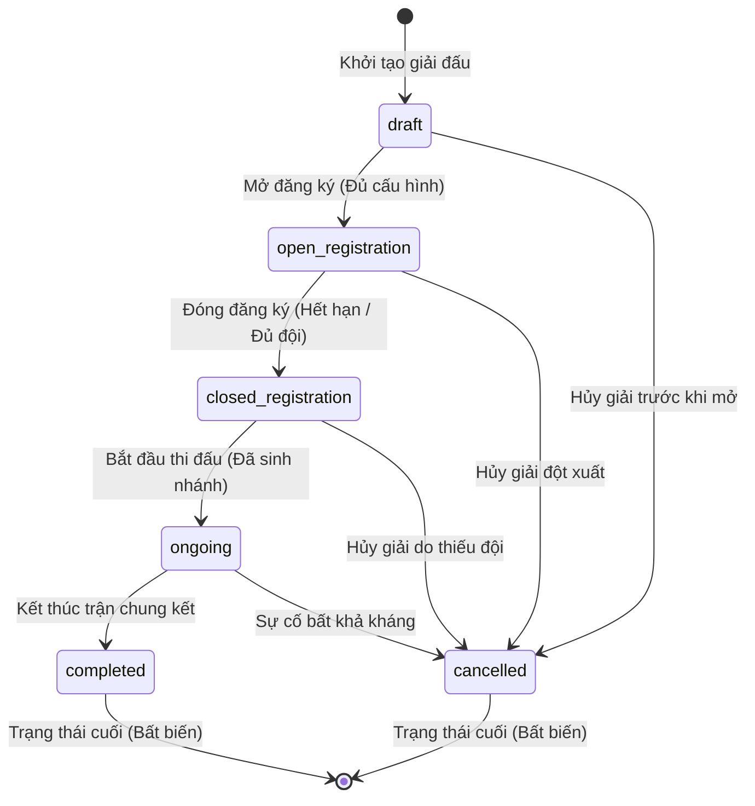
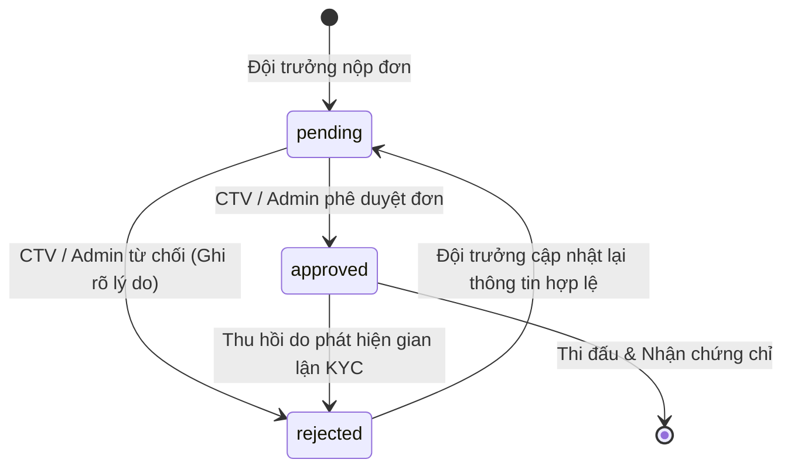
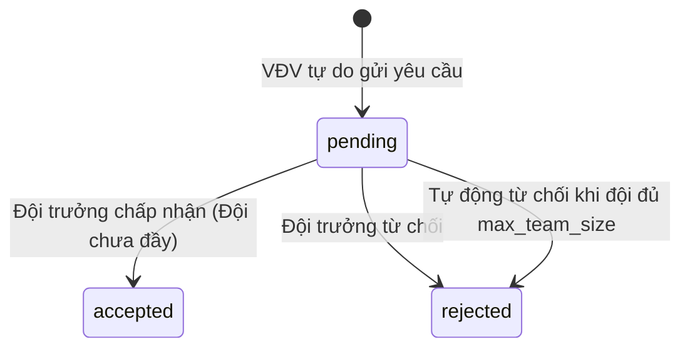
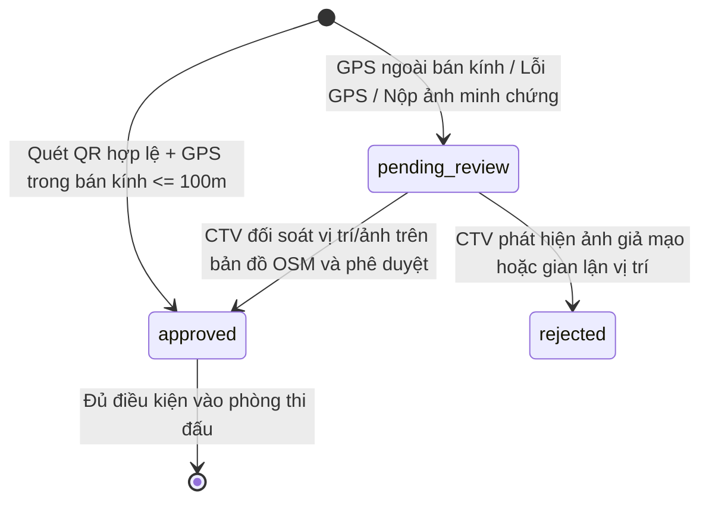

# MA TRẬN CHUYỂN TRẠNG THÁI HỆ THỐNG (FORMAL STATE TRANSITION MATRIX)
**Dự án:** Nền tảng Quản lý Giải đấu Thể thao Điện tử DUT ESPORTS  
**Tài liệu chuẩn hóa:** SRS 1.1 — Nghiệp vụ Cốt lõi & Kiểm soát Vận hành  
**Đơn vị thẩm định:** QA Automation Architect & Test Specialist  
**Ngày cập nhật:** 15/10/2026  

---

## 1. VÒNG ĐỜI GIẢI ĐẤU (TOURNAMENT LIFECYCLE STATE MACHINE)

Thực thể `tournaments` lưu trữ trạng thái tại cột `status VARCHAR(30)`.

### Bảng Quy chuẩn Chuyển trạng thái Giải đấu (Tournament Transition Table)

| Trạng thái Hiện tại (Current State) | Sự kiện / Trigger | Điều kiện Tiên quyết (Guard Conditions) | Trạng thái Mới (Next State) | Tác vụ Kèm theo (Actions / Side Effects) | Phân quyền (Allowed Roles) |
|---|---|---|---|---|---|
| `draft` | `OPEN_REGISTRATION` | 1. `form_schema` hợp lệ. 2. `min_team_size` $\ge 1$ và $\le max\_team\_size$. 3. Thời gian `registration_opens_at` $\le now()$. | `open_registration` | 1. Hiển thị giải đấu công khai trên trang chủ. 2. Cho phép nộp đơn đăng ký. 3. **Khóa chỉnh sửa cấu hình cốt lõi.** | `admin`, `ctv` (thường trực) |
| `draft` | `CANCEL_TOURNAMENT` | Không có điều kiện ràng buộc. | `cancelled` | 1. Đánh dấu giải đã hủy. 2. Ghi nhật ký vào `audit_logs`. | `admin` |
| `open_registration` | `CLOSE_REGISTRATION` | 1. `now() \ge registration_closes_at` hoặc Admin đóng thủ công. 2. Số đội hợp lệ $\ge min\_participants$. | `closed_registration` | 1. Chặn toàn bộ đơn đăng ký mới. 2. Tự động từ chối các yêu cầu tuyển quân còn `pending`. | `admin`, `ctv` (thường trực), Hệ thống tự động |
| `open_registration` | `CANCEL_TOURNAMENT` | Có văn bản/lý do hủy giải hợp lệ. | `cancelled` | 1. Thông báo hủy giải cho toàn bộ đội trưởng. 2. Chặn các đơn đăng ký. | `admin` |
| `closed_registration` | `START_TOURNAMENT` | 1. Đã chốt danh sách đội hợp lệ. 2. **Đã tạo nhánh đấu (Brackets) hoặc phân phòng TFT thành công.** | `ongoing` | 1. Mở cổng check-in theo lịch. 2. Khóa vĩnh viễn danh sách đội thi đấu (Roster Lock). | `admin`, `ctv` (thường trực) |
| `closed_registration` | `CANCEL_TOURNAMENT` | Số đội không đạt `min_participants` hoặc sự cố địa điểm. | `cancelled` | 1. Hủy lịch thi đấu. 2. Thông báo hoàn tiền/hủy giải. | `admin` |
| `ongoing` | `COMPLETE_TOURNAMENT`| 1. Trận đấu cuối cùng của giải có `status = 'completed'`. 2. Không còn trận đấu nào ở trạng thái `disputed`. | `completed` | 1. **Phát sự kiện `tournament.completed`.** 2. Kích hoạt Worker render E-Certificate. 3. Khóa bảng điểm vĩnh viễn. | `admin` |
| `ongoing` | `CANCEL_TOURNAMENT` | Sự cố gian lận hàng loạt hoặc bất khả kháng. | `cancelled` | Dừng toàn bộ các trận đấu đang dở dang. | `admin` |
| `completed` | *Bất kỳ hành động nào* | **KHÔNG CHO PHÉP** | — | Trả về lỗi `400 Bad Request` hoặc `409 Conflict`. Trạng thái bất biến. | — |
| `cancelled` | *Bất kỳ hành động nào* | **KHÔNG CHO PHÉP** | — | Trả về lỗi `400 Bad Request`. Không thể hồi sinh giải đã hủy. | — |

---

## 2. VÒNG ĐỜI ĐƠN ĐĂNG KÝ GIẢI ĐẤU (REGISTRATION STATE MACHINE)

Thực thể `registrations` lưu trữ trạng thái tại cột `status VARCHAR(20)`.  
*Lưu ý kiến trúc:* Bản DDL v2.0 đã bỏ trạng thái `cancelled`, chuẩn hóa 03 trạng thái: `pending`, `approved`, `rejected`.

### Bảng Chuyển trạng thái Đăng ký (Registration Transition Table)

| Trạng thái Hiện tại | Sự kiện / Trigger | Điều kiện Tiên quyết | Trạng thái Mới | Hành động Kèm theo |
|---|---|---|---|---|
| `[*] (Chưa có)` | `SUBMIT_REGISTRATION` | 1. Giải đấu ở trạng thái `open_registration`. 2. Đội trưởng có `kyc_status = 'approved'`. 3. Đội trưởng chưa thuộc bất kỳ đội nào khác trong cùng giải. 4. Dữ liệu nộp thỏa mãn `form_schema`. | `pending` | 1. Tạo bản ghi `registrations`. 2. Thêm đội trưởng vào `registration_members` với `is_captain = true`. |
| `pending` | `APPROVE_REGISTRATION` | 1. Số thành viên thỏa mãn $\ge min\_team\_size$ và $\le max\_team\_size$. 2. 100% thành viên đều có `kyc_status = 'approved'`. 3. Không có thành viên nào trùng giải. | `approved` | 1. Xác nhận đội hợp lệ tham gia bốc thăm nhánh đấu. 2. Gửi thông báo phê duyệt tới đội trưởng. |
| `pending` | `REJECT_REGISTRATION` | Bắt buộc nhập `rejection_reason` (ví dụ: in-game ID không tồn tại, thiếu thành viên). | `rejected` | 1. Lưu `rejection_reason` và `reviewed_by`. 2. Gửi thông báo từ chối kèm lý do để đội chỉnh sửa. |
| `rejected` | `UPDATE_RESUBMIT` | 1. Giải đấu vẫn còn trong thời gian `open_registration`. 2. Đội trưởng đã sửa đổi các thông tin không hợp lệ. | `pending` | Chuyển lại trạng thái `pending` để CTV xem xét ở lượt duyệt tiếp theo. |
| `approved` | `REVOKE_REGISTRATION` | Phát hiện vi phạm điều lệ giải đấu hoặc gian lận danh tính. | `rejected` | 1. Hủy tư cách thi đấu của đội. 2. Nếu nhánh đấu đã sinh: Xử thua đối kháng (Forfeit/Walkover) cho đối thủ. |

---

## 3. VÒNG ĐỜI YÊU CẦU GIA NHẬP ĐỘI (TEAM JOIN REQUEST STATE MACHINE)

Thực thể `team_join_requests` quản lý tuyển quân tại cột `status VARCHAR(20)`.  
Các trạng thái: `pending`, `accepted`, `rejected`.

### Bảng Chuyển trạng thái Yêu cầu Gia nhập (Join Request Transition Table)

| Trạng thái Hiện tại | Sự kiện / Trigger | Điều kiện Tiên quyết | Trạng thái Mới | Hành động Kèm theo (Atomic DB Action) |
|---|---|---|---|---|
| `[*] (Chưa có)` | `SEND_JOIN_REQUEST` | 1. Đội đang mở cờ `is_recruiting = true`. 2. VĐV có `kyc_status = 'approved'`. 3. VĐV chưa thuộc bất kỳ đội nào trong giải. 4. Chưa có request `pending` nào của VĐV với đội này. | `pending` | Tạo bản ghi với trạng thái `pending`, thông báo đến đội trưởng. |
| `pending` | `ACCEPT_JOIN_REQUEST` | **(Thực thi trong một Giao dịch Khóa hàng)**: 1. Giải đấu còn mở đăng ký. 2. Đội hiện tại có số thành viên $< max\_team\_size$. 3. VĐV chưa được đội khác chấp nhận trước đó. | `accepted` | 1. Chèn VĐV vào `registration_members`. 2. Nếu sĩ số mới đạt $= max\_team\_size$: Tự động cập nhật `registrations.is_recruiting = false`. 3. Tự động từ chối (`rejected`) toàn bộ các request `pending` khác của VĐV này trong cùng giải. |
| `pending` | `REJECT_JOIN_REQUEST` | Đội trưởng từ chối thủ công (tùy chọn nhập lý do). | `rejected` | Cập nhật `status = 'rejected'`, VĐV được phép gửi yêu cầu tới đội khác. |

---

## 4. VÒNG ĐỜI ĐIỂM DANH SÀN ĐẤU (CHECK-IN STATE MACHINE)

Thực thể `check_ins` quản lý trạng thái tại cột `status VARCHAR(20)`.  
Các trạng thái: `pending_review`, `approved`, `rejected`.

### Bảng Chuyển trạng thái Điểm danh (Check-in Transition Table)

| Phương thức (Method) | Tín hiệu Đầu vào | Điều kiện Phán quyết Hệ thống | Trạng thái Bản ghi | Hành động Kèm theo |
|---|---|---|---|---|
| `qr_scan` | Token QR động + Tọa độ GPS | 1. Token hợp lệ, chưa hết hạn 30s. 2. Khoảng cách $\le geofence\_radius$ (mặc định 100m). 3. Sai số $gps\_accuracy \le 100m$. | `approved` | Kích hoạt ngay sự kiện `checkin.approved`, hiển thị điểm xanh trên bản đồ OSM. |
| `qr_scan` | Token QR động + Tọa độ GPS | Khoảng cách $> geofence\_radius$ hoặc sai số GPS quá lớn. | `pending_review` | Đánh dấu cờ nghi vấn (chấm vàng trên bản đồ), chuyển hướng người dùng nộp minh chứng. |
| `proof_submission` | Tệp ảnh tải lên | Ảnh chụp phòng chờ game hoặc ảnh selfie tại sàn đấu. | `pending_review` | Lưu URL ảnh vào `proof_image_url`, thông báo cho CTV trực bản đồ Leaflet. |
| `manual_admin` | Thao tác của CTV/Admin | CTV đối soát ảnh/vị trí trên bản đồ OSM và bấm "Duyệt". | `approved` | Lưu `reviewed_by = users.id`, ghi nhận lịch sử vào `audit_logs`. |
| `manual_admin` | Thao tác của CTV/Admin | Ảnh không hợp lệ hoặc thí sinh không có mặt tại sàn đấu. | `rejected` | Đánh dấu từ chối điểm danh, tước quyền thi đấu trận đầu tiên. |

---

## 5. VÒNG ĐỜI TRẬN ĐẤU & KẾT QUẢ (MATCH & GAME STATE MACHINE)

Thực thể `matches` quản lý trạng thái tại cột `status VARCHAR(20)`.  
Các trạng thái: `scheduled`, `in_progress`, `awaiting_confirmation`, `disputed`, `completed`, `cancelled`.

| Trạng thái Hiện tại | Sự kiện / Trigger | Điều kiện Tiên quyết | Trạng thái Mới | Hành động Kèm theo |
|---|---|---|---|---|
| `scheduled` | `CALL_MATCH` | Đã đến giờ thi đấu và cả 2 bên đã hoàn tất check-in. | `in_progress` | Khóa phòng thi đấu, bắt đầu đếm giờ trận đấu. |
| `in_progress` | `SUBMIT_SCORE` | Trọng tài bàn / CTV nhập tỉ số ván đấu và ảnh chụp màn hình kết quả. | `awaiting_confirmation` | Mở cửa sổ 15 phút cho 2 đội trưởng bấm nút "Xác nhận kết quả". |
| `awaiting_confirmation`| `CONFIRM_SCORE` | Cả 2 đội trưởng cùng xác nhận hoặc hết thời hạn khiếu nại (15 phút). | `completed` | 1. Cập nhật `matches.status = 'completed'`. 2. **Đẩy đội thắng vào `winner_next_match_id`.** 3. **Đẩy đội thua vào `loser_next_match_id` (nếu có).** |
| `awaiting_confirmation`| `RAISE_DISPUTE` | Đội trưởng nộp đơn khiếu nại kèm hình ảnh bằng chứng gian lận in-game. | `disputed` | Đóng băng tiến trình nhánh đấu, gửi thông báo khẩn cấp tới Trưởng BTC (Admin). |
| `disputed` | `RESOLVE_DISPUTE` | Admin phân xử kết quả cuối cùng dựa trên video/trọng tài. | `completed` | Cập nhật tỉ số chuẩn hóa, ghi rõ lý do phân xử vào `audit_logs`. |
