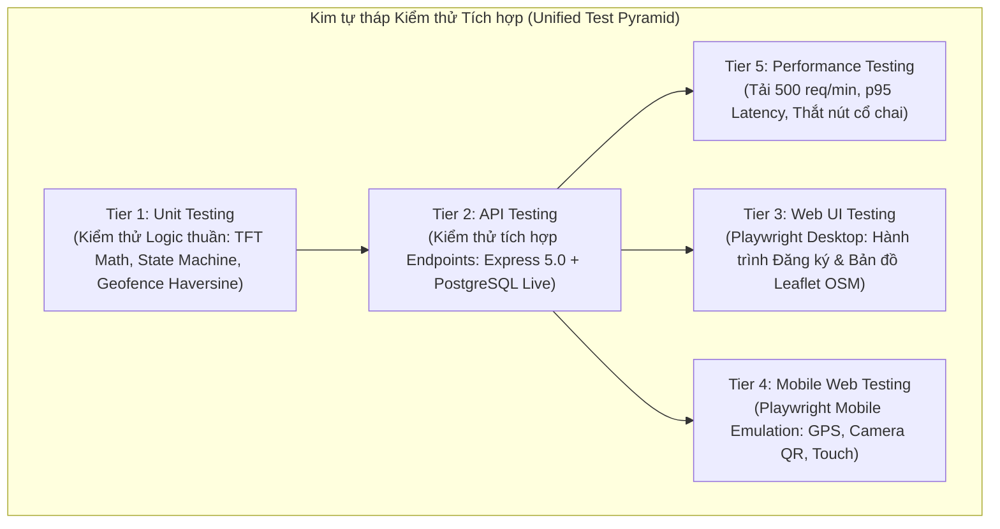

# CHIẾN LƯỢC KIỂM THỬ PHẦN MỀM 5 TẦNG CHO MỘT LẬP TRÌNH VIÊN (UNIFIED 5-TIER TEST STRATEGY)
**Dự án:** Nền tảng Quản lý Giải đấu Thể thao Điện tử DUT ESPORTS  
**Người xây dựng:** QA Automation Architect & Test Specialist (Solo Developer)  
**Tiêu chuẩn đối chiếu:** IEEE 829 / ISO/IEC/IEEE 29119-2  
**Ngày cập nhật:** 15/10/2026  

---

## 1. TỔNG QUAN CHIẾN LƯỢC ĐƠN LẬP (SOLO DEVELOPER UNIFIED STRATEGY)

Thay vì tạo ra 5 quy trình kiểm thử cồng kềnh với nhiều nhân sự và cuộc họp phê duyệt, dự án áp dụng **Chiến lược Kiểm thử Thống nhất 5 Tầng (Unified 5-Tier Strategy)** do một lập trình viên duy nhất thực hiện dưới sự hỗ trợ của AI.

---

## 2. CHI TIẾT 5 TẦNG KIỂM THỬ (THE 5 TESTING TIERS)

### Tầng 1: Kiểm thử Đơn vị (Unit Testing)
- **Mục tiêu:** Kiểm tra các hàm logic nghiệp vụ thuần túy (Pure Functions), thuật toán toán học và các quy tắc kiểm tra tính hợp lệ mà không phụ thuộc vào I/O mạng hoặc CSDL.
- **Phạm vi trọng tâm:**
  1. *Thuật toán chia phòng TFT:* Kiểm tra toán học công thức $m = \lceil N/8 \rceil$ với các giá trị biên và các điểm vô nghiệm ($N \in \{0, 1, 6, 7, 8, 13, 14, 15, 16, 17, 22, 24, 25, 33, 41, 100\}$).
  2. *Hàm tính khoảng cách Geofencing Haversine:* Tính khoảng cách giữa tọa độ thiết bị và sàn đấu (Hội trường F ĐHBK Đà Nẵng: `16.0748, 108.1499`), kiểm tra ngưỡng $\le 100m$.
  3. *Máy trạng thái hữu hạn (State Machine Transition Guards):* Kiểm tra tính hợp lệ của việc chuyển đổi trạng thái giải đấu và trạng thái trận đấu.
  4. *Kiểm tra định dạng và Magic Bytes ảnh:* Nhận diện chữ ký tệp nhị phân JPEG (`FF D8 FF`), PNG (`89 50 4E 47`), WebP; chặn các tệp giả mạo đuôi `.jpg` nhưng nội dung là script thực thi.
- **Công cụ thực thi:** **Node.js Native Test Runner** (`node --test --experimental-strip-types`) và `tsx` (cho linh kiện UI).

### Tầng 2: Kiểm thử Giao diện Lập trình (API Testing)
- **Mục tiêu:** Kiểm tra sự tương tác giữa client và server thông qua các RESTful API endpoints thực tế kết nối trực tiếp với Supabase PostgreSQL.
- **Phạm vi trọng tâm:**
  1. *Xác thực & RBAC:* Kiểm tra quyền truy cập của 4 vai trò (`admin`, `ctv`, `seasonal_staff`, `participant`) trên các endpoint bảo vệ. Chặn hành vi leo quyền (Privilege Escalation).
  2. *Quy trình Đăng ký & Tuyển quân (Function A):* Tạo đội, cập nhật JSONB form, bật cờ `is_recruiting`, gửi và duyệt `team_join_requests`.
  3. *Kiểm soát Đồng thời (Concurrency):* Gửi đồng thời nhiều yêu cầu gia nhập cho cùng 1 thí sinh để kiểm tra cơ chế khóa hàng và tính toàn vẹn CSDL.
  4. *Quy trình Điểm danh (Function B):* Sinh token QR động 30s, gửi yêu cầu điểm danh kèm tọa độ GPS, kiểm tra phản hồi khi hết hạn token hoặc ngoài vùng Geofencing.
- **Công cụ thực thi:** Kịch bản kiểm thử Node.js tự động (sử dụng fetch nguyên bản và xác thực JWT token).

### Tầng 3: Kiểm thử Giao diện Web Máy tính (Web UI Testing)
- **Mục tiêu:** Tự động hóa trải nghiệm người dùng cuối trên trình duyệt máy tính để bàn (Desktop Web), xác minh khả năng tương tác của các form và bản đồ số.
- **Phạm vi trọng tâm:**
  1. *Hành trình Đăng ký Thi đấu:* Đăng nhập tài khoản thí sinh, chọn giải đấu, điền form in-game động, tạo đội và bật cờ tuyển quân.
  2. *Bảng điều khiển Duyệt của Ban tổ chức:* Đăng nhập tài khoản CTV, xem danh sách hồ sơ KYC, so khớp 02 ảnh thẻ SV với chức năng phóng to (Zoom in), duyệt hoặc từ chối có lý do.
  3. *Bản đồ Giám sát Điểm danh Leaflet OSM:* Kiểm tra việc hiển thị vòng tròn Geofencing và các điểm ghim tọa độ thí sinh (xanh lá = hợp lệ, vàng/cam = nghi vấn/chờ duyệt).
- **Công cụ thực thi:** **Playwright Desktop** (`@playwright/test` với Chromium/WebKit).

### Tầng 4: Kiểm thử Web Di động & Giả lập Phần cứng (Mobile Web Testing)
- **Mục tiêu:** Đảm bảo trải nghiệm mượt mà trên thiết bị di động, kiểm tra các tương tác đặc thù với phần cứng camera và cảm biến định vị GPS.
- **Phạm vi trọng tâm:**
  1. *Responsive Viewport:* Kiểm tra hiển thị trên màn hình di động chuẩn (Pixel 7: 412x915px; iPhone 14 Pro: 393x852px).
  2. *Giả lập Cảm biến Geolocation GPS:* Bơm tọa độ nhân tạo (Mock Coordinates) qua Playwright Context:
     - Tọa độ trong sàn đấu (cách tâm 25m) -> Phải tự động duyệt.
     - Tọa độ ngoài sàn đấu (cách tâm 250m) -> Phải từ chối và hiển thị nút nộp minh chứng.
     - Thiết bị từ chối cấp quyền Geolocation -> Phải chuyển sang luồng nộp ảnh minh chứng dự phòng.
  3. *Giả lập Luồng Video Camera quét QR:* Mô phỏng khung camera HTML5 quét trực tiếp từ màn hình hiển thị.
- **Công cụ thực thi:** **Playwright Device Emulation** (Không cài Appium do hệ thống là ứng dụng Web đa nền tảng, không có app native iOS/Android).

### Tầng 5: Kiểm thử Hiệu năng & Đo lường Tải (Performance Testing)
- **Mục tiêu:** Xác định giới hạn chịu tải của hệ thống, đo lường các chỉ số phi chức năng theo tiêu chuẩn NFR-PRF-01 và NFR-PRF-03.
- **Phạm vi trọng tâm:**
  1. *Tải Đột biến Khai mạc Điểm danh (Check-in Rush Hour):* Mô phỏng 500 yêu cầu quét QR điểm danh mỗi phút trong khung giờ cao điểm (tương đương 50 client gửi liên tục trong 10 phút).
  2. *Các chỉ số đo lường thực tế:*
     - Thời gian phản hồi trung bình (Average Response Time).
     - Thời gian phản hồi phân vị 95 (p95 Latency) — Mục tiêu: $< 2.0$ giây.
     - Thời gian phản hồi phân vị 99 (p99 Latency).
     - Tốc độ xử lý thông lượng (Throughput: Requests Per Second - RPS).
     - Tỷ lệ lỗi (Error Rate / HTTP 5xx Rate) — Mục tiêu: $< 1.0\%$.
- **Công cụ thực thi:** Node.js Concurrency Benchmark Runner (Đo lường độ trễ độ phân giải cao `performance.now()`).

---

## 3. CÁC KỸ THUẬT THIẾT KẾ TEST CASE ÁP DỤNG

Để tối ưu hóa số lượng ca kiểm thử mà vẫn đạt độ bao phủ tối đa, Solo Developer áp dụng 8 kỹ thuật thiết kế chuẩn quốc tế:
1. **Phân vùng Tương đương (Equivalence Partitioning - EP):** Chia các miền giá trị hợp lệ và không hợp lệ (Ví dụ: Bán kính GPS hợp lệ $\le 100m$; Không hợp lệ $> 100m$).
2. **Phân tích Giá trị Biên (Boundary Value Analysis - BVA):** Kiểm tra chính xác tại các giá trị biên: $99m$, $100m$, $101m$; sĩ số đội $min\_team\_size - 1$, $min\_team\_size$, $max\_team\_size$, $max\_team\_size + 1$.
3. **Kiểm thử Bảng Quyết định (Decision Tables):** Áp dụng cho logic duyệt điểm danh kết hợp nhiều điều kiện (Token QR hợp lệ AND GPS hợp lệ AND Thí sinh chưa điểm danh).
4. **Kiểm thử Chuyển trạng thái (State Transition Testing):** Kiểm tra tính hợp lệ của các bước chuyển đổi trạng thái giải đấu theo `STATE_TRANSITION_MATRIX.md`.
5. **Kiểm thử Tiêu cực & Ngoại lệ (Negative Testing):** Cố tình gửi payload sai schema, thiếu trường bắt buộc, sai định dạng UUID, token hết hạn để kiểm tra khả năng phục hồi lỗi của máy chủ.
6. **Kiểm thử Xung đột Đồng thời (Concurrency Testing):** Đua luồng (Race Condition Testing) khi gia nhập đội và điểm danh cùng lúc.
7. **Kiểm thử An toàn & Bảo mật (Security Testing):** Thử nghiệm IDOR (Thay đổi `registration_id` của đội khác khi duyệt yêu cầu), kiểm tra che mờ dữ liệu PII và chặn tệp độc hại.
8. **Kiểm thử Hồi quy (Regression Testing):** Chạy lại toàn bộ test suite sau khi áp dụng các bản vá logic để đảm bảo không phát sinh lỗi mới.
