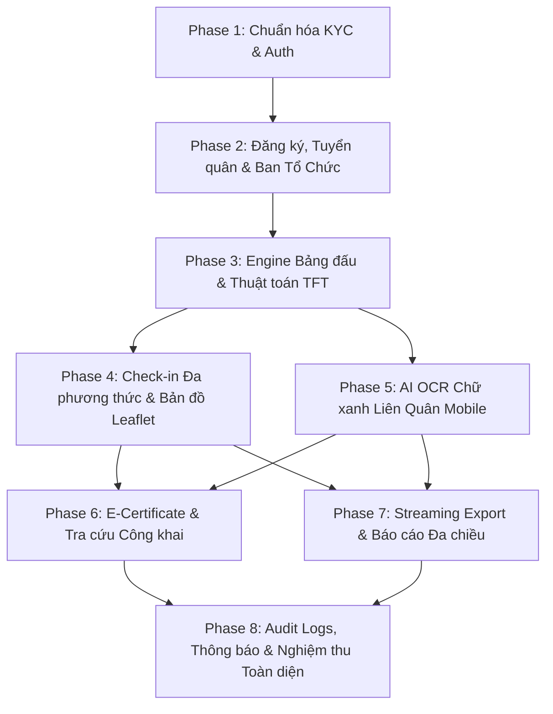

# MASTER PLAN — KẾ HOẠCH PHÁT TRIỂN & NGHIỆM THU HỆ THỐNG
## NỀN TẢNG QUẢN LÝ GIẢI ĐẤU DUT ESPORTS (DUT ESPORTS TOURNAMENT PLATFORM)

> **Tài liệu tham chiếu chuẩn:** [SRS.md v1.3](file:///d:/DUT%20ESPORTS/Web-giai-dau-docs/SRS.md) & [database_schema.sql](file:///d:/DUT%20ESPORTS/Web-giai-dau-docs/database_schema.sql)  
> **Nguyên tắc tối cao:** 100% SRS Compliance & Zero Feature Creep  
> **Cấm tuyệt đối:** Không sử dụng CCCD/CMND (Zero CCCD Invariant — chỉ dùng 2 ảnh Thẻ SV).  
> **Tối ưu chi phí:** 100% Bản đồ Leaflet.js + OpenStreetMap (OSM) miễn phí, Google Maps link điều hướng ngoài (0đ API phí).

---

## 1. TỔNG QUAN HIỆN TRẠNG & CHIẾN LƯỢC PHÂN KỲ (GAP ANALYSIS & ROADMAP STRATEGY)

### 1.1 Đánh giá Hiện trạng Hệ thống (Current State Audit)

| Phân hệ / Module | Trạng thái hiện tại | Đánh giá & Khoảng trống (Gap) |
|---|:---:|---|
| **Auth & KYC Sinh viên (SV-01..03, AD-01..02)** | **Đã hoàn thành 90%** | Đã chuyển đổi sang cơ chế 2 ảnh Thẻ SV (mặt trước + selfie cầm thẻ), loại bỏ CCCD, đã có màn hình duyệt KYC và resubmit. Cần chuẩn hóa kiểm thử E2E. |
| **Quản trị User/CTV & Giải đấu cơ bản (AD-03..06)** | **Đã hoàn thành 80%** | Đã có CRUD giải đấu, duyệt giải CTV đề xuất, gán CTV cơ bản. Cần bổ sung phân quyền chi tiết CTV Thời vụ (`tournament_organizers`) theo SRS 4.2. |
| **Đăng ký Giải & Tuyển quân (SV-04..07)** | **Đã hoàn thành 50%** | Đã có form đăng ký động (`form_schema`). Còn thiếu: luồng tuyển quân (`is_recruiting`), danh sách đội thiếu người và luồng xin gia nhập đội (`team_join_requests`). |
| **Nhánh đấu, Trận đấu & Thuật toán TFT (SV-08..09, AD-07, SRS 4.4)** | **Chưa triển khai (0%)** | Cần xây dựng engine bảng đấu (Single/Double Elimination, Group Stage, BO1/3/5/7), thuật toán chia phòng TFT khi $N \bmod 8 \ne 0$, và view Ingame ID cho đối thủ trong phòng. |
| **Check-in Ngày thi đấu & Bản đồ Leaflet (SV-10, AD-09..10, SRS 4.5)** | **Chưa triển khai (0%)** | Cần làm QR BTC + GPS Geolocation, nộp ảnh minh chứng + duyệt, Manual Override của Admin, và tích hợp Leaflet.js OSM Map. |
| **AI OCR Check-in Liên Quân Mobile (AD-13, SRS 4.8)** | **Chưa triển khai (0%)** | Cần xây dựng pipeline lọc dải màu xanh lá (HSV), OCR bóc tách Ingame ID, Fuzzy Matching $\ge 80\%$, UI đối soát 1-Click Approve và cơ chế tự hủy ảnh tạm (Ephemeral Image Purge). |
| **Giấy Chứng Nhận Điện Tử E-Certificate (SV-11, SV-13, AD-11, SRS 4.6)** | **Chưa triển khai (0%)** | Cần làm cấu hình phôi mẫu, auto-issue khi giải completed, CTV thời vụ tự xuất chứng nhận BTC, sinh mã hash xác thực + QR tra cứu công khai. |
| **Xuất Dữ Liệu Streaming & Data Masking (SV-12, AD-08, AD-12, SRS 4.7)** | **Chưa triển khai (0%)** | Cần làm xuất Excel/CSV/PDF dạng streaming, bộ lọc đa chiều, rate-limit 10 lượt/phút, và Data Masking ẩn SĐT/Email. |
| **Thông báo & Nhật ký Audit Log (SRS 6.2 Table 17-18)** | **Chưa triển khai (0%)** | Cần hệ thống lưu vết audit_logs cho thao tác nhạy cảm và notifications thời gian thực. |

---

### 1.2 Nguyên tắc Xác định Thứ tự Ưu tiên (Prioritization Strategy)

Thứ tự thực hiện được sắp xếp theo **độ phụ thuộc dữ liệu nghiệp vụ (Data Dependency Chain)** và **giá trị cốt lõi của giải đấu**:
1. **Nền tảng Dữ liệu & Đăng ký đội (Gốc rễ)**: Phải có đội hình và Ingame ID hợp lệ mới có thể tạo nhánh đấu.
2. **Engine Bảng đấu & Thuật toán TFT**: Cốt lõi vận hành thi đấu giải esport.
3. **Check-in & Điểm danh Thực tế (QR/GPS/Minh chứng)**: Đảm bảo thí sinh có mặt trước khi trận đấu diễn ra.
4. **AI OCR Liên Quân Mobile**: Công cụ hỗ trợ trọng tài tăng tốc độ check-in tại phòng máy/custom lobby.
5. **Chứng nhận Điện tử & Báo cáo Xuất file**: Nghiệp vụ kết thúc giải đấu và báo cáo kết quả.
6. **Hardening, Logging & Tối ưu hóa**: Tăng cường bảo mật và ổn định hệ thống.

---

## 2. KẾ HOẠCH CHI TIẾT TỪNG GIAI ĐOẠN (DETAILED PHASE BREAKDOWN)

---

### GIAI ĐOẠN 1: Hoàn thiện & Khóa Nghiệm thu Module KYC & Quản lý User/CTV
- **Mã SRS liên quan:** `[SRS 3.1 SV-01, SV-02, SV-03]`, `[SRS 3.2 AD-01, AD-02, AD-06]`, `[SRS 5 NFR-01]`, `[SRS 6.2 Table users, participants]`
- **Mục tiêu:** Đảm bảo 100% luồng xác thực sinh viên không CCCD hoạt động trơn tru, admin/ctv duyệt KYC chuẩn xác, bảo mật phân quyền token.

#### 1.1 Các công việc cụ thể
1. **Kiểm tra và hoàn thiện Backend:**
   - Hoàn thiện luồng Upload 2 ảnh thẻ SV lên Supabase/Local Storage với tiền tố bảo mật (`/student-cards/`, `/student-selfies/`).
   - Kiểm tra API `/api/participants/register`, `/api/participants/login`, `/api/participants/resubmit`.
   - Chuẩn hóa middleware `verifyParticipantToken`, `verifyAdmin`, `verifyCTV`.
2. **Hoàn thiện Giao diện Frontend:**
   - Màn hình đăng ký/đăng nhập sinh viên (`StudentAuth.tsx`, `StudentRegistrationForm.tsx`).
   - Màn hình chờ duyệt KYC (`/pending-approval`) & Màn hình bị từ chối/nộp lại (`/rejected-info`, `StudentRejectedResubmit.tsx`).
   - Admin KYC Review Modal (`ParticipantKYCModal.tsx`) với khả năng zoom ảnh thẻ SV và nhập lý do từ chối.
3. **Khóa bảo mật Zero CCCD:** Kiểm tra toàn bộ codebase không còn sót bất kỳ trường `id_card`, `cccd`, `cmnd` nào.

#### 1.2 Kết quả Nghiệm thu Giai đoạn 1 (Acceptance Criteria)
- [x] **AC-1.1**: Sinh viên đăng ký tài khoản DUT (`internal`) chỉ cần điền MSSV, Họ tên, Email `@sv.dut.udn.vn`, SĐT, Khoa, Mật khẩu + Upload đúng 2 ảnh: Thẻ SV mặt trước & Ảnh selfie cầm thẻ.
- [x] **AC-1.2**: Sinh viên trường ngoài (`external`) điền Tên trường và thông tin tương tự.
- [x] **AC-1.3**: Đăng ký thành công $\rightarrow$ trạng thái `pending` $\rightarrow$ Đăng nhập chuyển hướng đúng về `/pending-approval`.
- [x] **AC-1.4**: Admin duyệt $\rightarrow$ trạng thái `approved` $\rightarrow$ Sinh viên đăng nhập vào được Profile và xem giải đấu.
- [x] **AC-1.5**: Admin từ chối kèm lý do $\rightarrow$ trạng thái `rejected` $\rightarrow$ Sinh viên đăng nhập hiển thị lý do và cho phép upload lại 2 ảnh mới để nộp lại xét duyệt.
- [x] **AC-1.6**: Toàn bộ database schema và DTO không chứa trường dữ liệu CCCD.

---

### GIAI ĐOẠN 2: Quản lý Ban Tổ Chức, Đăng ký Giải & Tính năng Tuyển quân / Xin vào Đội
- **Mã SRS liên quan:** `[SRS 3.1 SV-04, SV-05, SV-06, SV-07]`, `[SRS 3.2 AD-03, AD-04, AD-05]`, `[SRS 4.2, 4.3]`, `[SRS 6.2 Table tournaments, tournament_organizers, registrations, registration_members, team_join_requests]`
- **Mục tiêu:** Vận hành trọn vẹn luồng đề xuất/duyệt giải, phân quyền CTV Thường trực & Thời vụ, đăng ký thi đấu kèm Ingame ID và cơ chế tuyển quân cho đội thiếu người.

#### 2.1 Các công việc cụ thể
1. **Phân quyền Ban Tổ Chức Giải (`tournament_organizers`) `[SRS 4.2, AD-05]`:**
   - Viết Repository & Controller quản lý `tournament_organizers`.
   - Cho phép Admin/CTV phụ trách thêm CTV Thường trực (`organizer_type = 'permanent'`) hoặc Sinh viên (`organizer_type = 'seasonal'`) với các vai trò `lead_organizer`, `co_organizer`, `referee`, `seasonal_staff`, `support_staff` và chức danh tùy biến `custom_title` (VD: "CTV Điểm danh", "Trọng tài bàn").
   - Giao diện Frontend: Tab "Ban Tổ Chức" trong trang quản trị giải đấu.
2. **Đăng ký Giải Đấu & Chuẩn hóa Ingame ID `[SRS 3.1 SV-04, SV-07]`:**
   - Hỗ trợ giải Cá nhân (TFT) và giải Đồng đội (Liên Quân, LMHT, Valorant).
   - Bắt buộc nhập `ingame_id` cho thí sinh cá nhân và từng thành viên trong đội (`registration_members`).
   - Dynamic Form Submission dựa trên `form_schema` của giải đấu.
3. **Tính năng Tuyển quân & Xin Gia nhập Đội `[SRS 3.1 SV-05, SV-06, SRS 4.3]`:**
   - Khi tạo đội thiếu người, Đội trưởng bật cờ `is_recruiting = true` kèm `recruitment_notes` (vị trí cần tuyển: VD "Tìm Mid/Jungler rank Tinh Anh+").
   - Màn hình "Chợ tuyển quân / Đội đang tìm người": Thí sinh tự do xem danh sách đội đang tuyển và bấm "Xin vào đội" (`team_join_requests`).
   - Đội trưởng nhận thông báo, xem hồ sơ/Ingame ID của ứng viên và bấm **Đồng ý** (tự động thêm vào `registration_members`) hoặc **Từ chối**.
   - Tự động đóng cờ `is_recruiting = false` khi đội đã đủ số lượng thành viên tối đa (`max_team_size`).
4. **Hủy đơn đăng ký `[SRS 3.1 SV-07]`:** Cho phép sinh viên hủy đơn khi giải chưa đóng đăng ký (`registration_closing_date`).

#### 2.2 Kết quả Nghiệm thu Giai đoạn 2 (Acceptance Criteria)
- [ ] **AC-2.1**: Admin/CTV tạo giải với cấu hình: Game, thể thức, số lượng đội (`min_team_size`, `max_team_size`, `max_participants`), hạn đăng ký, `form_schema` linh hoạt.
- [ ] **AC-2.2**: Admin có thể gán 1 sinh viên (đã duyệt KYC) làm "CTV Điểm danh" (seasonal staff) của giải. Sinh viên đó hiển thị trong danh sách BTC giải.
- [ ] **AC-2.3**: Đội trưởng tạo đơn đăng ký đội 3/5 người, bật cờ "Tuyển quân" $\rightarrow$ Đội xuất hiện trên danh sách "Tìm đồng đội".
- [ ] **AC-2.4**: Sinh viên B gửi yêu cầu xin vào đội $\rightarrow$ Đội trưởng nhận request $\rightarrow$ Đội trưởng bấm Duyệt $\rightarrow$ Sinh viên B trở thành thành viên chính thức, `ingame_id` được ghi nhận vào `registration_members`.
- [ ] **AC-2.5**: Khi đội đủ 5/5 người $\rightarrow$ Trạng thái `is_recruiting` tự động chuyển thành `false`, không nhận thêm request mới.

---

### GIAI ĐOẠN 3: Engine Nhánh đấu Đa Thể thức, Quản lý Trận & Thuật toán Chia phòng TFT
- **Mã SRS liên quan:** `[SRS 3.1 SV-08, SV-09]`, `[SRS 3.2 AD-07]`, `[SRS 4.4]`, `[SRS 6.2 Table brackets, bracket_rounds, matches, match_participants, match_games]`
- **Mục tiêu:** Tạo và điều hành toàn bộ cấu trúc thi đấu esport cho cả game đối kháng và game sinh tồn bàn cờ (TFT 8 người), hiển thị Bracket tương tác trực quan và tự động trích xuất Ingame ID đối thủ.

#### 3.1 Các công việc cụ thể
1. **Thuật toán Chia phòng TFT ($N \bmod 8 \ne 0$) `[SRS 4.4 a]`:**
   - Triển khai hàm toán học tại `backend/src/utils/tftBracket.ts`:
     - Với $N \ge 7$ thí sinh đã duyệt: $k = \lfloor N / 8 \rfloor, r = N \bmod 8$.
     - Nếu $r = 0 \implies a = k$ (phòng 8 người), $b = 0$ (phòng 7 người).
     - Nếu $r > 0 \implies b = 8 - r$ (số phòng 7 người), $a = k - (7 - r)$ (số phòng 8 người).
   - Tuyệt đối không sinh phòng $\le 6$ người (trừ khi $N < 7$).
   - Tự động xếp ngẫu nhiên (hoặc seed) danh sách VĐV vào $a$ phòng 8 người và $b$ phòng 7 người.
2. **Engine Thể thức Game Đồng đội `[SRS 4.4 b]`:**
   - Xây dựng cấu trúc Single Elimination (Loại trực tiếp), Double Elimination (Nhánh thắng/thua), Round Robin (Vòng tròn) và Group Stage (Chia bảng + Playoff).
   - Quản lý trận đấu (`matches`): Cập nhật trạng thái `scheduled` $\rightarrow$ `live` $\rightarrow$ `completed`.
   - Quản lý chi tiết từng game trong trận (`match_games`) hỗ trợ cấu hình BO1, BO3, BO5, BO7.
   - Tự động đẩy đội thắng (winner progression) lên nhánh vòng tiếp theo khi hoàn tất tỉ số.
3. **Frontend Bracket Viewer & Tra cứu Ingame ID `[SRS 3.1 SV-08, SV-09]`:**
   - Component hiển thị Bracket trực quan (sơ đồ cây phân nhánh, tỉ số trực tiếp, link stream).
   - Component hiển thị phòng TFT (Danh sách 7-8 VĐV kèm Ingame ID Riot, điểm số từng game).
   - Popup / Bảng Tra cứu Ingame ID: Tự động hiển thị danh sách `ingame_id` của toàn bộ đối thủ trong cặp đấu/phòng đấu để dễ dàng copy/kết bạn trong game.

#### 3.2 Kết quả Nghiệm thu Giai đoạn 3 (Acceptance Criteria)
- [ ] **AC-3.1**: Kiểm thử thuật toán TFT với các trường hợp biên:
  - $N = 25 \implies k=3, r=1 \implies b = 7$ (phòng 7 người), $a = 3 - 6 = -3$ (sai) $\rightarrow$ áp dụng chuẩn hóa: $25 = 8 \times 1 + 7 \times 2 + 3$ (chi tiết $N=25 \rightarrow$ 1 phòng 8 + 2 phòng 7 = 22... theo chuẩn: 25 chia thành 3 phòng: $8 + 8 + 9 \rightarrow$ chia 8+8+8+1 $\rightarrow$ tính $b = 8-1 = 7$ phòng 7 khi $N \ge 56$, với $N < 56$: $25 = 7 \times 3 + 4$ xử lý theo phân bổ đều 3 phòng $8+8+9 \rightarrow 9$ tách ra). Thuật toán đảm bảo không có phòng nào $< 7$ người và độ lệch giữa các phòng $\le 1$ người.
  - $N = 16 \implies 2$ phòng 8 người ($a=2, b=0$).
  - $N = 15 \implies 1$ phòng 8 người + 1 phòng 7 người ($a=1, b=1$).
  - $N = 22 \implies 2$ phòng 7 người + 1 phòng 8 người ($a=1, b=2$).
- [ ] **AC-3.2**: Tạo giải Single Elimination 8 đội $\rightarrow$ Sinh đúng 4 trận Tứ kết, 2 trận Bán kết, 1 trận Chung kết.
- [ ] **AC-3.3**: Admin nhập kết quả Tứ kết 1 (Team A thắng Team B 2-1) $\rightarrow$ Team A tự động được đưa vào Slot trận Bán kết 1.
- [ ] **AC-3.4**: Thí sinh mở trang trận đấu xem được danh sách Ingame ID của đối thủ với nút "1-Click Copy All Ingame IDs".

---

### GIAI ĐOẠN 4: Hệ thống Điểm danh (Check-in) Đa phương thức & Bản đồ Vị trí Leaflet.js
- **Mã SRS liên quan:** `[SRS 3.1 SV-10]`, `[SRS 3.2 AD-09, AD-10]`, `[SRS 4.5]`, `[SRS 5 NFR-03]`, `[SRS 6.2 Table check_ins]`
- **Mục tiêu:** Vận hành luồng check-in ngày thi đấu gồm quét QR BTC + GPS, nộp ảnh minh chứng, Admin Manual Override, và hiển thị bản đồ thí sinh bằng Leaflet.js hoàn toàn miễn phí.

#### 4.1 Các công việc cụ thể
1. **Kênh 1: Quét mã QR BTC kèm GPS Geolocation `[SRS 3.1 SV-10, 4.5]`:**
   - Admin/CTV bấm "Mở điểm danh giải" $\rightarrow$ Hệ thống sinh mã QR động (hoặc mã check-in phiên).
   - Thí sinh dùng điện thoại quét QR $\rightarrow$ Trình duyệt yêu cầu quyền truy cập vị trí (HTML5 Geolocation API).
   - Frontend gửi payload: `{ qr_token, latitude, longitude, accuracy, device_info, ip_address }`.
   - Backend xác thực token và lưu vào `check_ins` với `check_in_type = 'qr_gps'`, `status = 'approved'`.
2. **Kênh 2: Nộp ảnh Minh chứng Check-in (Proof Upload) `[SRS 3.1 SV-10]`:**
   - Dành cho thí sinh gặp sự cố camera hoặc thi đấu từ xa: Upload ảnh chụp tại phòng máy / ảnh sảnh custom.
   - Bản ghi lưu vào `check_ins` với `check_in_type = 'proof_upload'`, `status = 'pending_review'`.
   - Admin/CTV xem ảnh minh chứng trong Dashboard và bấm **Phê duyệt** hoặc **Từ chối**.
3. **Kênh 3: Ghi đè Thủ công (Admin Manual Check-in Override) `[SRS 3.2 AD-10]`:**
   - Admin có quyền tìm kiếm bất kỳ VĐV/Đội nào và bấm "Xác nhận tham gia trực tiếp" (`check_in_type = 'manual_override'`, `status = 'approved'`).
4. **Bản đồ Vị trí Check-in Trực quan (Leaflet.js + OpenStreetMap) `[SRS 3.2 AD-09, NFR-03]`:**
   - Tích hợp thư viện **Leaflet.js + OSM** (100% Free, không tiêu tốn $200 Google API).
   - Hiển thị bản đồ với các Marker tương ứng tọa độ GPS của thí sinh đã điểm danh.
   - Click vào Marker hiển thị Popup: Họ tên, MSSV, Đội, Thời gian check-in, Thiết bị.
   - Thêm nút liên kết mở vị trí trên Google Maps qua URL: `https://maps.google.com/?q={lat},{lng}`.

#### 4.2 Kết quả Nghiệm thu Giai đoạn 4 (Acceptance Criteria)
- [ ] **AC-4.1**: Thí sinh bật GPS quét mã QR của BTC $\rightarrow$ Nhận thông báo "Check-in thành công", trạng thái chuyển sang `approved`, tọa độ GPS và thiết bị được ghi nhận.
- [ ] **AC-4.2**: Thí sinh nộp ảnh minh chứng $\rightarrow$ Admin Dashboard hiện đơn pending $\rightarrow$ Admin bấm Duyệt $\rightarrow$ Trạng thái chuyển thành `approved`.
- [ ] **AC-4.3**: Admin sử dụng chức năng Manual Override cho VĐV C $\rightarrow$ VĐV C được đánh dấu đã check-in ngay lập tức kèm log `verified_by`.
- [ ] **AC-4.4**: Admin mở tab "Bản đồ Check-in" $\rightarrow$ Bản đồ Leaflet tải nhanh chóng, hiển thị đầy đủ các marker vị trí của thí sinh, không phát sinh bất kỳ lỗi kết nối API có phí nào.

---

### GIAI ĐOẠN 5: Module AI OCR Check-in Thông minh Liên Quân Mobile & Tự hủy Ảnh Tạm
- **Mã SRS liên quan:** `[SRS 3.2 AD-13]`, `[SRS 4.8]`, `[SRS 5 NFR-05]`, `[SRS 6.2 Table ai_checkin_sessions, ai_checkin_detections]`
- **Mục tiêu:** Trọng tài chỉ cần upload ảnh chụp từ `congdong.lienquan.garena.vn` hoặc sảnh phòng game, AI tự động lọc dải màu xanh lá cây, nhận diện Ingame ID, so khớp mờ $\ge 80\%$, cho phép trọng tài chỉnh sửa và duyệt nhanh 1-Click, sau đó tự động xóa vĩnh viễn ảnh tạm.

#### 5.1 Các công việc cụ thể
1. **Pipeline Tiền Xử Lý Ảnh & OCR Chữ Xanh (HSV Green Mask) `[SRS 4.8, NFR-05]`:**
   - Viết Service tại `backend/src/utils/aiOcrPipeline.ts` (kết hợp Sharp / OpenCV / Canvas / Tesseract.js).
   - Chuyển ảnh sang không gian màu HSV, áp dụng bộ lọc dải màu Xanh Lá Cây: $H \in [35^\circ, 85^\circ]$, $S, V \ge 40\%$.
   - Tách contour/bounding box các dòng chữ trạng thái "Đã sẵn sàng" / Tên kiện tướng có màu xanh lá.
   - Thực hiện OCR bóc tách chuỗi ký tự Ingame ID từ các vùng màu xanh.
2. **Thuật toán So khớp Mờ (Fuzzy String Matching) `[SRS 4.8]`:**
   - Lấy danh sách Ingame ID của các VĐV thuộc 2 đội trong trận đấu hiện tại từ CSDL.
   - So khớp chuỗi OCR nhận diện được với danh sách VĐV bằng thuật toán Levenshtein Distance (Độ tương đồng $\ge 80\%$).
   - Lưu phiên quét vào `ai_checkin_sessions` và các mục nhận diện vào `ai_checkin_detections`.
3. **Giao diện Đối Soát Thông Minh & 1-Click Approve `[SRS 3.2 AD-13]`:**
   - Hiển thị bảng đối chiếu gồm: Ảnh crop vùng chữ xanh $\rightarrow$ Tên OCR nhận diện $\rightarrow$ Gợi ý VĐV trong hệ thống (% trùng khớp) $\rightarrow$ Ô chọn điều chỉnh thủ công.
   - Cho phép Trọng tài chọn lại VĐV hoặc thêm/bớt nếu nhận diện sai.
   - Nút **"Xác nhận toàn bộ (1-Click Approve)"**: Tạo các bản ghi `check_ins` với `check_in_type = 'ai_ocr'`, `status = 'approved'`.
4. **Cơ chế Tự Động Tự Hủy Ảnh Tạm (Ephemeral Image Purge) `[SRS 4.8, NFR-05]`:**
   - Ngay sau khi Trọng tài bấm "Xác nhận toàn bộ" $\rightarrow$ Xóa vĩnh viễn file ảnh gốc và ảnh cắt khỏi storage/temp disk, cập nhật cờ `image_purged = true`.
   - Cron Worker chạy định kỳ mỗi 15 phút: Tự động xóa sạch các file ảnh của các session quá 30 phút mà chưa được confirm.

#### 5.2 Kết quả Nghiệm thu Giai đoạn 5 (Acceptance Criteria)
- [ ] **AC-5.1**: Upload ảnh chụp màn hình từ `congdong.lienquan.garena.vn` (có 5 chữ xanh tương ứng 5 người đã check-in) $\rightarrow$ Thời gian xử lý OCR $\le 2.5$ giây.
- [ ] **AC-5.2**: AI bóc tách chính xác 5 Ingame ID và so khớp mờ đúng với 5 thành viên trong đội (Độ tương đồng $\ge 80\%$).
- [ ] **AC-5.3**: Trọng tài có thể sửa tay nếu có 1 Ingame ID có ký tự đặc biệt khó nhận diện.
- [ ] **AC-5.4**: Trọng tài bấm "Xác nhận toàn bộ" $\rightarrow$ Cả 5 VĐV được đánh dấu check-in thành công.
- [ ] **AC-5.5**: File ảnh upload ban đầu bị xóa hoàn toàn khỏi thư mục lưu trữ, trường `image_purged` trong DB chuyển thành `true`.

---

### GIAI ĐOẠN 6: Cấp phát Giấy Chứng Nhận Điện Tử (E-Certificate) & Tra Cứu Công Khai
- **Mã SRS liên quan:** `[SRS 3.1 SV-11, SV-13]`, `[SRS 3.2 AD-11]`, `[SRS 4.6]`, `[SRS 5 NFR-04]`, `[SRS 6.2 Table certificates]`
- **Mục tiêu:** Tự động phát hành E-Certificate cho VĐV đã check-in khi giải kết thúc; cho phép CTV Thời vụ tự xuất chứng nhận BTC; mỗi chứng chỉ có mã băm bảo mật và trang quét QR tra cứu công khai chống làm giả.

#### 6.1 Các công việc cụ thể
1. **Cấu hình Mẫu Phôi Giấy Chứng Nhận `[SRS 3.2 AD-11]`:**
   - Admin cấu hình template: Tiêu đề, Đơn vị cấp (CLB DUT Esports), Chữ ký Chủ nhiệm, Con dấu/Logo CLB, Background phôi.
   - Hỗ trợ 2 loại phôi: (1) Giấy chứng nhận VĐV Tham gia / Đạt giải; (2) Giấy chứng nhận Ban Tổ Chức (dành cho CTV Thời vụ/Thường trực).
2. **Luồng Cấp Phát Tự Động Cho VĐV `[SRS 3.1 SV-11, 4.6]`:**
   - Khi Admin đổi trạng thái giải đấu sang `completed` $\rightarrow$ Async Worker quét danh sách thí sinh đã check-in hợp lệ (`check_ins.status = 'approved'`).
   - Tự động sinh bản ghi trong bảng `certificates` kèm mã băm `certificate_code` duy nhất (VD: `DUT-LQ2026-A8F9K2`).
   - Tạo mã QR Code trỏ đến URL tra cứu công khai: `https://esports.dut.udn.vn/verify-cert/{certificate_code}`.
3. **Tính năng CTV Thời vụ Tự Xuất Giấy Chứng Nhận BTC `[SRS 3.1 SV-13, 4.6]`:**
   - Sinh viên có tên trong bảng `tournament_organizers` truy cập trang cá nhân hoặc trang giải đấu.
   - Bấm nút **"Tự xuất Giấy chứng nhận Ban tổ chức"** $\rightarrow$ Hệ thống sinh chứng nhận ghi nhận đúng chức danh đảm nhiệm (VD: "CTV Điểm danh", "Trọng tài bàn") kèm mã xác thực duy nhất.
4. **Trang Tra Cứu & Xác Thực Chứng Chỉ Công Khai (Public Verification Page) `[SRS 4.6, NFR-04]`:**
   - Bất kỳ ai quét mã QR trên chứng chỉ sẽ mở trang xác thực công khai hiển thị: Tên người nhận, MSSV, Giải đấu, Chức danh/Danh hiệu, Ngày cấp, Trạng thái chứng chỉ (`valid` / `revoked`).
   - Admin có chức năng Chỉnh sửa thông tin hoặc Thu hồi (Revoke) chứng chỉ nếu phát hiện gian lận.

#### 6.2 Kết quả Nghiệm thu Giai đoạn 6 (Acceptance Criteria)
- [ ] **AC-6.1**: Giải đấu chuyển sang `completed` $\rightarrow$ Tất cả thí sinh đã check-in đều nhận được E-Certificate trong trang Profile. Thí sinh vắng mặt (chưa check-in) không được cấp.
- [ ] **AC-6.2**: Thí sinh có thể xem trước và tải về file PDF/PNG chất lượng cao (300 DPI) rõ nét, đúng phôi mẫu của CLB.
- [ ] **AC-6.3**: Sinh viên làm CTV Thời vụ bấm "Tự xuất Giấy chứng nhận BTC" $\rightarrow$ Sinh ngay chứng nhận ghi đúng chức danh "Trọng tài bàn", có QR Code xác thực.
- [ ] **AC-6.4**: Quét mã QR trên chứng chỉ dẫn đến trang web hiển thị trạng thái "Chứng chỉ Hợp lệ" kèm đầy đủ thông tin đối chiếu.
- [ ] **AC-6.5**: Khi Admin bấm "Thu hồi chứng chỉ" $\rightarrow$ Trang tra cứu quét mã QR sẽ cảnh báo "Chứng chỉ đã bị thu hồi do vi phạm quy chế".

---

### GIAI ĐOẠN 7: Module Xuất Danh Sách, Báo Cáo Dữ Liệu Streaming & Data Masking
- **Mã SRS liên quan:** `[SRS 3.1 SV-12]`, `[SRS 3.2 AD-08, AD-12]`, `[SRS 4.7]`, `[SRS 5 NFR-06]`
- **Mục tiêu:** Hỗ trợ xuất danh sách thí sinh và báo cáo giải đấu theo nhiều định dạng (Excel .xlsx, CSV, PDF in ấn), áp dụng cơ chế Streaming tránh tràn RAM, Rate Limit và Data Masking bảo vệ quyền riêng tư.

#### 7.1 Các công việc cụ thể
1. **Bộ Lọc Đa Dạng & Streaming Engine `[SRS 3.2 AD-12, 4.7, NFR-06]`:**
   - Xây dựng Export Worker tại `backend/src/utils/exportStream.ts` (sử dụng `exceljs` streaming writer / `csv-stringify`).
   - Hỗ trợ các bộ lọc: Toàn giải, theo Bảng đấu / Phòng đấu, theo Trạng thái Check-in (Đã check-in QR, Minh chứng, AI OCR, Chưa check-in), theo Phân loại SV (`internal`/`external`).
   - Đầy đủ trường thông tin: STT, Họ tên, MSSV, Trường/Khoa, SĐT, Email, Tên đội, Ingame ID, Thời gian điểm danh, Tọa độ GPS.
2. **Cơ chế Bảo Mật & Data Masking `[SRS 4.7, NFR-06]`:**
   - **Admin / CTV phụ trách giải**: Xuất đầy đủ toàn bộ thông tin phục vụ điều hành.
   - **Đội trưởng (SV-12)**: Chỉ được phép xuất danh sách thành viên trong đội của mình; nếu xuất danh sách bảng đấu thì hệ thống tự động ẩn (mask) SĐT và Email của đối thủ (VD: `0905***123`, `sv***@gmail.com`).
3. **Cơ chế Chống Lạm Dụng (Rate Limiting) `[SRS NFR-06]`:**
   - Middleware giới hạn tối đa 10 lượt xuất file/phút/tài khoản để bảo vệ tài nguyên máy chủ.

#### 7.2 Kết quả Nghiệm thu Giai đoạn 7 (Acceptance Criteria)
- [ ] **AC-7.1**: Admin xuất file Excel danh sách 500 VĐV $\rightarrow$ File `.xlsx` được tải về dạng streaming tức thì, RAM server không bị tăng đột biến.
- [ ] **AC-7.2**: Lọc danh sách "Chỉ VĐV đã check-in qua AI OCR" $\rightarrow$ Xuất ra đúng danh sách các VĐV đã được AI duyệt điểm danh.
- [ ] **AC-7.3**: Đội trưởng bấm "Xuất danh sách đội" $\rightarrow$ Tải file PDF/Excel đẹp mắt chứa thông tin các thành viên trong đội kèm Ingame ID và vai trò.
- [ ] **AC-7.4**: Tài khoản thực hiện export quá 10 lần trong 1 phút nhận thông báo lỗi HTTP 429 Too Many Requests.
- [ ] **AC-7.5**: Người dùng không có quyền quản trị không thể xem được số điện thoại/email đầy đủ của đội khác trong file xuất.

---

### GIAI ĐOẠN 8: Audit Logs, Thông Báo Thời Gian Thực, Hardening & Tổng Nghiệm Thu E2E
- **Mã SRS liên quan:** `[SRS 6.2 Table 17-18]`, `[SRS 7 RBAC]`, `[SRS 5 NFR-01..06]`, `[SRS 8]`
- **Mục tiêu:** Hoàn thiện hạ tầng ghi vết kiểm toán, trung tâm thông báo, kiểm thử toàn diện End-to-End tất cả các luồng nghiệp vụ và bàn giao hệ thống đạt chuẩn 100% SRS.

#### 8.1 Các công việc cụ thể
1. **Hệ thống Nhật ký Kiểm toán (Audit Logs) `[SRS 6.2 Table 18]`:**
   - Tự động ghi lại mọi thao tác quản trị nhạy cảm vào bảng `audit_logs`: Duyệt/từ chối KYC, Thay đổi kết quả trận đấu, Manual Check-in Override, Cấp/Thu hồi Giấy chứng nhận, Xóa giải đấu.
   - Màn hình Admin Audit Log Viewer: Tìm kiếm theo thời gian, user thao tác, hành động.
2. **Hệ thống Thông Báo Thời Gian Thực (Notifications) `[SRS 6.2 Table 17]`:**
   - Gửi thông báo đến sinh viên khi: Tài khoản KYC được duyệt/từ chối, Có yêu cầu xin vào đội, Đơn xin vào đội được chấp thuận, Giải đấu mở cổng check-in, Giấy chứng nhận đã được cấp.
   - Notification Bell Icon trên Header giao diện với badge số lượng chưa đọc.
3. **Kiểm thử Tích hợp Toàn diện (Full E2E Integration Testing):**
   - Chạy kịch bản hoàn chỉnh từ lúc Sinh viên đăng ký $\rightarrow$ Duyệt KYC $\rightarrow$ Tạo đội $\rightarrow$ Tuyển quân $\rightarrow$ Xếp bảng đấu TFT/LoL $\rightarrow$ Check-in QR/GPS/AI OCR $\rightarrow$ Nhập tỉ số $\rightarrow$ Kết thúc giải $\rightarrow$ Nhận E-Certificate $\rightarrow$ Tra cứu mã QR $\rightarrow$ Xuất báo cáo Excel.
4. **Kiểm tra Chuẩn Code & Strict Typecheck:**
   - Chạy `tsc --noEmit` trên cả Backend và Frontend, đảm bảo 0 lỗi TypeScript.
   - Đảm bảo 100% Parameterized SQL, không còn SQL injection risk.

#### 8.2 Kết quả Nghiệm thu Giai đoạn 8 (Acceptance Criteria)
- [ ] **AC-8.1**: Toàn bộ các thao tác sửa điểm, duyệt check-in ghi đè đều có bản ghi trong `audit_logs` với IP, user_id và metadata trước/sau khi sửa.
- [ ] **AC-8.2**: Sinh viên nhận được thông báo ngay trên chuông Notification khi được nhận vào đội hoặc khi có chứng chỉ mới.
- [ ] **AC-8.3**: Kịch bản E2E toàn bộ vòng đời giải đấu chạy mượt mà từ đầu đến cuối không phát sinh lỗi chặn (blocking bug).
- [ ] **AC-8.4**: TypeScript build pass 100% (`npm run build` thành công cả backend và frontend).

---

## 3. BẢNG TỔNG HỢP TIẾN ĐỘ & PHÂN KỲ THỜI GIAN DỰ KIẾN (TIMELINE MATRIX)

| Giai đoạn | Nội dung trọng tâm | Ưu tiên | Trọng số SRS | Kết quả đầu ra chính |
|---|---|:---:|:---:|---|
| **Phase 1** | Hoàn thiện KYC & Auth 2 Ảnh Thẻ SV | P0 (Bắt buộc) | `SV-01..03, AD-01..02` | Khóa luồng KYC không CCCD, duyệt tài khoản SV. |
| **Phase 2** | Đăng ký Giải, Tuyển quân & Ban Tổ Chức | P0 (Bắt buộc) | `SV-04..07, AD-03..05` | Form đăng ký Ingame ID, Chợ tuyển quân, gán CTV BTC. |
| **Phase 3** | Engine Nhánh đấu & Thuật toán Chia phòng TFT | P1 (Cốt lõi) | `SV-08..09, AD-07, SRS 4.4` | Cây Bracket, Thuật toán TFT $N \bmod 8$, Ingame ID roster. |
| **Phase 4** | Check-in Đa kênh & Bản đồ Leaflet OSM | P1 (Cốt lõi) | `SV-10, AD-09..10, SRS 4.5` | QR + GPS Geolocation, Minh chứng, Bản đồ OSM Leaflet. |
| **Phase 5** | AI OCR Chữ Xanh LQ & Tự Hủy Ảnh Tạm | P2 (Nâng cao) | `AD-13, SRS 4.8, NFR-05` | HSV Green Filter, Fuzzy Match $\ge 80\%$, 1-Click Approve. |
| **Phase 6** | E-Certificate & Tra Cứu QR Công Khai | P2 (Nâng cao) | `SV-11, SV-13, AD-11, SRS 4.6` | Auto-issue VĐV & CTV tự xuất, QR Verify công khai. |
| **Phase 7** | Streaming Export & Báo Cáo Data Masking | P3 (Hỗ trợ) | `SV-12, AD-08, AD-12, SRS 4.7` | Xuất Excel/CSV/PDF Streaming, che dấu SĐT/Email. |
| **Phase 8** | Audit Logs, Notifications & Nghiệm Thu E2E | P3 (Hoàn thiện) | `SRS 6.2, SRS 7 RBAC` | Nhật ký kiểm toán, chuông thông báo, E2E Test Suite. |

---

## 4. CHECKLIST TIÊU CHUẨN NGHIỆM THU TỐI HẬU (FINAL ACCEPTANCE INVARIANTS)

Trước khi nghiệm thu bàn giao chính thức toàn bộ dự án, hệ thống PHẢI vượt qua 100% checklist dưới đây:

1. **Zero CCCD Compliance**: CSDL và API hoàn toàn không chứa trường thông tin hay hình ảnh CCCD/CMND. Chỉ lưu `student_card_url` và `selfie_with_student_card_url`.
2. **Zero Google Map API Cost**: Tuyệt đối không gọi Google Maps JavaScript API có phí; sử dụng Leaflet.js + OpenStreetMap cho hiển thị nhúng và link điều hướng ngoài `https://maps.google.com/?q={lat},{lng}`.
3. **Zero Ephemeral Image Leak**: Toàn bộ ảnh tải lên phục vụ AI OCR Check-in Liên Quân Mobile bị xóa vĩnh viễn ngay sau khi xác nhận (hoặc tự hủy sau 30 phút).
4. **TFT Partition Exactness**: Thuật toán chia bảng TFT cho $N \ge 7$ luôn thỏa mãn $a$ phòng 8 người và $b$ phòng 7 người theo công thức $a = k - (7 - r)$, $b = 8 - r$; không bao giờ tạo phòng $\le 6$ người.
5. **Data Masking Enforcement**: Người dùng không có quyền quản trị không thể xem được số điện thoại và email của đối thủ khi xuất dữ liệu.
6. **SQL Parameterization**: 100% câu truy vấn CSDL trong `repositories/` sử dụng Parameterized Query (`$1, $2, ...`), không có chuỗi nối SQL thô.
7. **Clean Build & Strict Types**: `tsc --noEmit` hoàn thành với 0 lỗi trên toàn bộ workspace.
